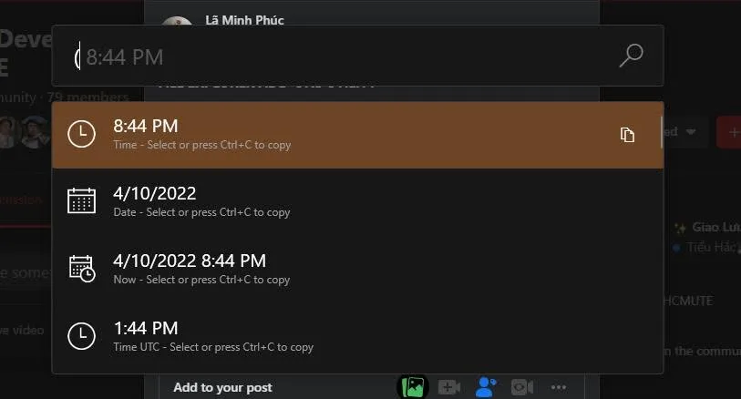
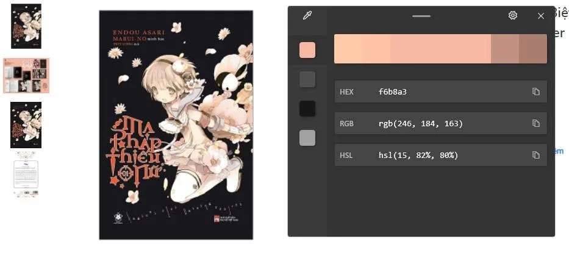
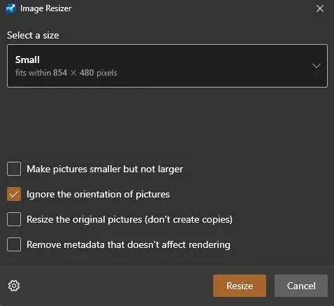

Hôm nay mình muốn chia sẻ đến các bạn ứng dụng có tên PowerToys đây là một ứng dụng khá nhảm cho những ai đang dùng windows. Dù các chức năng của nó có phần vô dụng nhưng thi thoảng cũng có lúc sẽ dùng tới.

<!--truncate-->

## Always on Top

Chức năng này sẽ đảm bảo một cửa sổ sẽ luôn được hiển thị và không bị các ứng dụng khác đè lên.

## Color Picker

Lấy nhanh mã màu trên màn hình.

## Image Resizer

Sửa nhanh kích thước ảnh.

## PowerToys Awake

Sẽ đảm bảo máy không bị tự động ngủ.

## FancyZones

Tạo bố cục chia màn hình để làm việc thấy khá xịn nhưng mình chả bao giờ dùng (máy 1366x768 lúc nào cũng maximize window còn thấy thiếu diện tích).

## Keyboard Manager

Map lại phím tắt hoặc tạo thêm phím tắt.

## PowerRename

Công cụ đổi tên hàng loạt khá xịn xò.

## PowerToys Run

Mở lên 1 thanh run giống như Mac, hỗ trợ tìm kiếm cũng tốt dùng khá thích.

## File Explorer add-ons utility

Preview thêm một số tệp trên File Explorer.

Còn vài chức năng nữa nhưng mình viết vài chức năng mình dùng nhiều hoặc thấy hữu dụng thôi. Các bạn có thể tải và và xem hướng dẫn đầy đủ về phần mềm tại https://docs.microsoft.com/en-us/windows/powertoys/

_Bài viết được chia sẻ lần đầu trong group nội bộ của CLB ngày 10/04/2022._
