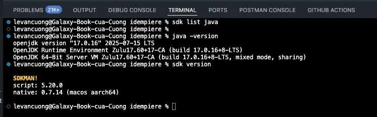

À nhon mọi người 👋,

<!--truncate-->

Hẳn nhiều bạn học CNTT (đặc biệt là khi làm với **Java, Spring Boot, Kotlin, Scala, Maven, Gradle...**) đã gặp tình huống:
* Máy cài **nhiều phiên bản JDK** (Java 8, 11, 17, 21…) nhưng chuyển qua lại cực phiền 😫
* Muốn thử version mới nhưng sợ rối loạn môi trường
* Cần cài nhanh Maven/Gradle nhưng không muốn mò thủ công từng bước

👉 Lúc này, **SDKMAN!** chính là “cứu tinh” 🎯

(Nay mình nhận 1 project bên ngoài để làm, nhưng project này yêu cầu Java 17 trong khi các project trên công ty đều yêu cầu Java 8 . Mình chuyển đổi phiên bản Java thì nhớ hồi mình từng dùng SDKMAN, nên sẵn tiện viết bài để giới thiệu cho mọi người)  
## 🔹 SDKMAN! là gì?
* Là một công cụ CLI (dùng trong terminal) dành cho macOS, Linux (Windows dùng qua WSL).
* Cho phép **cài đặt, gỡ, chuyển đổi version** của Java, Kotlin, Scala, Maven, Gradle... cực nhanh.
* Kiểu như **nvm** cho Node.js, nhưng dành cho Java và các công cụ trong hệ sinh thái JVM.

## 🔹 Cách cài đặt SDKMAN!

Mở terminal và chạy lệnh:

`curl -s "https://get.sdkman.io"` | bash  
`source "$HOME`/.sdkman/bin/sdkman-init.sh"

Kiểm tra cài thành công chưa: sdk version

## 🔹 Các lệnh hay dùng
* Xem các version Java có sẵn: sdk list java

* Cài Java 17: sdk install java 17.0.8-tem

* Chuyển tạm thời sang Java 17: sdk use java 17.0.8-tem

* Đặt mặc định Java 21: sdk default java 21.0.1-tem

* Gỡ version không cần: sdk uninstall java 11.0.20-tem

👉 Tất cả chỉ cần 1–2 lệnh, không phải mò và sửa đường dẫn `JAVA_HOME` thủ công nữa ✅

## 🔹 Lợi ích cho sinh viên CNTT
* Dễ dàng **test project ở nhiều version JDK** (ví dụ làm bài tập bằng Java 8 nhưng project Spring Boot yêu cầu Java 17).
* **Tiết kiệm thời gian** cài đặt Maven, Gradle, Kotlin...
* Giúp việc tìm phiên bàn Java phù hợp mà k**hông mất quá nhiều công sức để cài đặt**
* Giúp quen với công cụ mà **lập trình viên chuyên nghiệp hay dùng**.

Tin mình đi, một khi quen rồi thì không muốn quay lại “cài tay” nữa đâu 😎

_Bài viết được chia sẻ lần đầu trong group nội bộ của CLB ngày 04/10/2025._
