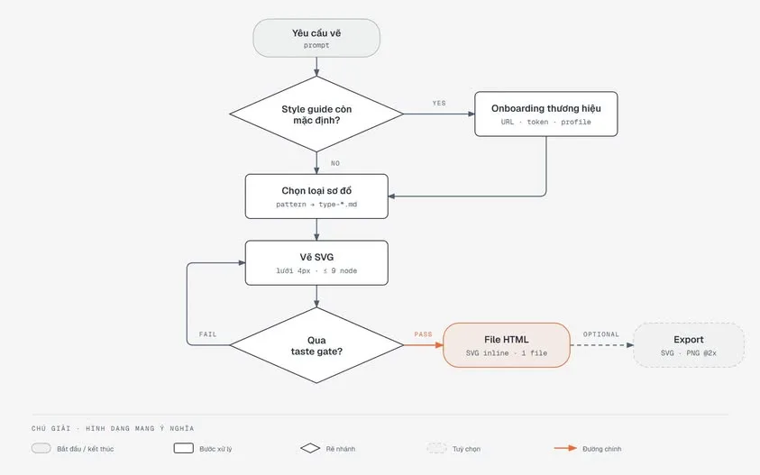

Các bạn học trên trường chắc cũng quen với các loại diagram (ERD, class diagram, sequence diagram...). Nhưng mà xưa giờ thì mình thường dùng mấy phần mềm chuyên dụng, hoặc vẽ tay trên drawio.

<!--truncate-->

Gần đây thì việc dùng AI agents ngày càng phổ biến, đặc biệt là Claude, Codex, Github Copilot... Thì việc sử dụng các skills cho AI ngày càng được ưa chuộng.

Hôm nay anh xin giới thiệu 1 skill free, mà theo anh thấy thì rất đáng để dùng. Diagram Design là một skill mã nguồn mở cho Claude Code, Codex và GitHub Copilot. Cài vào, agent sẽ vẽ sơ đồ kiến trúc, flowchart, sequence và hơn 40 loại khác theo một bộ quy tắc thiết kế chặt, xuất ra một file HTML duy nhất.

[https://tiennhm.io.vn/blog/diagram-design-skill-ve-so-do-cho-ai-agent)

_Bài viết được chia sẻ lần đầu trong group nội bộ của CLB ngày 10/10/2026._
