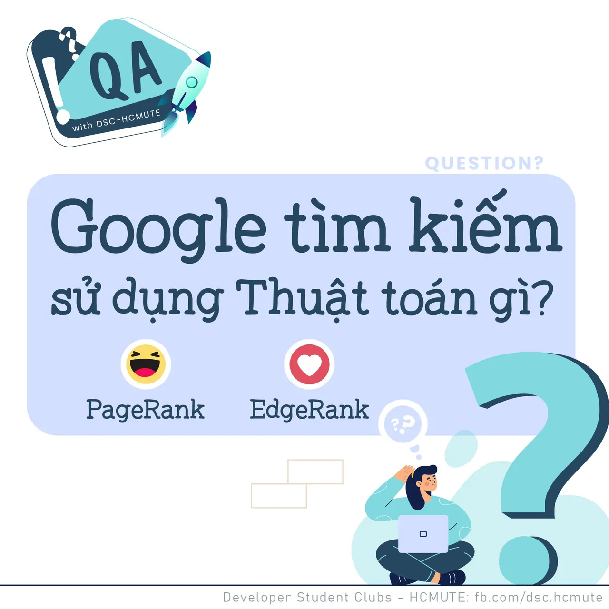

\[QA GDSC - Question\]

<!--truncate-->

  
 Xin chào các bạn,

  
 Google hiện nay đang đóng vai trò thiết yếu và là công cụ "bất ly thân" không chỉ đối với ngành Công nghệ Thông tin, mà còn đối với tỷ tỷ ngành nghề khác!  
Vậy, bạn đã hiểu rõ Google và cách thức hoạt động của công cụ thần thánh này hay chưa

  
 Hãy cùng GDSC HCMUTE chúng mình tìm hiểu về Google qua Question  Answer tuần này nhá!

  
 Cùng bắt đầu với Câu hỏi đầu tiên! React và để lại Comment để tụi mình đếm xem bao nhiêu bạn vượt qua cửa ải đầu tiên của GDSC HCMUTE nhaaa

  
Đừng quên Like và Follow Page để đón chờ phần Answer được lên sóng vào ngày mai  
---------------------------  
QA with GDSC HCMUTE là chuyên mục do GDSC HCMUTE thực hiện với mong muốn cung cấp các kiến thức và thông tin hữu ích, giúp các bạn có thêm các tips thú vị trong lĩnh vực Công nghệ Thông tin thông qua Question và Answer được lên sóng hàng ngày!

  
 Mọi ý kiến đóng góp, các bạn có thể liên hệ trực tiếp thông qua fanpage Developer Student Clubs - HCM UTE: [https://www.facebook.com/dsc.hcmute](https://www.facebook.com/dsc.hcmute)
  
\#GDSC #DSC\_HCMUTE #DSC\_QA

---

_Bài viết được lưu trữ từ [fanpage HCMUTE Developer Student Club](https://www.facebook.com/hcmute.dsc)._
