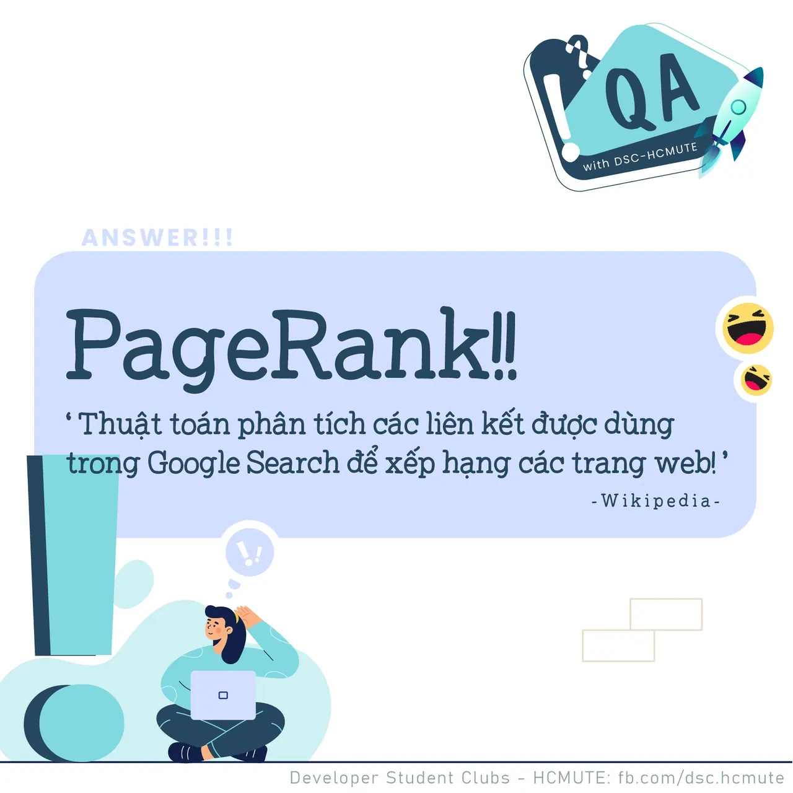

\[QA DSC - Answer\]

<!--truncate-->

  
 Chào mọi người,

  
 Với câu hỏi đầu tiên: Thuật toán được sử dụng cho Google Tìm kiếm Chúng ta được biết thêm về PageRank - thuật toán phân tích các liên kết được dùng trong Google Search để xếp hạng các trang web (theo Wikipedia).

  
 PageRank chỉ định một giá trị liên quan đến mọi trang web và xác định mức độ quan trọng của một trang web. PageRank được đặt theo tên của người đồng sáng lập Google: Larry Page.
  
 Trong khi các công cụ tìm kiếm thông thường xếp hạng kết quả bằng cách đếm số lần tìm kiếm xuất hiện trên trang, PageRank xác định mức độ liên quan của một trang web theo số lượng trang và tầm quan trọng của những trang được liên kết trở lại trang web gốc.

  
 Nói về Thuật toán, Theo Geeksgorgeeks, PageRank đưa ra phân bố xác suất, được sử dụng để thể hiện khả năng khi một người click chuột ngẫu nhiên vào đường link và sẽ tới được trang web cụ thể. Pagerank có thể được tính cho các tập văn bản với tài liệu có độ dài bất kỳ. Khi bắt đầu tính toán thì sự phân bổ đó được chia đều cho tất cả những văn bản trong tập văn bản. Các tính toán Pagerank cần một số lần "lặp đi lặp lại" qua các văn bản trong tập để có thể đạt được giá trị thực tế một cách thiết thực hơn. Xác suất có giá trị từ 0 đến 1. Với giá trị 0.5, thường được hiểu là "50% cơ hội" của một việc gì đó có thê xảy ra. Trong Pagerank, 0.5 có nghĩa là 50% cơ hội một người nào đó click vào một link ngẫu nhiên để được chuyển đến văn bản đó (giá trị pagerank = 0.5)

  
 Bên cạnh đó, EdgeRank chính là Thuật toán được sử dụng trong Facebook, dùng để quyết định những gì sẽ xuất trên News Feed của người dùng đó! Thật thú vị đúng không nào

  
Vậy các bạn đã trả lời đúng hay chưa Để lại comment bàn luận và tìm hiểu thêm về chủ đề này để chúng mình biết nhá!

  
Đừng quên Like và Follow Page để đón chờ phần Question tiếp theo được lên sóng vào ngày mai nữa đó  
----------------------  
QA with DSC - HCMUTE là chuyên mục do DSC - HCMUTE thực hiện với mong muốn cung cấp các kiến thức và thông tin hữu ích, giúp các bạn có thêm các tips thú vị trong lĩnh vực Công nghệ Thông tin thông qua Question và Answer được lên sóng hàng ngày!

  
 Mọi ý kiến đóng góp, các bạn có thể liên hệ trực tiếp thông qua fanpage: Developer Student Clubs - HCM UTE
  
\#GDSC #DSC\_HCMUTE #DSC\_QA

---

_Bài viết được lưu trữ từ [fanpage HCMUTE Developer Student Club](https://www.facebook.com/hcmute.dsc)._
