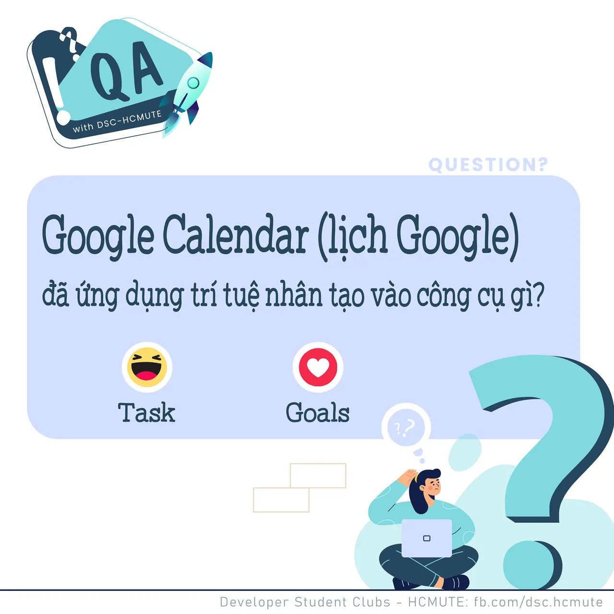

\[QA DSC - Question\]
  
 Xin chào các bạn, lại là chuyên mục QA with DSC - HCMUTE đâyyyy!

<!--truncate-->

  
 Tiếp nối chủ đề Google tuần này, hôm nay, chúng mình tiếp tục đưa ra thử thách cho các bạn về Trí tuệ nhân tạo - AI (Artificial Intelligence) đang được "gã khổng lồ" Google áp dụng, cụ thể là trong ứng dụng rất quen thuộc - Google Calendar!

  
 Cùng tìm hiểu và đưa ra câu trả lời bạn cho là đúng nhá! React và để lại Comment để tụi mình đếm xem bao nhiêu bạn vượt qua thử thách lần này của GDSC HCMUTE nàoooo

  
Đừng quên Like và Follow Page để đón chờ phần Answer được lên sóng vào ngày mai  
---------------------------  
QA with GDSC HCMUTE là chuyên mục do GDSC HCMUTE thực hiện với mong muốn cung cấp các kiến thức và thông tin hữu ích, giúp các bạn có thêm các tips thú vị trong lĩnh vực Công nghệ Thông tin thông qua Question và Answer được lên sóng hàng ngày!
  
 Mọi ý kiến đóng góp, các bạn có thể liên hệ trực tiếp thông qua fanpage Developer Student Clubs - HCM UTE: [https://www.facebook.com/dsc.hcmute](https://www.facebook.com/dsc.hcmute)
  
\#GDSC #DSC\_HCMUTE #DSC\_QA

---

_Bài viết được lưu trữ từ [fanpage HCMUTE Developer Student Club](https://www.facebook.com/hcmute.dsc)._
