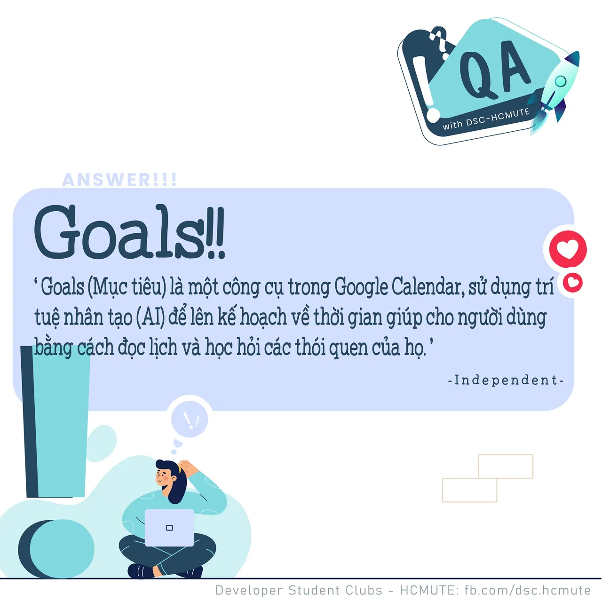

\[QA DSC - Answer\]
  
Xin chào mọi người

<!--truncate-->

,
  
 Với câu hỏi về Google Calendar vừa rồi, không biết có bao nhiêu bạn có câu trả lời đúng nhỉ? Cùng DSC- HCMUTE chúng mình dạo sơ qua về Trí tuệ nhân tạo AI được ứng dụng trong Google Calendar này nhá!
  
 Goals (Mục tiêu) là một công cụ trong Google Calendar, sử dụng trí tuệ nhân tạo (AI) để lên kế hoạch về thời gian giúp cho người dùng bằng cách đọc lịch và học hỏi các thói quen của họ (theo Independent.co.uk)
  
 Trong Google Calendar, khi bạn tạo ra 1 mục tiêu (goal), Goals sẽ đưa ra các mục tiêu để bạn chọn lựa ( ví dụ: Learn a language), sau khi chọn, Goals sẽ yêu cầu bạn trả lời 1 bộ các câu hỏi liên quan đến tần suất xảy ra và thời gian diễn ra hoạt động ấy trong bao lâu, sau đó xem các kế hoạch có trong lịch của bạn và đặt thời gian. Một khi chúng đã được sắp xếp vào, những thuật toán của Google sẽ sử dụng trí tuệ nhân tạo (AI) để đảm bảo rằng người dùng có thể thực hiện những hoạt động ấy. Nếu như có bất kì hoạt động nào chen ngang vào thời gian đã được đặt ra trước đó cho mục tiêu hoặc mục tiêu không thể hoàn thành trong thời gian đã đặt ra thì ứng dụng sẽ tự động sắp xếp lại kế hoạch thực hiện mục tiêu ấy. Vì thế ứng dụng sẽ học hỏi được khi người dùng có ý định hoãn lại hoặc hoàn thành mục tiêu, từ đó lên kế hoạch tốt hơn trong tương lai.
  
 Việc ứng dụng trí tuệ nhân tạo vào Google Calendar hay cụ thể là công cụ Goals giúp người dùng tiết kiệm được nhiều thời gian và sức lực thay vì phải đau đầu lập ra 1 khoảng thời gian khác mà đôi khi khó có thể đi đúng được tiến độ. Nếu các bạn đã biết đến và đang sử dụng ứng dụng Google Calendar thì đừng bỏ qua công cụ cực kì hữu ích này nhé!
  
Đừng quên Like và Follow Page để đón chờ phần Question tiếp theo được lên sóng vào ngày mai
  
---------------------------
  
 QA with GDSC HCMUTE là chuyên mục do GDSC HCMUTE thực hiện với mong muốn cung cấp các kiến thức và thông tin hữu ích, giúp các bạn có thêm các tips thú vị trong lĩnh vực Công nghệ Thông tin thông qua Question và Answer được lên sóng hàng ngày!
  
 Mọi ý kiến đóng góp, các bạn có thể liên hệ trực tiếp thông qua fanpage Developer Student Clubs - HCM UTE: [https://www.facebook.com/dsc.hcmute](https://www.facebook.com/dsc.hcmute)  
\#GDSC #DSC\_HCMUTE #DSC\_QA

---

_Bài viết được lưu trữ từ [fanpage HCMUTE Developer Student Club](https://www.facebook.com/hcmute.dsc)._
