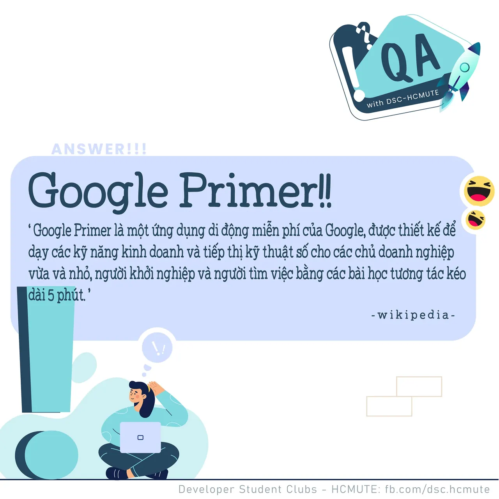

\[QA DSC - Answer\]
  
Xin chào mọi người  
,
  
 Với câu hỏi về ứng dụng của Google giúp hỗ trợ dạy các kỹ năng doanh nghiệp vùa qua, không biết có bao nhiêu bạn có câu trả lời đúng nhỉ Cùng DSC- HCMUTE chúng mình dạo sơ qua về ứng dụng thú vị này nhá!

<!--truncate-->

  
 Google Primer là một ứng dụng di động miễn phí của Google, được thiết kế để dạy các kỹ năng kinh doanh và tiếp thị kỹ thuật số cho các chủ doanh nghiệp vừa và nhỏ, người khởi nghiệp và người tìm việc bằng các bài học tương tác… See more

---

_Bài viết được lưu trữ từ [fanpage HCMUTE Developer Student Club](https://www.facebook.com/hcmute.dsc)._
