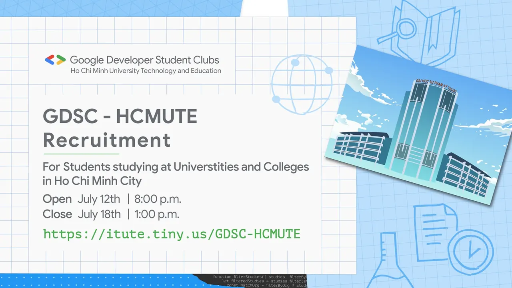

\[GDSC HCMUTE - RECRUITMENT\]
  
 Loa loa loa

<!--truncate-->

 Không để các bạn đợi lâu nữa, link đăng ký tuyển Thành viên cho Google Developer Student Clubs - HCMUTE đã chính thức được lên sóng rồi đây
  
 Với mong muốn tìm kiếm và kết nối các bạn Sinh viên có niềm đam mê, yêu thích các công nghệ của Google nói riêng và Công nghệ Thông tin nói chung, GDSC - HCMUTE chúng mình chính thức mở form đăng ký thành viên cụ thể như sau:
  
 Thời gian đăng ký: từ 20h ngày  
/  
/  
 đến 13h ngày  
/  
/
  
 Link đăng ký: [https://itute.tiny.us/GDSC-HCMUTE](https://itute.tiny.us/GDSC-HCMUTE)
  
 Đối tượng đăng ký: Sinh viên tại các trường Đại học và Cao đẳng trong địa bàn TP.HCM có hiểu biết hoặc đam mê với Công nghệ Thông tin.
  
 Sau khi đăng ký thành công, các bạn sẽ trải qua vòng phỏng vấn online với ban chủ nhiệm CLB để chính thức bước chân vào GDSC - HCMUTE, nhưng đừng lo lắng quá nhá  
 Thông tin chi tiết sẽ được chúng mình đăng tải sớm trên Fanpage!
  
 Rất mong nhận sự tham gia, đồng hành và hỗ trợ từ các bạn Sinh viên để GDSC - HCMUTE ngày càng phát triển, góp phần mang lại kiến thức và kỹ năng bổ ích cho cộng đồng các bạn Sinh viên  
. Vậy nên còn chần chờ gì nữa? Hãy đăng ký để trở thành thành viên của GDSC - HCMUTE thôi nào
  
 Like và Follow Page để cùng đón chờ các hoạt động thú vị tiếp theo của GDSC - HCMUTE các bạn nhá
  
\#DeveloperStudentClubs

---

_Bài viết được lưu trữ từ [fanpage HCMUTE Developer Student Club](https://www.facebook.com/hcmute.dsc)._
