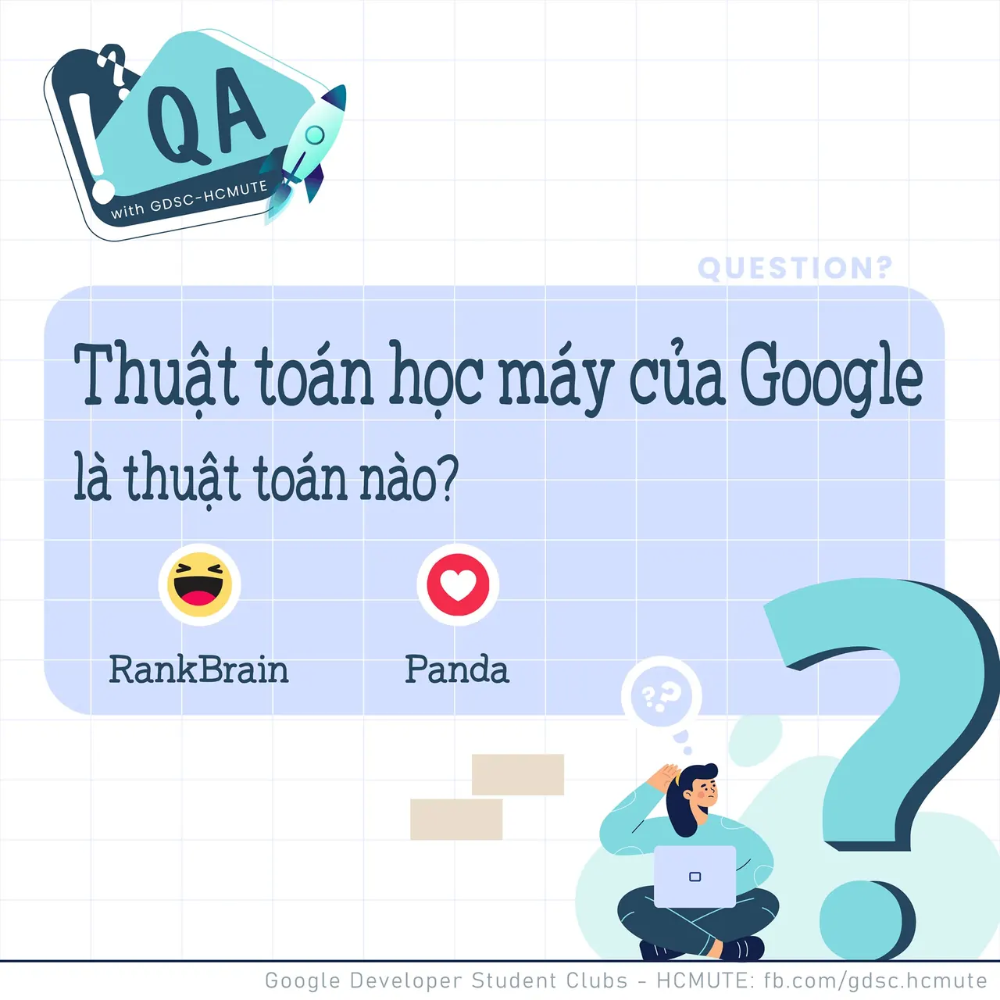

\[QA GDSC - Question\]
  
 Chào các bạn! QA with GDSD - HCMUTE lại quay trở lại rồi đâyyyy

<!--truncate-->

 Trong thời gian đợi chờ kết quả đăng ký thành viên của GDSC - HCMUTE thì tụi mình cùng quay trở lại với chuyên mục hằng ngày này nhá! Lần này, chúng mình cùng tìm hiểu qua câu hỏi về Thuật toán Học máy mà "ông lớn" Google sử dụng nhá!
  
 React và để lại Comment để cùng GDSC - HCMUTE vượt qua thử thách lần này nào
  
Đừng quên Like và Follow Page để đón chờ phần Answer được lên sóng vào ngày mai
  
---------------------------
  
 QA with GDSC HCMUTE là chuyên mục do GDSC - HCMUTE thực hiện với mong muốn cung cấp các kiến thức và thông tin hữu ích, giúp các bạn có thêm các tips thú vị trong lĩnh vực Công nghệ Thông tin thông qua Question và Answer được lên sóng hàng ngày!
  
 Mọi ý kiến đóng góp, các bạn có thể liên hệ trực tiếp thông qua fanpage Google Developer Student Clubs - HCM UTE: [https://www.facebook.com/gdsc.hcmute](https://www.facebook.com/gdsc.hcmute)
  
\#GDSC #GoogleDeveloperStudentClubs #GDSC\_HCMUTE #GDSC\_QA

---

_Bài viết được lưu trữ từ [fanpage HCMUTE Developer Student Club](https://www.facebook.com/hcmute.dsc)._
