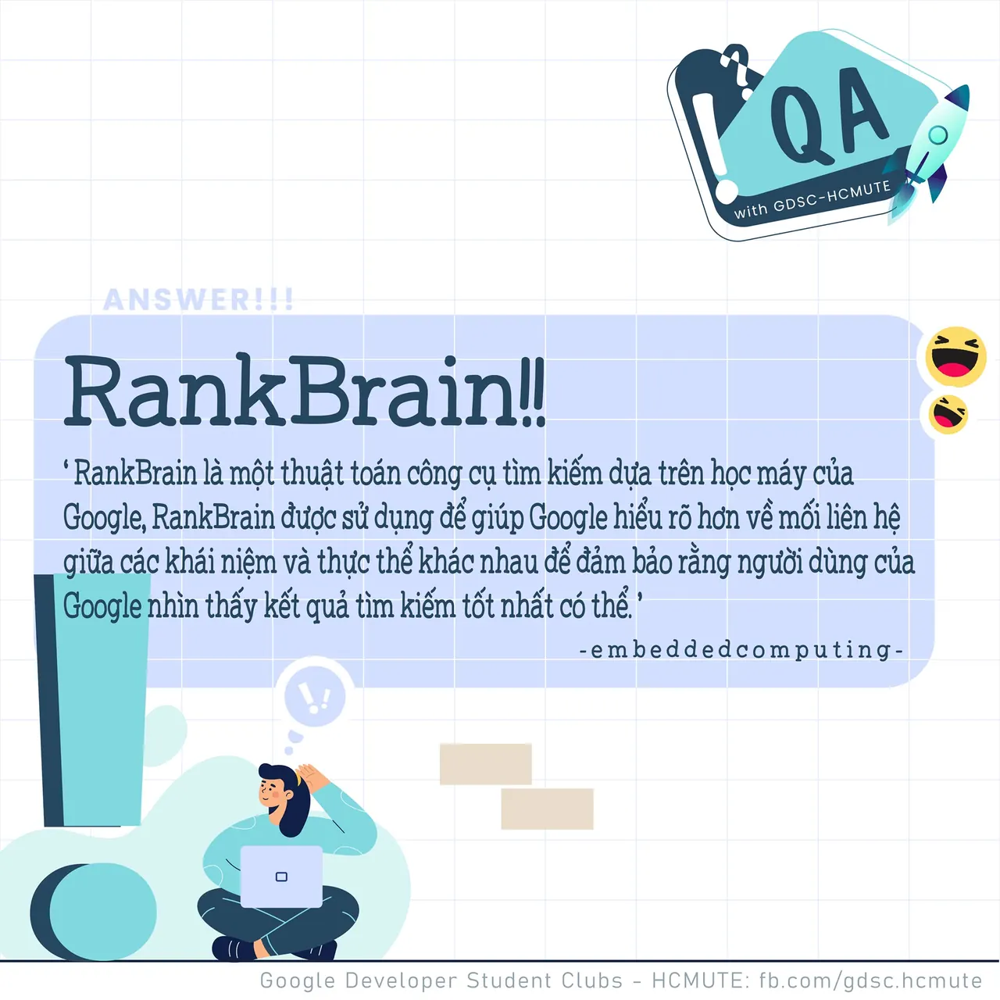

\[QA GDSC - Answer\]
  
Chào buổi tối mọi người  
,

<!--truncate-->

  
 Với câu hỏi về Thuật toán Học máy sử dụng trong Google, không biết có bao nhiêu bạn có câu trả lời đúng nhỉ  
Cùng DSC- HCMUTE chúng mình tìm hiểu sơ qua về thuật toán thú vị này nhá!

  
 RankBrain là một thuật toán công cụ tìm kiếm dựa trên học máy của Google, RankBrain được sử dụng để giúp Google hiểu rõ hơn về mối liên hệ giữa các khái niệm và thực thể khác nhau để đảm bảo rằng người dùng của Google nhìn thấy kết quả tìm kiếm tốt nhất có thể (theo embeddedcomputing.com)

  
 Một ví dụ điển hình về cách RankBrain sử dụng học máy là cách chương trình học các từ đồng nghĩa. Con người một cách trực giác biết được khi nào hai từ đồng nghĩa và khi nào chúng không đồng nghĩa, nhưng RankBrain liên tục học các sắc thái của từ đồng nghĩa để cải thiện khả năng tìm kiếm. Ví dụ: “sửa chữa” và “thay thế” là từ đồng nghĩa khi thảo luận về một bộ phận của máy nhưng không phải khi thảo luận về toàn bộ máy - “Cách thay màn hình của một máy tính xách tay” không có nghĩa giống như “Cách thay thế 1 chiếc ô tô” và RankBrain biết điều này. Do đó, người dùng Google thực hiện các tìm kiếm khác nhau này sẽ nhận được các loại kết quả khác nhau, một loại dành cho việc sửa lỗi Tự làm (thay thế màn hình máy tính) và một loại có các bước bán hàng và mua sắm (thay thế một chiếc xe).

  
 Bên cạnh đó, Thuật toán Panda hay Google Panda là một thuật toán được Google tạo ra nhằm thay đổi cách xếp hạng các kết quả tìm kiếm trên mạng tốt hơn và công bằng hơn, Google Panda sẽ loại bỏ những nội dung rác, nội dung copy, loại bỏ những website có thương hiệu kém… Đây là bộ lọc quan trọng để cải tiến các kết quả tìm kiếm mới của Google nhằm loại bỏ hay đánh tụt hạng của các trang web có "chất lượng thấp" ("low-quality sites") hoặc trang có quá ít nội dung ("thin sites"), đặc biệt tiêu diệt các trang chuyên đi chép lại nội dung ("content farms"), và đưa các trang có chất lượng nội dung tốt lên thứ hạng cao hơn trong kết quả tìm kiếm.
  
Đừng quên Like và Follow Page để đón chờ phần Question tiếp theo được lên sóng vào ngày mai nhá  
---------------------------  
QA with GDSC HCMUTE là chuyên mục do GDSC HCMUTE thực hiện với mong muốn cung cấp các kiến thức và thông tin hữu ích, giúp các bạn có thêm các tips thú vị trong lĩnh vực Công nghệ Thông tin thông qua Question và Answer được lên sóng hàng ngày!
  
 Mọi ý kiến đóng góp, các bạn có thể liên hệ trực tiếp thông qua fanpage Developer Student Clubs - HCM UTE: [https://www.facebook.com/gdsc.hcmute](https://www.facebook.com/gdsc.hcmute)
  
\#GDSC #GoogleDeveloperStudentClubs #GDSC\_HCMUTE #GDSC\_QA

---

_Bài viết được lưu trữ từ [fanpage HCMUTE Developer Student Club](https://www.facebook.com/hcmute.dsc)._
