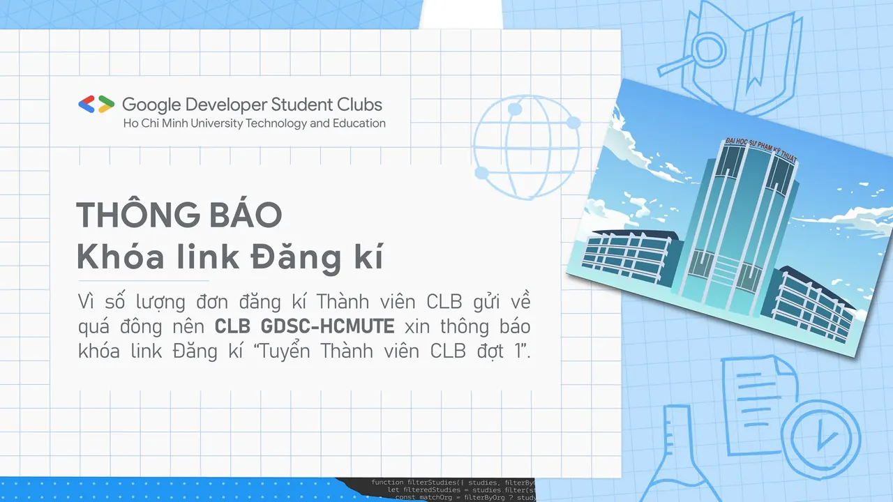

Lời đầu tiên, CLB Sinh viên lập trình Google - HCMUTE xin gửi lời cảm ơn chân thành nhất đến toàn thể các bạn sinh viên gần xa đã quan tâm đến CLB!
  
 Sau gần 3 ngày mở link đăng ký thành viên, số lượng đơn đăng ký chúng mình nhận được đã hơn con số 120, vượt xa kỳ vọng của tụi mình. Do đó chúng mình xin phép đóng link đăng ký vào hôm nay để tập trung duyệt hồ sơ. Các bạn chưa đăng ký kịp cũng đừng buồn nhé, vì chúng mình sẽ còn tuyển thành viên giai đoạn 2 vào thời gian sắp tới, các bạn hãy chờ nhé!

<!--truncate-->

 Kết quả duyệt đơn đăng ký sẽ có vào Chủ Nhật (18/07/2021) và sẽ được đăng tải trên Fanpage, nhớ theo dõi Fanpage của tụi mình để không bỏ lỡ nhé!
  
 Một lần nữa xin cảm ơn tình cảm của mọi người dành cho CLB Sinh viên lập trình Google - HCMUTE.  
Hẹn gặp lại tất cả các bạn!  
\#gdsc\_hcmute  
-------------------
  
 Mọi thắc mắc và ý kiến đóng góp gửi cho tụi mình thông qua Fanpage: fb.com/gdsc-hcmute

---

_Bài viết được lưu trữ từ [fanpage HCMUTE Developer Student Club](https://www.facebook.com/hcmute.dsc)._
