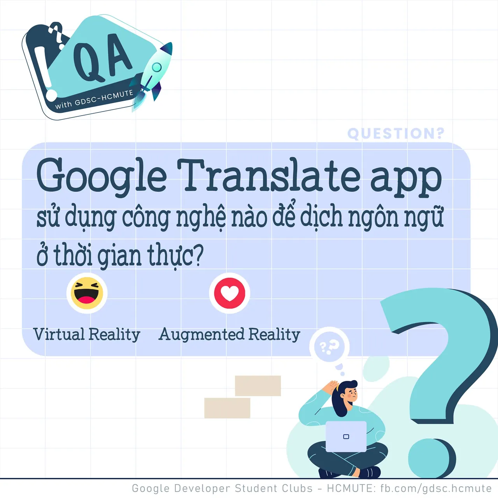

\[QA GDSC - Question\]
  
 Chào các bạn

<!--truncate-->

 Google Translate là công cụ mà gần như mọi người ai cũng từng ít nhất 1 lần sử dụng! Đồng thời, khi Google Translate ngày càng phát triển, thì đó cũng là lúc Ứng dụng Google Translate trên điện thoại được ra đời và kèm theo đó là rất nhiều tính năng hữu ích khác! Vậy, bạn đã biết trong thời gian thực, khi dịch ngôn ngữ thông qua camera, thì Google Translate App đã ứng dụng công nghệ gì hay chưa?
  
 React và để lại Comment để cùng GDSC - HCMUTE vượt qua thử thách lần này nào
  
Đừng quên Like và Follow Page để đón chờ phần Answer được lên sóng vào ngày mai
  
---------------------------
  
 QA with GDSC HCMUTE là chuyên mục do GDSC - HCMUTE thực hiện với mong muốn cung cấp các kiến thức và thông tin hữu ích, giúp các bạn có thêm các tips thú vị trong lĩnh vực Công nghệ Thông tin thông qua Question và Answer được lên sóng hàng ngày!
  
 Mọi ý kiến đóng góp, các bạn có thể liên hệ trực tiếp thông qua fanpage Google Developer Student Clubs - HCM UTE: [https://www.facebook.com/gdsc.hcmute](https://www.facebook.com/gdsc.hcmute)  
\#GDSC #GoogleDeveloperStudentClubs #GDSC\_HCMUTE #GDSC\_QA

---

_Bài viết được lưu trữ từ [fanpage HCMUTE Developer Student Club](https://www.facebook.com/hcmute.dsc)._
