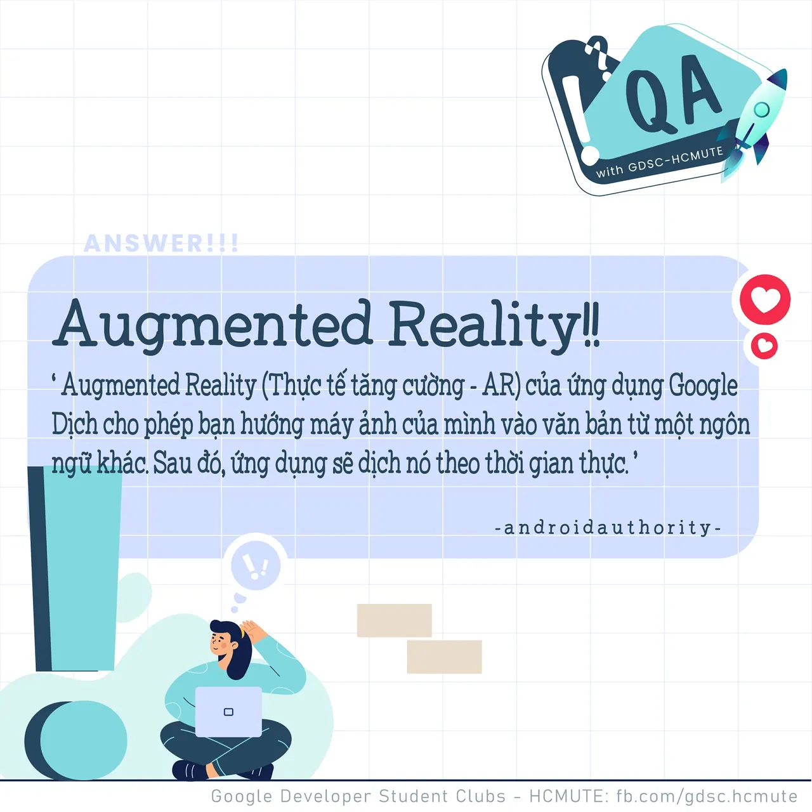

\[QA GDSC - Answer\]
  
Chào buổi tối mọi người

<!--truncate-->

,
  
 Với câu hỏi "Google Translate app sử dụng công nghệ nào để dịch ngôn ngữ ở thời gian thực?", không biết có bao nhiêu bạn tìm ra đáp án trong vòng 10s không nhỉ?
  
 Vâng, đáp án chính xác của chúng ta đó là Augmented Reality.
  
-----------
  
Phần thực tế tăng cường (AR) của ứng dụng Google Dịch cho phép bạn hướng máy ảnh của mình vào văn bản từ một ngôn ngữ khác. Sau đó, ứng dụng sẽ dịch nó theo thời gian thực. (theo androidauthority.com)
  
Dưới đây là 5 cách giải thích để bạn hiểu hơn về thế nào là AR- Augmented Reality:  
\- AR là một công nghệ nâng cao trải nghiệm của bạn về thế giới xung quanh.  
\- AR là việc sử dụng thông tin theo thời gian thực dưới dạng văn bản, đồ họa, âm thanh và các cải tiến ảo khác được tích hợp với các đối tượng trong thế giới thực.  
\- AR là việc kết xuất (rendering) hình ảnh hoặc dữ liệu kỹ thuật số lên các đối tượng trong thế giới thực.  
\- AR là thông tin kỹ thuật số được xếp chồng lên trên tầm nhìn về môi trường vật chất của người dùng.  
\- AR đề cập đến bất kỳ công nghệ nào “tăng cường” nhận thức trực quan của người dùng (và trong một số trường hợp là thính giác) về môi trường của họ. Thông thường, thông tin kỹ thuật số được xếp chồng lên môi trường hiện có tự nhiên.
  
Google Dịch đã áp dụng AR vào việc dịch nghĩa tức thì chỉ với một thao tác là trỏ máy ảnh điện thoại của bạn đến biển chỉ đường, menu hoặc hoặc bất kỳ đoạn văn bản nào mà bạn muốn dịch. Nó thậm chí đã cố gắng để phù hợp với văn bản gốc và màu nền.
  
Ví dụ: nếu văn bản gốc có màu vàng trên nền đen, nó sẽ hiển thị văn bản đã dịch có màu vàng trên nền đen. Thêm vào đó, Google Dịch còn có cả tính năng tự động phát hiện ngôn ngữ (automatic language detection). Điều này không chỉ giúp người dùng có bản dịch nhanh hơn mà còn đảm bảo rằng họ có thể dịch bất kỳ văn bản nào mà không thực sự biết ngôn ngữ mà chúng được viết.
  
---------------------------
  
 QA with GDSC - HCMUTE là chuyên mục do GDSC - HCMUTE thực hiện với mong muốn cung cấp các kiến thức và thông tin hữu ích, giúp các bạn có thêm các tips thú vị trong lĩnh vực Công nghệ Thông tin thông qua Question và Answer được lên sóng hàng ngày!
  
 Mọi ý kiến đóng góp, các bạn có thể liên hệ trực tiếp thông qua fanpage Google Developer Student Clubs - HCM UTE: [https://www.facebook.com/gdsc.hcmute](https://www.facebook.com/gdsc.hcmute)  
\#GDSC #GoogleDeveloperStudentClubs #GDSC\_HCMUTE #GDSC\_QA

---

_Bài viết được lưu trữ từ [fanpage HCMUTE Developer Student Club](https://www.facebook.com/hcmute.dsc)._
