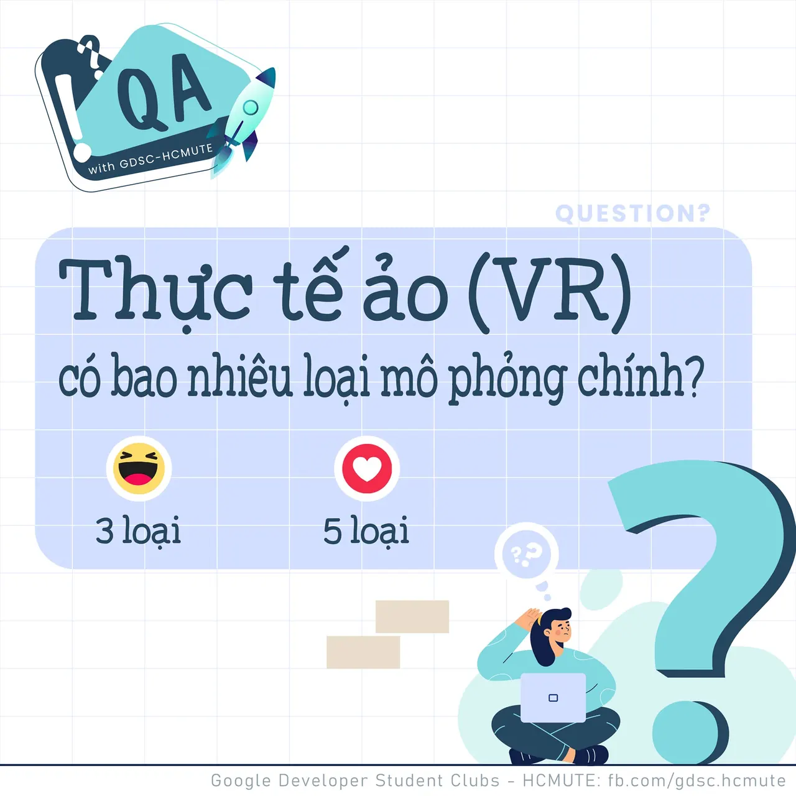

\[QA GDSC - Question\]
  
 Chào các bạn

<!--truncate-->

 Virtual Reality Technology, hay Công nghệ Thực tế Ảo đang ngày càng phát triển và được ứng dụng trong nhiều lĩnh vực, giúp con người dễ dàng tương tác thực tế thông qua hình ảnh, âm thanh và các cảm giác khác mô phỏng sự hiện diện vật lý của người dùng trong môi trường ảo. Vậy các bạn đã biết, trong Công nghệ VR thú vị này, có bao nhiêu loại mô phỏng chính?
  
 React và để lại Comment để cùng GDSC - HCMUTE vượt qua thử thách lần này nào
  
Đừng quên Like và Follow Page để đón chờ phần Answer được lên sóng vào ngày mai nha
  
---------------------------
  
 QA with GDSC HCMUTE là chuyên mục do GDSC - HCMUTE thực hiện với mong muốn cung cấp các kiến thức và thông tin hữu ích, giúp các bạn có thêm các tips thú vị trong lĩnh vực Công nghệ Thông tin thông qua Question và Answer được lên sóng hàng ngày!
  
 Mọi ý kiến đóng góp, các bạn có thể liên hệ trực tiếp thông qua fanpage Google Developer Student Clubs - HCM UTE: [https://www.facebook.com/gdsc.hcmute](https://www.facebook.com/gdsc.hcmute)  
\#GDSC #GoogleDeveloperStudentClubs #GDSC\_HCMUTE #GDSC\_QA

---

_Bài viết được lưu trữ từ [fanpage HCMUTE Developer Student Club](https://www.facebook.com/hcmute.dsc)._
