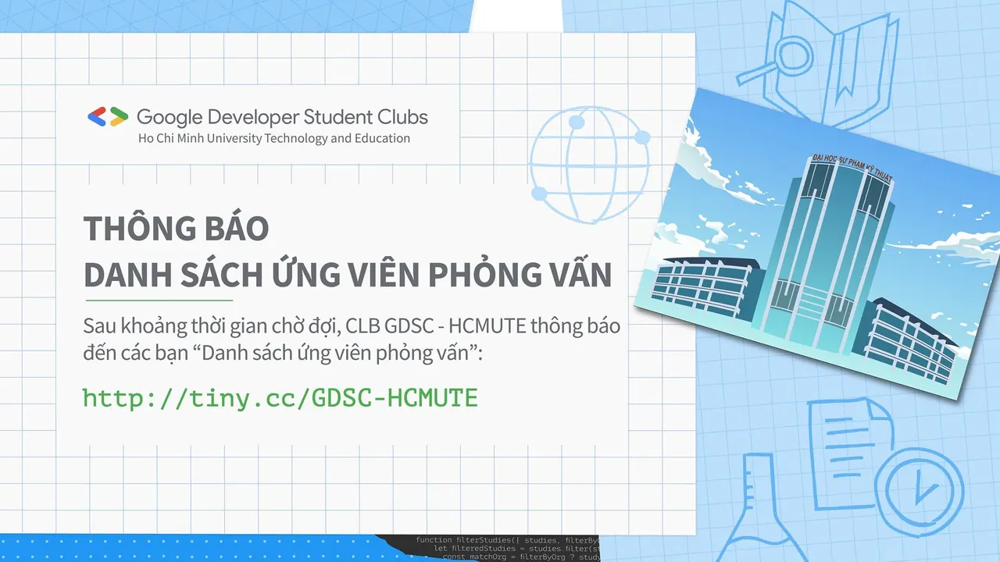

\[GDSC - HCMUTE | RECRUITMENT INTERVIEW ONLINE ROUND\]
  
 Loa loa loa,

<!--truncate-->

 Vậy là Đợt 1 Tuyển thành viên GDSC - HCMUTE đã đi được nửa chặng đường rồi, chỉ còn 1 tuần nữa, những thành viên Google Developer Student Clubs - HCMUTE sẽ chính thức được lộ diện
  
Và không để các bạn đợi lâu nữa, GDSC - HCMUTE xin công bố danh sách các bạn tham gia làm Bài kiểm tra và Phỏng vấn Online đâyyyy
  
 Thời gian làm Bài Test: từ 8h đến 23h, Thứ 4, ngày  
/  
/  
.
  
 Đối tượng làm bài Test: Các bạn đăng ký tham gia vào Ban Học thuật.
  
 Thời gian Phỏng vấn: Thứ 7, ngày  
/  
/  
.
  
 Ca 1: 8h - 11h30
  
 Ca 2: 14h - 17h30
  
 Danh sách: [http://tiny.cc/GDSC-HCMUTE](http://tiny.cc/GDSC-HCMUTE)
  
 Mọi thông tin chi tiết về bài Test và lịch Phỏng vấn sẽ được GDSC - HCMUTE gửi đến các bạn thông qua Mail trong thời gian sớm nhất, nên các bạn chú ý check mail thường xuyên nhá
  
 Lưu ý: Các bạn vui lòng ghi nhớ số thứ tự trên danh sách để tụi mình tiện liên hệ nha
  
-----------------------------------------
  
 Nếu có bất cứ sai sót và cần chỉnh sửa về thông tin cá nhân, các bạn vui lòng liên hệ trực tiếp thông qua Page Google Developer Student Clubs: [https://www.facebook.com/gdsc.hcmute](https://www.facebook.com/gdsc.hcmute)
  
 Khi có bất kỳ câu hỏi hay vấn đề cần được giải đáp, đừng ngần ngại comment hoặc inbox trực tiếp fanpage để được giải đáp nhanh nhất
  
Rất mong gặp lại các bạn trong buổi phỏng vấn tuần sau nha
  
\#GoogleDeveloperStudentClubs #GDSC #GDSC\_HCMUTE

---

_Bài viết được lưu trữ từ [fanpage HCMUTE Developer Student Club](https://www.facebook.com/hcmute.dsc)._
