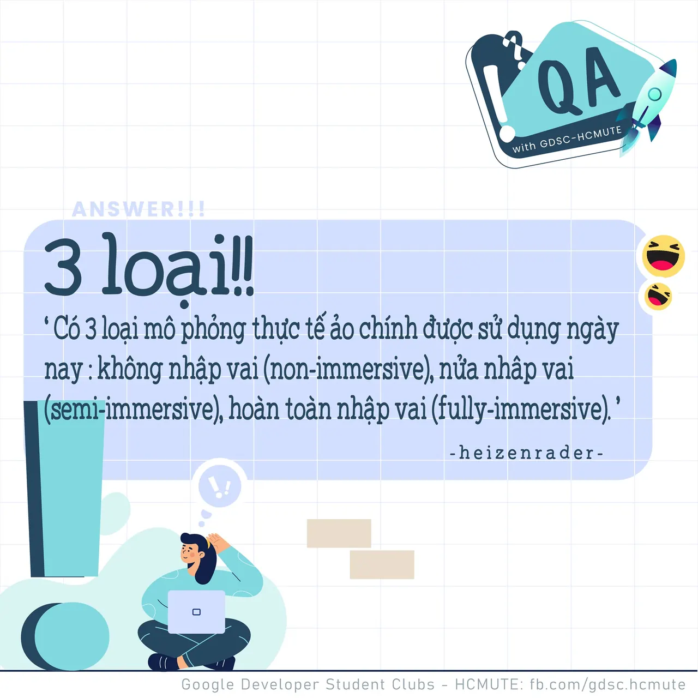

\[QA GDSC - Answer\]
  
Chào buổi tối mọi người

<!--truncate-->

,
  
 Với câu hỏi "Có bao nhiêu loại mô phỏng thực tế ảo (VR) chính?", không biết có bao nhiêu bạn tìm ra đáp án chính xác ngay và luôn không nhỉ?
  
 Cùng GDSC - HCMUTE tìm hiểu sơ qua về 3 loại mô phỏng VR chính nhá!
  
---------------------------
  
 Non-immersive VR: Thực tế ảo không nhập vai là một loại thực tế ảo trong đó bạn tương tác với môi trường ảo thường thông qua máy tính, nơi bạn có thể điều khiển một số nhân vật hoặc hoạt động trong trải nghiệm, nhưng môi trường ảo không tương tác trực tiếp với bạn.
  
 Fully-immersive VR: Thực tế ảo nhập vai hoàn toàn trái ngược với thực tế ảo không nhập vai. Nó đảm bảo một trải nghiệm ảo thực tế. Bạn sẽ cảm thấy như thể bạn đang hiện diện thực tế trong thế giới ảo và những sự kiện xảy ra ở đó đang xảy ra với bạn. Cần phải có các thiết bị đặc biệt như kính VR, găng tay, máy dò tìm cơ thể được trang bị cảm biến để mang lại trải nghiệm ảo thực tế. Dữ liệu từ các cảm biến này được máy tính sử dụng và thế giới ảo phản hồi dữ liệu đó theo thời gian thực để cung cấp cho người dùng trải nghiệm ảo thực tế.
  
 Semi-immersive VR: Thực tế ảo nửa nhập vai là thứ nằm giữa thực tế ảo không nhập vai và hoàn toàn nhập vai. Sử dụng màn hình máy tính hoặc kính VR, bạn có thể di chuyển trong môi trường ảo nhưng ngoài trải nghiệm hình ảnh, bạn sẽ không có cảm giác vật lý nào để nâng cao trải nghiệm.
  
 Thú vị quá đúng không nào? Like và Follow page để cùng tụi mình đón chờ phần QA lên sóng tiếp theo vào tuần sau nhá
  
---------------------------
  
 QA with GDSC - HCMUTE là chuyên mục do GDSC - HCMUTE thực hiện với mong muốn cung cấp các kiến thức và thông tin hữu ích, giúp các bạn có thêm các tips thú vị trong lĩnh vực Công nghệ Thông tin thông qua Question và Answer được lên sóng hàng ngày!
  
 Mọi ý kiến đóng góp, các bạn có thể liên hệ trực tiếp thông qua fanpage Google Developer Student Clubs - HCM UTE: [https://www.facebook.com/gdsc.hcmute](https://www.facebook.com/gdsc.hcmute)  
\#GDSC #GoogleDeveloperStudentClubs #GDSC\_HCMUTE #GDSC\_QA

---

_Bài viết được lưu trữ từ [fanpage HCMUTE Developer Student Club](https://www.facebook.com/hcmute.dsc)._
