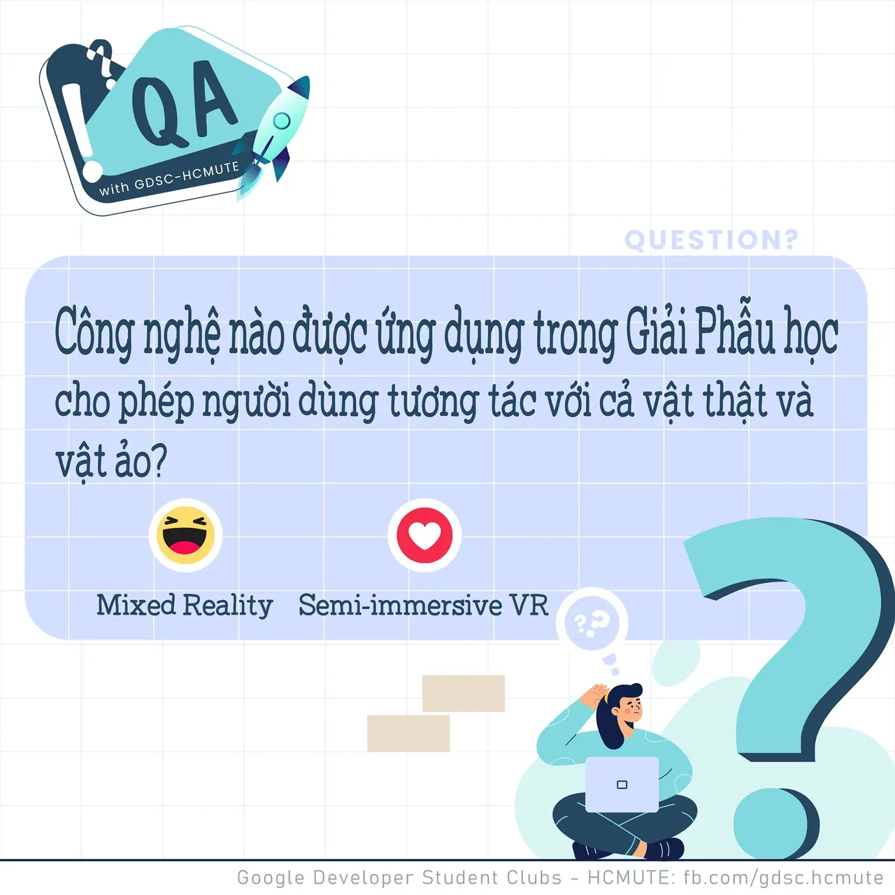

\[QA GDSC - Question\]

<!--truncate-->

  
 Chào buổi tối mọi người
  
Trong lúc chờ đợi tới bài Test ngày mai, tụi mình cùng đến với câu hỏi ngày hôm nay nào!

  
 Ở các Question trước, tụi mình đã được làm quen với Virtual Reality và Augmented Reality. Vậy lần này, các bạn hãy cùng GDSC - HCMUTE tìm hiểu công nghệ được ứng dụng trong lĩnh vực Giải phẫu học, xem có giống với 2 công nghệ kể trên hay không nhá!

  
 React và để lại Comment để GDSC - HCMUTE chúng mình xem có bao nhiêu bạn vượt qua thử thách lần này nào

  
Đừng quên Like và Follow Page để đón chờ phần Answer được lên sóng vào ngày mai nha  
---------------------------  
QA with GDSC HCMUTE là chuyên mục do GDSC - HCMUTE thực hiện với mong muốn cung cấp các kiến thức và thông tin hữu ích, giúp các bạn có thêm các tips thú vị trong lĩnh vực Công nghệ Thông tin thông qua Question và Answer được lên sóng hàng ngày!
  
 Mọi ý kiến đóng góp, các bạn có thể liên hệ trực tiếp thông qua fanpage Google Developer Student Clubs - HCM UTE: [https://www.facebook.com/gdsc.hcmute](https://www.facebook.com/gdsc.hcmute)
  
\#GDSC #GoogleDeveloperStudentClubs #GDSC\_HCMUTE #GDSC\_QA

---

_Bài viết được lưu trữ từ [fanpage HCMUTE Developer Student Club](https://www.facebook.com/hcmute.dsc)._
