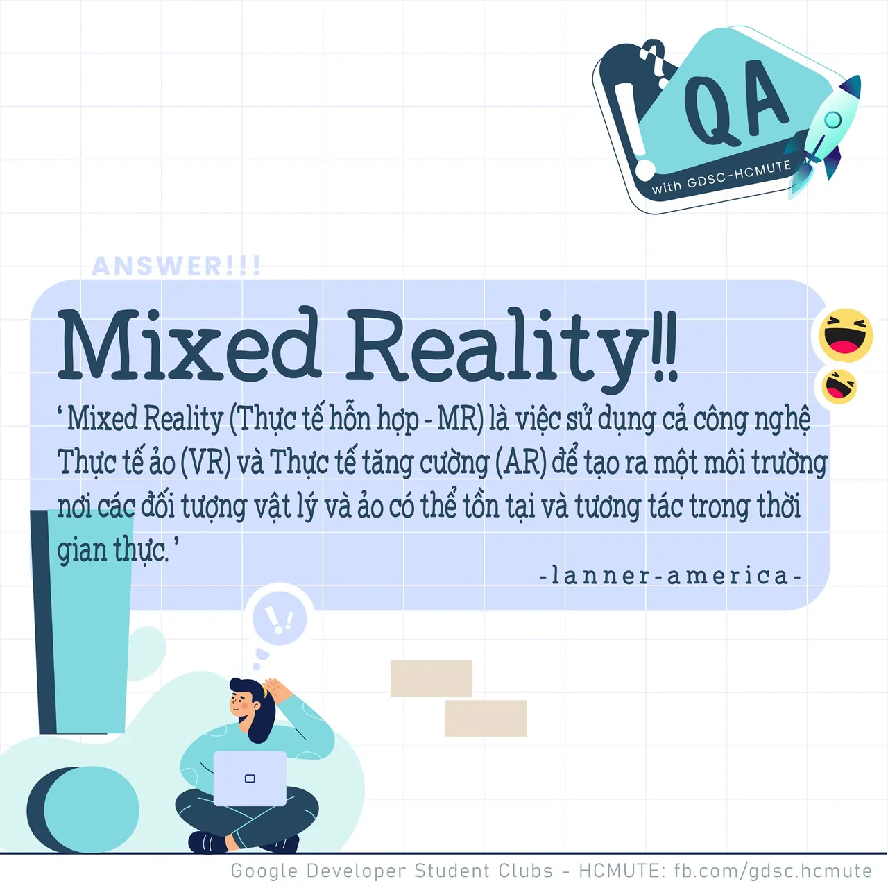

\[QA GDSC - Answer\]  
Chào buổi tối mọi người

<!--truncate-->

,
  
 Với câu hỏi "Công nghệ nào được ứng dụng trong Giải Phẫu học cho phép người dùng tương tác với cả vật thật và vật ảo?", không biết có bao nhiêu bạn tìm ra đáp án chính xác ngay và luôn không nhỉ
  
 Cùng GDSC - HCMUTE tìm hiểu sơ qua về công nghệ Thực tế hỗn hợp (MR- Mixed Reality) nhé!  
---------------------------  
Thực tế hỗn hợp (MR) là việc sử dụng cả công nghệ Thực tế ảo (VR) và Thực tế tăng cường (AR) để tạo ra một môi trường nơi các đối tượng vật lý và ảo có thể tồn tại và tương tác trong thời gian thực.(theo lanner-america.com)
  
AR có thể giúp bạn nhìn hoặc hiển thị một đối tượng ảo trong thế giới thực thông qua camera của điện thoại thông minh, máy tính bảng... Bộ lọc Snapchat, trang điểm ảo và đồ nội thất là những ví dụ điển hình về việc sử dụng AR.
  
Ngược lại, VR đưa bạn vào một môi trường hoàn toàn ảo nhưng yêu cầu thiết bị cụ thể: kính thực tế ảo VR và bộ điều khiển.
  
Được xây dựng trên hai thực tế này, các ứng dụng thực tế hỗn hợp cho phép bạn thao tác và tương tác với các yếu tố của cả thế giới thực và thế giới kỹ thuật số. Ví dụ: bạn có thể lấy một chiếc hộp ảo từ bàn cạnh giường thật của mình, mở nó ra và xem bên trong có gì. MR là một loại AR nhập vai, không còn bị ràng buộc với một màn hình hoặc người xem giới hạn.
  
Nói một cách ngắn gọn, Giải phẫu học mô tả hình dạng và vị trí của các bộ phận khác nhau, "thành phần" cấu tạo nên bộ phận đó cũng như mối quan hệ giữa các bộ phận đó với các bộ phận khác. Và đôi khi việc hiểu được những gì được ghi trong sách giải phẫu là 1 việc rất khó khăn. Với công nghệ MR, chúng sẽ cho bạn thấy những gì đang diễn ra trong cơ thể theo một hướng rất khác.
  
Thực tế ảo nửa nhập vai (semi-immersive VR) cũng được ứng dụng vào Giải phẫu học nhưng với công nghệ này bạn chỉ có thể tương tác được với vật ảo trong không gian ảo do kính thực tế ảo tạo ra.

  
 Minh chứng cho thấy chúng ta ngày càng tiến gần với những bước tiến công nghệ khó tin và ưu việt. Thú vị quá đúng không nào Like và Follow page để cùng tụi mình đón chờ phần QA lên sóng tiếp theo vào tuần sau nhá  
---------------------------  
QA with GDSC - HCMUTE là chuyên mục do GDSC - HCMUTE thực hiện với mong muốn cung cấp các kiến thức và thông tin hữu ích, giúp các bạn có thêm các tips thú vị trong lĩnh vực Công nghệ Thông tin thông qua Question và Answer được lên sóng hàng ngày!
  
 Mọi ý kiến đóng góp, các bạn có thể liên hệ trực tiếp thông qua fanpage Google Developer Student Clubs - HCM UTE: [https://www.facebook.com/gdsc.hcmute](https://www.facebook.com/gdsc.hcmute)
  
\#GDSC #GoogleDeveloperStudentClubs #GDSC\_HCMUTE #GDSC\_QA

---

_Bài viết được lưu trữ từ [fanpage HCMUTE Developer Student Club](https://www.facebook.com/hcmute.dsc)._
