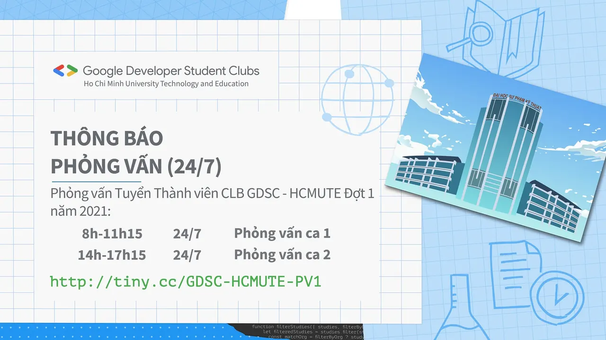

\[GDSC - HCMUTE\]

<!--truncate-->

  
Xin chào tất cả các bạn!

  
Vừa qua chúng ta đã hoàn thành bài test đánh giá kỹ năng dành cho các bạn đăng ký vào ban Học thuật của CLB GSDC - HCMUTE.

  
Chặn đường tiếp theo, chúng mình sẽ có đợt phỏng vấn trực tuyến vào ngày 24/7 tới đó nha. Thời gian phỏng vấn sẽ được chia thành 2 ca:
  
Ca 1: từ 8h-11h
  
Ca 2: từ 14h-17h15
  
Do số lượng đăng kí khá đông nên ca phỏng vấn sẽ được kéo dài hơn dự tính và sẽ có một số thay đổi so với ca phỏng vấn mà các bạn đã đăng ký. Mong các bạn thông cảm!
  
Cụ thể khung giờ và số thứ tự phỏng vấn, các bạn truy cập vào link: [http://tiny.cc/GDSC-HCMUTE-PV1](http://tiny.cc/GDSC-HCMUTE-PV1)

  
Mọi ý kiến về khung giờ phỏng vấn và các vấn đề liên quan, các bạn vui lòng liên hệ trực tiếp tại Fanpage, chúng mình sẽ giải quyết cho các bạn sớm nhất có thể!

  
Chúc các bạn thật nhiều sức khỏe và có sự chuẩn bị thật tốt cho buổi phỏng vấn sắp tới. Và các bạn cũng đừng quên kiểm tra email vào ngày mai để nhận được thông tin về cách tham gia phỏng vấn nhé!

---

_Bài viết được lưu trữ từ [fanpage HCMUTE Developer Student Club](https://www.facebook.com/hcmute.dsc)._
