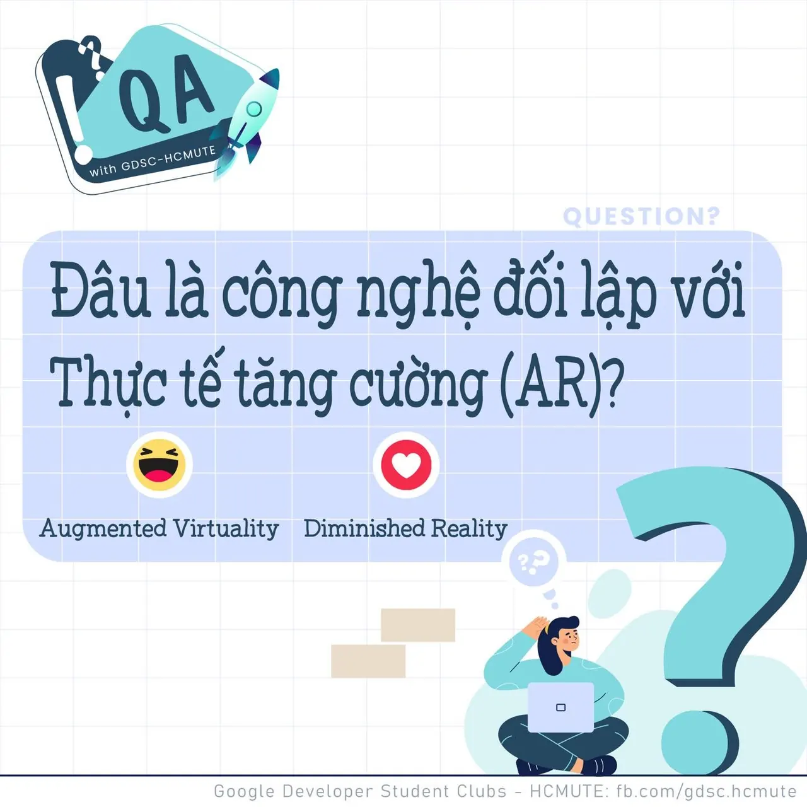

\[QA GDSC - Question\]
  
Chào buổi tối mọi người, lại là Q&A đâyy

<!--truncate-->

Trước khi đến với số hôm nay, Ad nhắc nhẹ các bạn ứng viên nhớ chuẩn bị thật kĩ để ngày mai có một buổi phỏng vấn thật thuận lợi nhaa!
  
 Ở các Question trước, tụi mình đã được làm quen với các ứng dụng thực tế ảo tăng cường, và tương tác với thực tế ảo. Nhưng các bạn có biết nó cũng có một người anh em trái ngược?  
Vậy “đâu là công nghệ đối lập với thực tế tăng cường - AR ?” chính là Question số này cần các bạn giải đáp đó!!
  
 React và để lại Comment để GDSC - HCMUTE chúng mình xem có bao nhiêu bạn vượt qua thử thách lần này nào
  
Đừng quên Like và Follow Page để đón chờ phần Answer được lên sóng vào ngày mai nha
  
---------------------------
  
 QA with GDSC HCMUTE là chuyên mục do GDSC - HCMUTE thực hiện với mong muốn cung cấp các kiến thức và thông tin hữu ích, giúp các bạn có thêm các tips thú vị trong lĩnh vực Công nghệ Thông tin thông qua Question và Answer được lên sóng hàng ngày!
  
 Mọi ý kiến đóng góp, các bạn có thể liên hệ trực tiếp thông qua fanpage Google Developer Student Clubs - HCM UTE: [https://www.facebook.com/gdsc.hcmute](https://www.facebook.com/gdsc.hcmute)  
\#GDSC #GoogleDeveloperStudentClubs #GDSC\_HCMUTE #GDSC\_QA

---

_Bài viết được lưu trữ từ [fanpage HCMUTE Developer Student Club](https://www.facebook.com/hcmute.dsc)._
