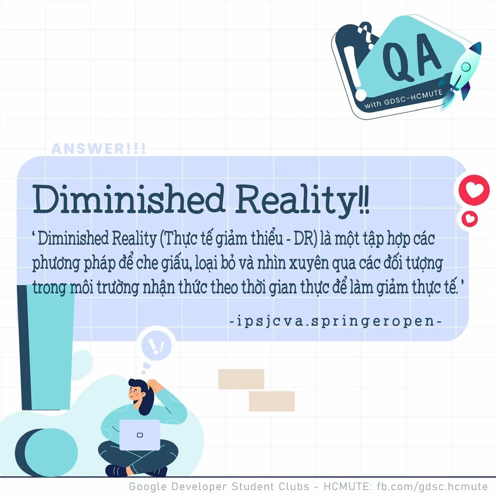

\[QA GDSC - Answer\]
  
Chào buổi tối mọi người

<!--truncate-->

,
  
 Với câu hỏi "Đâu là công nghệ đối lập với Thực tế tăng cường - AR?", không biết có bao nhiêu bạn tìm ra đáp án chính xác ngay và luôn không nhỉ
  
 Cùng GDSC - HCMUTE tìm hiểu sơ qua về công nghệ Thực tế giảm thiểu  
---------------------------  
Thực tế giảm thiểu (DR) là một tập hợp các phương pháp để che giấu, loại bỏ và nhìn xuyên qua các đối tượng trong môi trường nhận thức theo thời gian thực để làm giảm thực tế.(theo ipsjcva.springeropen.com)
  
Theo truyền thống, có hai loại DR chính: Observational và Inpainting. Đây chỉ đơn giản là mô tả kỹ thuật cơ bản được sử dụng để tạo ra sự giảm thị giác:  
• Observational DR sử dụng hình ảnh/video được chụp trước hoặc hiện có của cảnh nền. Sau đó, khi các vật thể mới được đưa vào không gian nền đó, hình ảnh nền có thể được sử dụng làm tài liệu tham chiếu để thu thập thông tin nền bị che bởi các đối tượng mới.  
• Inpainting là một kỹ thuật cố gắng vẽ lên các đối tượng bằng cách sử dụng kết cấu xung quanh đối tượng và vá thông tin. Inpainting kém chính xác hơn, nhưng cung cấp một cách tiếp cận tổng quát hơn để hoàn thành DR khi không thể truy cập được kiến thức trước về một cảnh (cảnh nền không được biết trước như Oservational và có những vật thực trên cảnh nền đó).
  
DR rất phù hợp để sản xuất hình ảnh / video trong đó các mục / tính năng không mong muốn của cảnh cần được loại bỏ. Ví dụ, dây và cụm dây thường được sử dụng trong các phân cảnh hành động mà các diễn viên phải rơi hoặc vượt qua một khoảng cách đáng kể trong không khí. Trong bản chỉnh sửa cuối cùng của bộ phim, những sợi dây này không được phép hiển thị cho khán giả.
  
Trong kinh doanh, Nhiều doanh nghiệp cho phép người dùng xem sản phẩm sẽ ở trong nhà của họ như thế nào trước khi mua. Giả sử bạn muốn thử một số đồ nội thất mới trong nhà, và căn phòng của bạn đang ngổn ngang đồ đạc cũ, việc dọn dẹp và di chuyển đồ đạc xung quanh để tạo không gian cho hình ảnh 3d sẽ rất tẻ nhạt. Thực tế giảm thiểu làm cho nó dễ dàng hơn bằng cách loại bỏ các phần nội thất mà họ không muốn khỏi tầm nhìn. Điều này giúp ích cho doanh nghiệp rất nhiều. Dưới đây là 1 video minh họa thực tế các nội thất trong nhà được “xóa” đi như thế nào: [https://www.youtube.com/watch?v=anAm7AHYreQ&t=43s](https://www.youtube.com/watch?v=anAm7AHYreQ&t=43s)

  
 Augmented Virtuality: môi trường ảo tăng cường là môi trường ảo đã thêm các đối tượng thực như con người hay đồ vật từ môi trường thực, các đối tượng này có thể tương tác với đối tượng ảo như một phần của môi trường ảo.  
Sau nhiều thông tin và ứng dụng của các loại “Thực tế” khác nhau, nếu bạn cảm thấy hứng thú và muốn tìm hiểu một cách trực quan thì đây là 1 đường dẫn rất hữu ích đó : [https://mediatedreality.info/](https://mediatedreality.info/)

  
 Như vậy chúng ta không những có thể tạo ra và tương tác với thực tế ảo mà còn có thể xoá vật thể của thế giới thực thông qua thực tế ảo. Hơi ảo nhưng thú vị quá đúng không nào Like và Follow page để cùng tụi mình đón chờ phần QA lên sóng tiếp theo vào hôm sau nhá  
---------------------------  
QA with GDSC - HCMUTE là chuyên mục do GDSC - HCMUTE thực hiện với mong muốn cung cấp các kiến thức và thông tin hữu ích, giúp các bạn có thêm các tips thú vị trong lĩnh vực Công nghệ Thông tin thông qua Question và Answer được lên sóng hàng ngày!
  
 Mọi ý kiến đóng góp, các bạn có thể liên hệ trực tiếp thông qua fanpage Google Developer Student Clubs - HCM UTE: [https://www.facebook.com/gdsc.hcmute](https://www.facebook.com/gdsc.hcmute)
  
\#GDSC #GoogleDeveloperStudentClubs #GDSC\_HCMUTE #GDSC\_QA

---

_Bài viết được lưu trữ từ [fanpage HCMUTE Developer Student Club](https://www.facebook.com/hcmute.dsc)._
