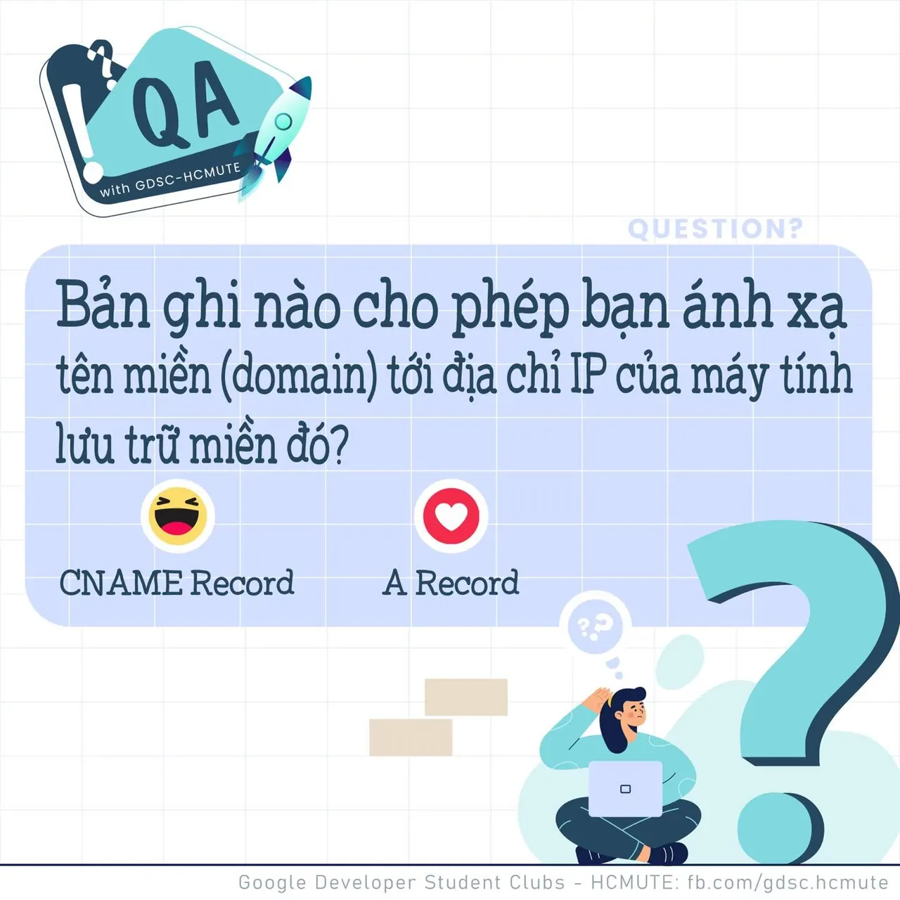

\[QA GDSC - Question\]
  
Chào buổi tối mọi người, lại là Q&A đâyy

<!--truncate-->

Trong khi chờ đợi kết quả tuyển thành viên CLB đợt 1 năm 2021, mình cùng đến với số QA tiếp theo nào
  
 Có thể bạn đã biết khi chúng ta duyệt Web chúng ta sẽ nhập tên miền tương ứng với trang web chúng ta muốn đến, và Enter mọi chuyện còn lại trình duyệt sẽ lo hết. Tuy nhiên về bản chất lúc này, trình duyệt sẽ chạy đi hỏi DNS Server - hệ thống máy chủ trung gian với nhiệm vụ “dịch” tên miền thành địa chỉ IP. DNS Server sẽ trả lời cho trình duyệt địa chỉ IP tương ứng với tên miền. Và bay giờ trình duyệt mới chạy thẳng đến webserver theo IP mới có để yêu cầu trang web.
  
Vậy bạn có thắc mắc: “Bản ghi nào đã được sử dụng cho phép ánh xạ tên miền đến địa chỉ IP của máy chủ trang web?”
  
 React và để lại Comment để GDSC - HCMUTE chúng mình xem có bao nhiêu bạn vượt qua thử thách lần này nào
  
Đừng quên Like và Follow Page để đón chờ phần Answer được lên sóng vào ngày mai nha
  
---------------------------
  
 QA with GDSC HCMUTE là chuyên mục do GDSC - HCMUTE thực hiện với mong muốn cung cấp các kiến thức và thông tin hữu ích, giúp các bạn có thêm các tips thú vị trong lĩnh vực Công nghệ Thông tin thông qua Question và Answer được lên sóng hàng ngày!
  
 Mọi ý kiến đóng góp, các bạn có thể liên hệ trực tiếp thông qua fanpage Google Developer Student Clubs - HCM UTE: [https://www.facebook.com/gdsc.hcmute](https://www.facebook.com/gdsc.hcmute)  
\#GDSC #GoogleDeveloperStudentClubs #GDSC\_HCMUTE #GDSC\_QA

---

_Bài viết được lưu trữ từ [fanpage HCMUTE Developer Student Club](https://www.facebook.com/hcmute.dsc)._
