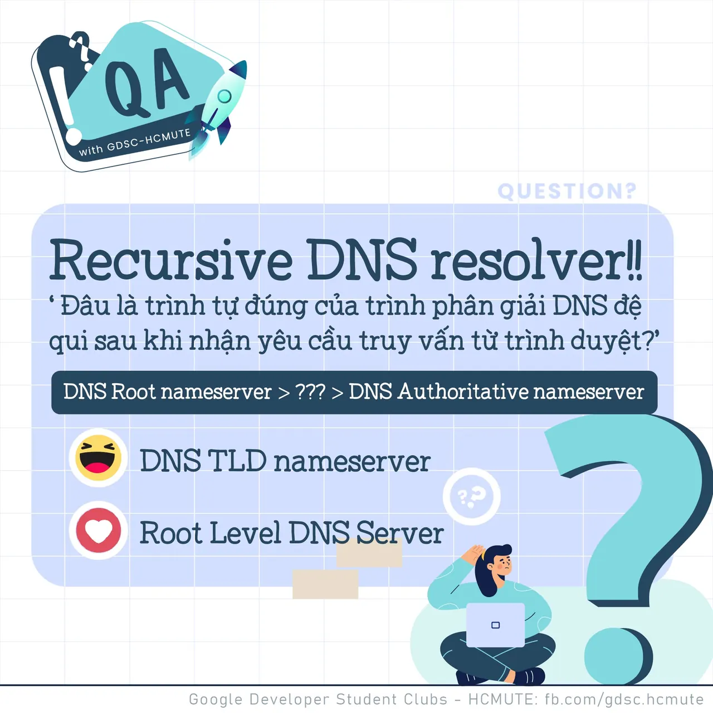

\[QA GDSC - Question\]
  
Chào buổi tối mọi người, lại là Q&A đâyy

<!--truncate-->

  
 Tiếp nối chủ đề bàn luận về DNS, hôm nay, tụi mình cùng tìm hiểu về trình phân giải DNS đệ quy (Recursive DNS Resolver) nhá!

  
 Về trình phân giải DNS đệ quy, đây là server (máy chủ) đóng vai trò liên lạc với các server khác để thay nó làm nhiệm vụ phản hồi cho client (trình duyệt người dùng), nói cách khác, nó chính là "nhân viên cần mẫn" nhiệm vụ lấy và trả thông tin cho client để tìm đúng thông tin cần thiết!

  
 Vậy, bạn có biết, khi nhận được truy vấn từ máy khách thông qua ứng dụng như trình duyệt web, thì trình tự mà "nhân viên cần mẫn" này cần đi qua sẽ như thế nào

  
 React và để lại Comment để GDSC - HCMUTE chúng mình xem có bao nhiêu bạn vượt qua thử thách lần này nào

  
Đừng quên Like và Follow Page để đón chờ phần Answer được lên sóng vào ngày mai nha  
---------------------------  
QA with GDSC HCMUTE là chuyên mục do GDSC - HCMUTE thực hiện với mong muốn cung cấp các kiến thức và thông tin hữu ích, giúp các bạn có thêm các tips thú vị trong lĩnh vực Công nghệ Thông tin thông qua Question và Answer được lên sóng hàng ngày!

  
 Mọi ý kiến đóng góp, các bạn có thể liên hệ trực tiếp thông qua fanpage Google Developer Student Clubs - HCM UTE: [https://www.facebook.com/gdsc.hcmute](https://www.facebook.com/gdsc.hcmute)
  
\#GDSC #GoogleDeveloperStudentClubs #GDSC\_HCMUTE #GDSC\_QA

---

_Bài viết được lưu trữ từ [fanpage HCMUTE Developer Student Club](https://www.facebook.com/hcmute.dsc)._
