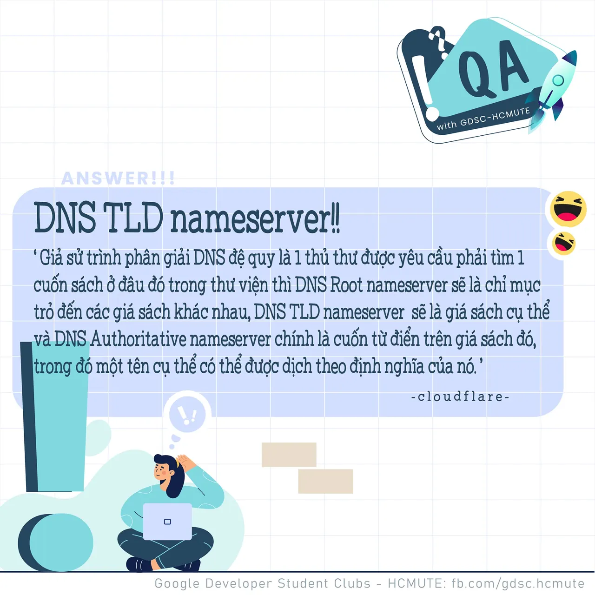

\[QA GDSC - Answer\]  
Chào buổi tối mọi người  
,

<!--truncate-->

  
 Với câu hỏi "Đâu là trình tự mà trình phân giải DNS đệ quy (Recursive DNS resolver) đi qua khi nhận được truy vấn từ máy khách thông qua ứng dụng như trình duyệt web?", thì đáp án chính xác chính là đáp án DNS TLD nameserver.

  
 Cùng GDSC - HCMUTE tìm hiểu sơ qua về trình phân giải DNS đệ quy và trình tự truy vấn của nó nhá  
---------------------------  
Giả sử trình phân giải DNS đệ quy là 1 thủ thư được yêu cầu phải tìm 1 cuốn sách ở đâu đó trong thư viện thì DNS Root nameserver sẽ là chỉ mục trỏ đến các giá sách khác nhau, DNS TLD nameserver sẽ là giá sách cụ thể và DNS Authoritative nameserver chính là cuốn từ điển trên giá sách, trong đó một tên cụ thể có thể được dịch theo định nghĩa của nó.(theo cloudflare.com)

  
 Trình phân giải DNS đệ quy là server đóng vai trò liên lạc với các server khác để thay nó làm nhiệm vụ phản hồi cho client (trình duyệt người dùng). Nó như một nhân viên cần mẫn nhận nhiệm vụ lấy và trả thông tin cho client (trình duyệt) để tìm đúng thông tin chúng cần. Để lấy được thông tin, trình phân giải DNS đệ quy có thể sẽ cần gọi đến Root DNS Server để trợ giúp.

  
 Root DNS Server, cũng thường được gọi là Root nameserver, là server quan trọng nhất trong hệ thống cấp bậc của DNS. Trình phân giải đệ quy DNS sẽ chuyển yêu cầu tới Root nameserver. Sau đó, Server này sẽ phản hồi rằng nó cần tìm trong các server tên miền cấp cao nhất (TLD nameserver) cụ thể.

  
 Ví dụ như khi bạn gõ www.google.com trên trình duyệt, phần .com chính là tên miền cao cấp nhất (top-level domain hay TLD). Khi đó TLD nameserver sẽ phản hồi từ một trình phân giải DNS để giới thiệu cho nó một Authoritative DNS server. Authoritative nameserver là nơi chính thức chứa nguồn dữ liệu của tên miền đó.

  
 Khi một trình phân giải DNS tìm thấy một Authoritative nameserver, đây là việc phân giải tên miền diễn ra. Authoritative nameserver có chứa thông tin tên miền gắn với địa chỉ nào. Nó sẽ đưa cho trình phân giải DNS đệ quy địa chỉ IP cần thiết tìm thấy trong danh mục các bản ghi của nó.

  
 Quá thú vị đúng không nào ^^ Hãy cùng GDSC - HCMUTE đón chờ những chuyên mục thú vị kế tiếp nhá  
---------------------------  
QA with GDSC - HCMUTE là chuyên mục do GDSC - HCMUTE thực hiện với mong muốn cung cấp các kiến thức và thông tin hữu ích, giúp các bạn có thêm các tips thú vị trong lĩnh vực Công nghệ Thông tin thông qua Question và Answer được lên sóng hàng ngày!

  
 Mọi ý kiến đóng góp, các bạn có thể liên hệ trực tiếp thông qua fanpage Google Developer Student Clubs - HCM UTE: [https://www.facebook.com/gdsc.hcmute](https://www.facebook.com/gdsc.hcmute)
  
\#GDSC #GoogleDeveloperStudentClubs #GDSC\_HCMUTE #GDSC\_QA

---

_Bài viết được lưu trữ từ [fanpage HCMUTE Developer Student Club](https://www.facebook.com/hcmute.dsc)._
