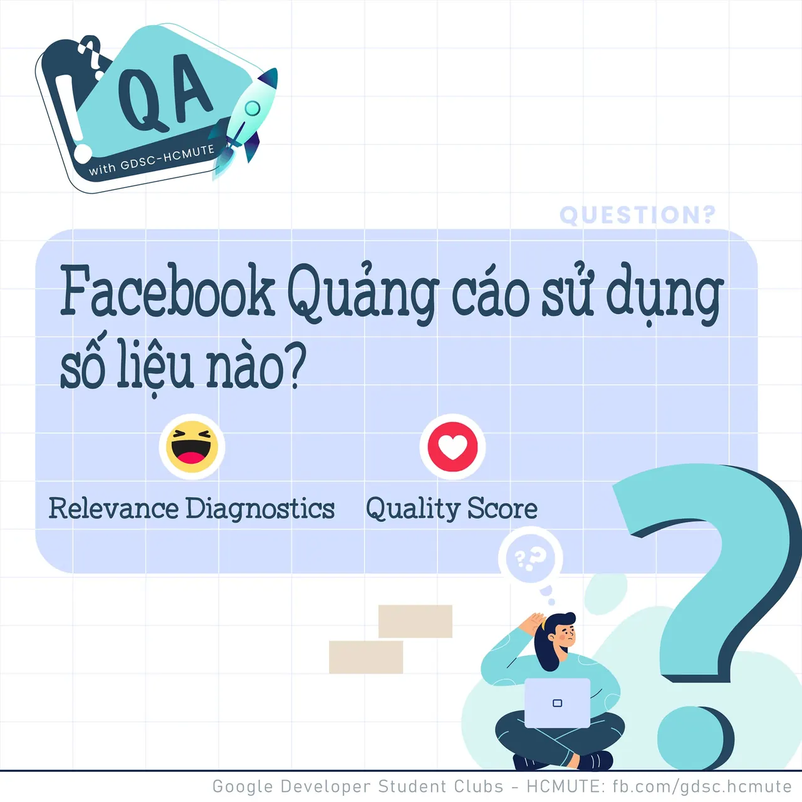

\[QA GDSC - Question\]
  
Chào buổi tối mọi người, QA with GDSC - HCMUTE lại lên sóng rồi đây

<!--truncate-->

  
 Hôm nay, tụi mình cùng dạo qua về một "ông lớn" khác rất gần gũi và quen thuộc với tất cả mọi người - chính là Facebook.

  
 Hiện nay, facebook đang là mạng xã hội phổ biến, không chỉ trong việc hoạt động liên lạc, nhắn tin giữa 2.8 tỷ người dùng trên thế giới với nhau, mà còn là nơi trao đổi, buôn bán gần như "mọi thứ trên đời". Từ đó, việc tiếp cận người dùng thông qua Facebook Advertising - Facebook Quảng cáo đang ngày càng được ưa chuộng và phổ biến.

  
 𝑽𝒂̣̂𝒚, 𝒃𝒂̣𝒏 đ𝒂̃ 𝒃𝒊𝒆̂́𝒕, đ𝒆̂̉ 𝒉𝒐𝒂̣𝒕 đ𝒐̣̂𝒏𝒈 đ𝒖̛𝒐̛̣𝒄 𝒉𝒊𝒆̣̂𝒖 𝒒𝒖𝒂̉, 𝒄𝒉𝒐̣𝒏 𝒍𝒐̣𝒄 𝒏𝒉𝒖̛̃𝒏𝒈 𝒒𝒖𝒂̉𝒏𝒈 𝒄𝒂́𝒐 𝒌𝒆́𝒎 𝒄𝒉𝒂̂́𝒕 𝒍𝒖̛𝒐̛̣𝒏𝒈 𝒗𝒂̀ 𝒄𝒂̉𝒊 𝒕𝒉𝒊𝒆̣̂𝒏 𝒄𝒉𝒖́𝒏𝒈, 𝒕𝒉𝒊̀ 𝑭𝒂𝒄𝒆𝒃𝒐𝒐𝒌 𝑸𝒖𝒂̉𝒏𝒈 𝒄𝒂́𝒐 𝒔𝒆̃ 𝒅𝒖̛̣𝒂 𝒕𝒓𝒆̂𝒏 𝒔𝒐̂́ 𝒍𝒊𝒆̣̂𝒖 𝒏𝒂̀𝒐

  
 React và để lại Comment để GDSC - HCMUTE chúng mình xem có bao nhiêu bạn vượt qua thử thách lần này nào
  
Đừng quên Like và Follow Page để đón chờ phần Answer được lên sóng vào ngày mai nha  
---------------------------  
QA with GDSC HCMUTE là chuyên mục do GDSC - HCMUTE thực hiện với mong muốn cung cấp các kiến thức và thông tin hữu ích, giúp các bạn có thêm các tips thú vị trong lĩnh vực Công nghệ Thông tin thông qua Question và Answer được lên sóng hàng ngày!

  
 Mọi ý kiến đóng góp, các bạn có thể liên hệ trực tiếp thông qua fanpage Google Developer Student Clubs - HCM UTE: [https://www.facebook.com/gdsc.hcmute](https://www.facebook.com/gdsc.hcmute)
  
\#GDSC #GoogleDeveloperStudentClubs #GDSC\_HCMUTE #GDSC\_QA

---

_Bài viết được lưu trữ từ [fanpage HCMUTE Developer Student Club](https://www.facebook.com/hcmute.dsc)._
