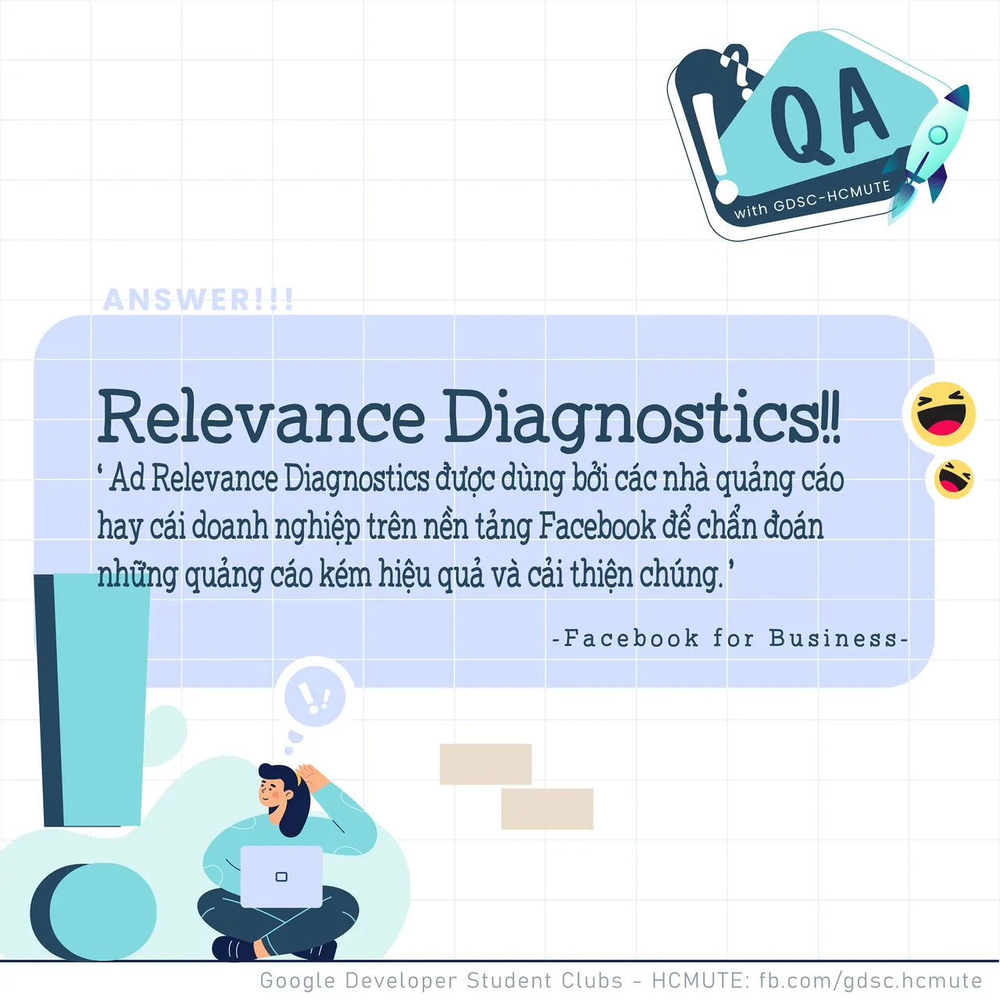

\[QA GDSC - Answer\]
  
Chào mọi người chào mọi người

<!--truncate-->

,
  
 Với câu hỏi "Facebook Quảng cáo sử dụng số liệu nào?", thì đáp án chính xác chính là đáp án 𝐑𝐞𝐥𝐞𝐯𝐚𝐧𝐜𝐞 𝐃𝐢𝐚𝐠𝐧𝐨𝐬𝐭𝐢𝐜𝐬!
  
 Sau đây, cùng GDSC - HCMUTE tụi mình tìm hiểu về Dữ liệu chuẩn đoán mức độ phù hợp - Relevance Diagnostics vô cùng thú vị này nhá
  
---------------------------
  
 𝐀𝐝 𝐑𝐞𝐥𝐞𝐯𝐚𝐧𝐜𝐞 𝐃𝐢𝐚𝐠𝐧𝐨𝐬𝐭𝐢𝐜𝐬 được dùng bởi các nhà quảng cáo hay các doanh nghiệp trên nền tảng Facebook để chuẩn đoán những quảng cáo kém hiệu quả và cải thiện chúng. (theo Facebook for Business)
  
 Mọi người thích xem quảng cáo phù hợp với mình hơn. Và khi doanh nghiệp hiển thị quảng cáo cho đối tượng phù hợp, họ sẽ thu được kết quả kinh doanh tốt hơn.
  
 Bằng Dữ liệu chuẩn đoán mức độ phù hợp của quảng cáo, bạn có thể chuẩn đoán xem quảng cáo đã chạy có phù hợp với đối tượng bạn tiếp cận hay không  
. Nếu quảng cáo của bạn không đạt được mục tiêu quảng cáo, bạn có thể sử dụng Dữ liệu chẩn đoán mức độ phù hợp để tìm hiểu xem việc điều chỉnh nội dung, trải nghiệm sau khi nhấp hay tiêu chí nhắm mục tiêu đối tượng có thể cải thiện hiệu quả như thế nào.
  
 Dữ liệu chuẩn đoán bao gồm:  
\- 𝑿𝒆̂́𝒑 𝒉𝒂̣𝒏𝒈 𝒄𝒉𝒂̂́𝒕 𝒍𝒖̛𝒐̛̣𝒏𝒈: Chất lượng cảm nhận từ quảng cáo của bạn so với quảng cáo cạnh tranh để thu hút cùng một đối tượng.  
\- 𝑿𝒆̂́𝒑 𝒉𝒂̣𝒏𝒈 𝒕𝒚̉ 𝒍𝒆̣̂ 𝒕𝒖̛𝒐̛𝒏𝒈 𝒕𝒂́𝒄: Tỷ lệ tương tác dự kiến của quảng cáo của bạn so với quảng cáo cạnh tranh để thu hút cùng một đối tượng.  
\- 𝑿𝒆̂́𝒑 𝒉𝒂̣𝒏𝒈 𝒕𝒚̉ 𝒍𝒆̣̂ 𝒄𝒉𝒖𝒚𝒆̂̉𝒏 đ𝒐̂̉𝒊: Tỷ lệ chuyển đổi dự kiến của quảng cáo so với quảng cáo có cùng mục tiêu tối ưu hóa và cạnh tranh để thu hút cùng một đối tượng.
  
 Ad Relevance Diagnostics là công cụ hữu ích và rõ ràng hơn thay thế cho 𝐑𝐞𝐥𝐞𝐯𝐚𝐧𝐜𝐞 𝐒𝐜𝐨𝐫𝐞 mà Facebook Quảng cáo sử dụng trước đây.
  
 Ngoài ra, Điểm chất lượng (Quality Score) là xếp hạng của Google về trải nghiệm người dùng tổng thể mà quảng cáo và trang đích của bạn cung cấp khi người dùng tìm kiếm (các) từ khóa của bạn. Điều này được thể hiện trên thang điểm từ 1-10, với 1 là thấp nhất và 10 là cao nhất.
  
 Về bản chất, Điểm chất lượng là dấu hiệu cho biết liệu quảng cáo và trang đích của bạn có hữu ích cho người tiêu dùng hay không.
  
 Mong rằng, qua đây, các bạn đã có cái nhìn tổng quan về hoạt động Quảng cáo của Google ^^ Nếu có bất kỳ đề tài hay chủ đề thú vị nào khác các bạn muốn tìm hiểu, đừng ngần ngại để lại bình luận bên dưới để chúng mình cùng trao đổi nhá
  
---------------------------
  
 QA with GDSC - HCMUTE là chuyên mục do GDSC - HCMUTE thực hiện với mong muốn cung cấp các kiến thức và thông tin hữu ích, giúp các bạn có thêm các tips thú vị trong lĩnh vực Công nghệ Thông tin thông qua Question và Answer được lên sóng hàng ngày!
  
 Mọi ý kiến đóng góp, các bạn có thể liên hệ trực tiếp thông qua fanpage Google Developer Student Clubs - HCM UTE: [https://www.facebook.com/gdsc.hcmute](https://www.facebook.com/gdsc.hcmute)  
\#GDSC #GoogleDeveloperStudentClubs #GDSC\_HCMUTE #GDSC\_QA

---

_Bài viết được lưu trữ từ [fanpage HCMUTE Developer Student Club](https://www.facebook.com/hcmute.dsc)._
