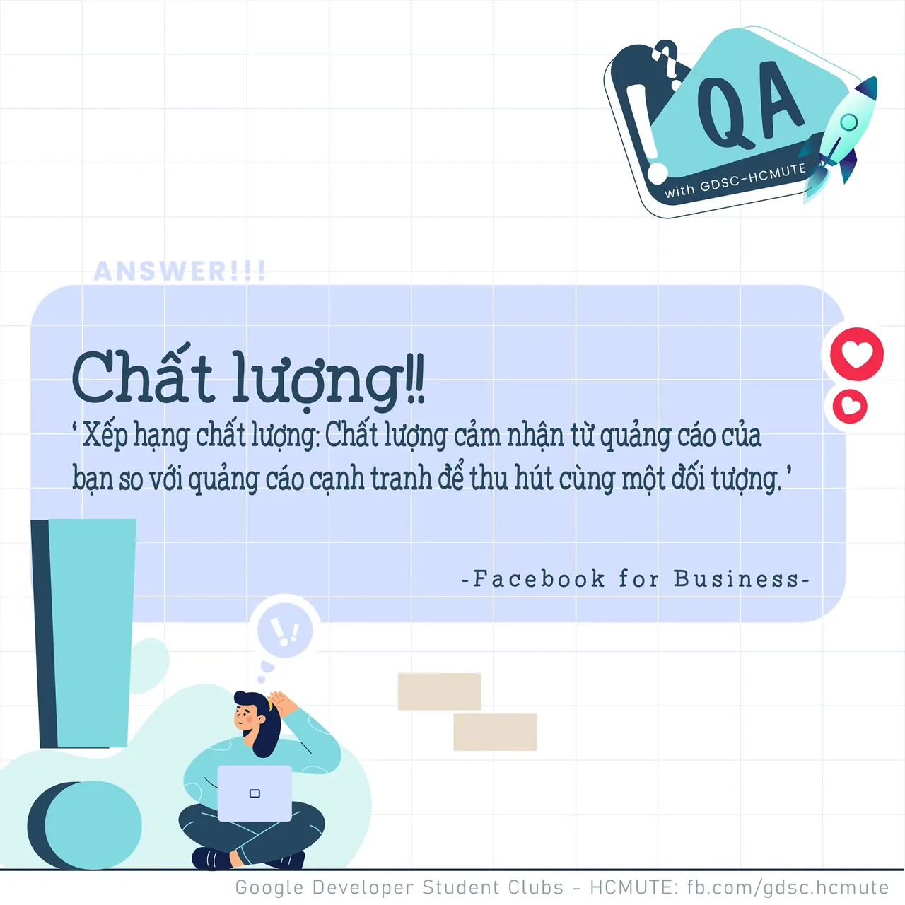

\[QA GDSC - Answer\]  
Chào mọi người chào mọi người  
,
  
 Với câu điền khuyết "Hành động ẩn hay xóa đi quảng cáo trên News Feed của bạn sẽ ảnh hưởng đến xếp hạng \_\_\_ của quảng cáo .", thì đáp án chính xác chính là đáp án Chất lượng!
  
 Sau đây, cùng GDSC - HCMUTE chúng mình đi vào tìm hiểu rõ hơn về cách hoạt động của các số liệu trong Dữ liệu chẩn đoán mức độ phù hợp của quảng cáo nhé! Số liệu đầu tiên chúng ta gặp sẽ là Xếp hạng Chất lượng.  
---------------------------  
Xếp hạng chất lượng: Chất lượng cảm nhận từ quảng cáo của bạn so với quảng cáo cạnh tranh để thu hút cùng một đối tượng. (theo Facebook for Business)

<!--truncate-->

  
 Facebook tuyên bố rằng chẩn đoán xếp hạng chất lượng giải thích “chất lượng cảm nhận của quảng cáo của bạn so với các quảng cáo cạnh tranh cho cùng một đối tượng”. Chất lượng đó được đo lường thông qua hành vi của những người dùng thực tế xem quảng cáo: những người có khả năng ẩn quảng cáo khỏi nguồn cấp dữ liệu của họ. Nếu nhiều người ẩn quảng cáo, xếp hạng chất lượng quảng cáo của bạn sẽ thấp hơn vì mọi người chỉ đơn giản là không muốn xem quảng cáo.

  
 Facebook cũng đánh giá số lượng clickbait và mồi tương tác mà bạn đưa vào quảng cáo của mình, nhằm đánh lừa người dùng nhấp vào hoặc tương tác với quảng cáo của bạn. Nếu bạn sử dụng những chiến thuật đó, xếp hạng chất lượng của bạn sẽ bị giảm.

  
 Cửa sổ bật lên ẩn quá nhiều nội dung trang hoặc khó đóng, cũng là một cách khác làm ảnh hưởng đến xếp hạng chất lượng của bạn. Làm gián đoạn khách truy cập vào trang web của bạn bằng các cửa sổ bật lên chặn nội dung làm phiền khách truy cập, khiến họ muốn rời khỏi trang.

  
 Để có một quảng cáo tốt về chất lượng, trang đích (landing page) đóng một vai trò vượt trội. Người dùng đã báo cáo có trải nghiệm tiêu cực với các trang đích cung cấp trải nghiệm nội dung không mong muốn. Một ví dụ là trang chi tiết xe có mô tả chung chung, chỉ có một số hình ảnh và không có đánh giá. Điều này dẫn đến tỷ lệ thoát cao và thời gian xem thấp, làm giảm xếp hạng chất lượng quảng cáo của bạn.

  
 Vậy sau khi xét qua những yếu tố làm cho chất lượng bài quảng cáo của bạn bị giảm, làm sao để cải thiện được chúng Hãy tập trung vào chất lượng của Creative assets của quảng cáo (bao gồm logo, hình ảnh, infographic, video, thương hiệu mạng xã hội) và nội dung trên trang đích của bạn. Khi bạn tin rằng quảng cáo của mình có chất lượng cao, hãy chuyển sự chú ý sang đối tượng mục tiêu và cố gắng nhắm mục tiêu đến những người có khả năng sẽ thấy quảng cáo của bạn có giá trị.

  
 Mong rằng, qua đây, các bạn đã có cái nhìn tổng quan về cách hoạt động của các số liệu trong Dữ liệu chẩn đoán mức độ phù hợp của quảng cáo ^^ Nếu có bất kỳ đề tài hay chủ đề thú vị nào khác các bạn muốn tìm hiểu, đừng ngần ngại để lại bình luận bên dưới để chúng mình cùng trao đổi nhá  
---------------------------  
QA with GDSC - HCMUTE là chuyên mục do GDSC - HCMUTE thực hiện với mong muốn cung cấp các kiến thức và thông tin hữu ích, giúp các bạn có thêm các tips thú vị trong lĩnh vực Công nghệ Thông tin thông qua Question và Answer được lên sóng hàng ngày!
  
 Mọi ý kiến đóng góp, các bạn có thể liên hệ trực tiếp thông qua fanpage Google Developer Student Clubs - HCM UTE: [https://www.facebook.com/gdsc.hcmute](https://www.facebook.com/gdsc.hcmute)
  
\#GDSC #GoogleDeveloperStudentClubs #GDSC\_HCMUTE #GDSC\_QA

---

_Bài viết được lưu trữ từ [fanpage HCMUTE Developer Student Club](https://www.facebook.com/hcmute.dsc)._
