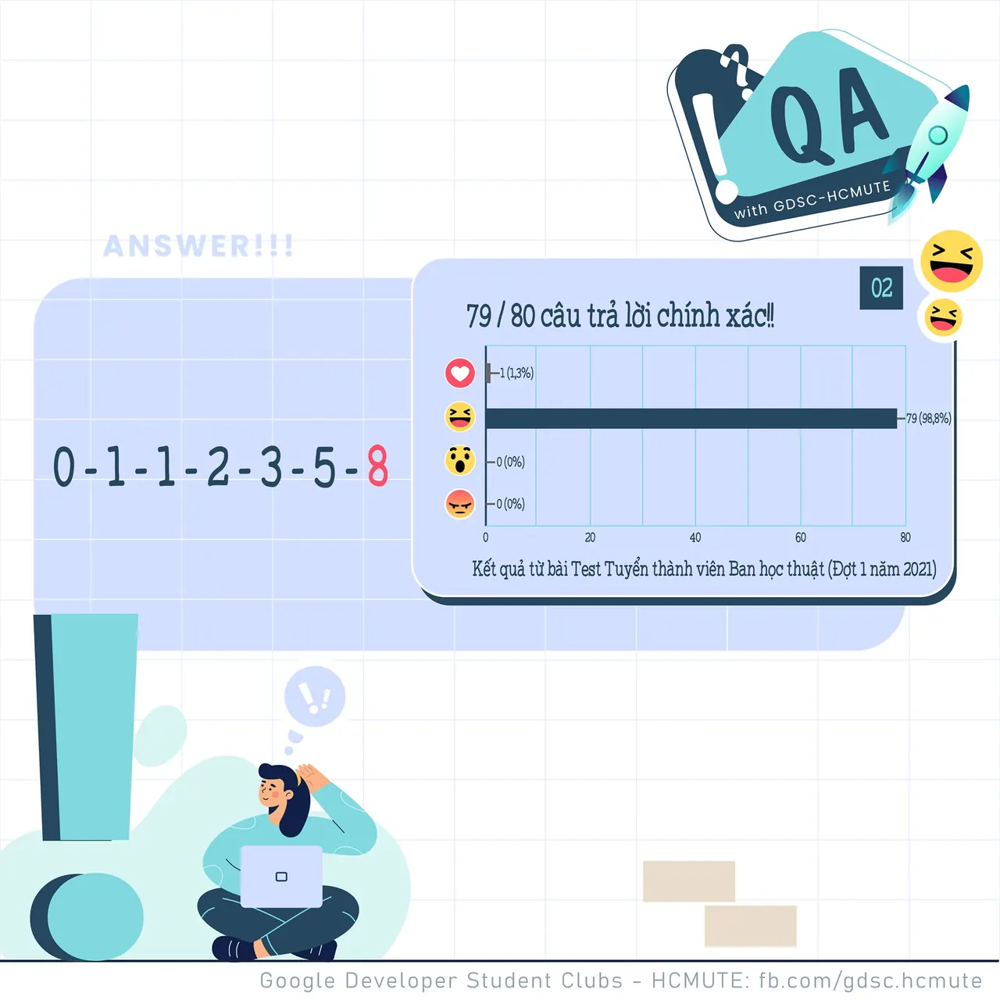

\[QA GDSC - Answer\]
  
Chào mọi người chào mọi người

<!--truncate-->

,
  
 Với câu hỏi Logic "𝟎 - 𝟏 - 𝟏 - 𝟐 - 𝟑 - 𝟓 - ?" ngày hôm qua, thì đáp án chính xác chính là "𝟖"!
  
 Đây là câu hỏi logic để tìm ra quy luật của dãy số, cũng thường dùng nhiều trong các bài test IQ.
  
 Như chúng ta dễ dàng nhận thấy đây cũng chính là 𝐝ã𝐲 𝐬ố 𝐟𝐢𝐛𝐨𝐧𝐚𝐜𝐜𝐢.  
 Dãy số tuân theo quy luật bắt đầu từ số thứ ba sẽ có kết quả đúng bằng tổng hai số trước đó.
  
 Các bạn có cùng suy nghĩ với ad hông nào? Để lại bình luận bên dưới để ad có thể hóng ké nha ^^  
---------------------------
  
 QA with GDSC - HCMUTE là chuyên mục do GDSC - HCMUTE thực hiện với mong muốn cung cấp các kiến thức và thông tin hữu ích, giúp các bạn có thêm các tips thú vị trong lĩnh vực Công nghệ Thông tin thông qua Question và Answer được lên sóng hàng ngày!
  
 Mọi ý kiến đóng góp, các bạn có thể liên hệ trực tiếp thông qua fanpage Google Developer Student Clubs - HCM UTE: [https://www.facebook.com/gdsc.hcmute](https://www.facebook.com/gdsc.hcmute)  
\#GDSC #GoogleDeveloperStudentClubs #GDSC\_HCMUTE #GDSC\_QA

---

_Bài viết được lưu trữ từ [fanpage HCMUTE Developer Student Club](https://www.facebook.com/hcmute.dsc)._
