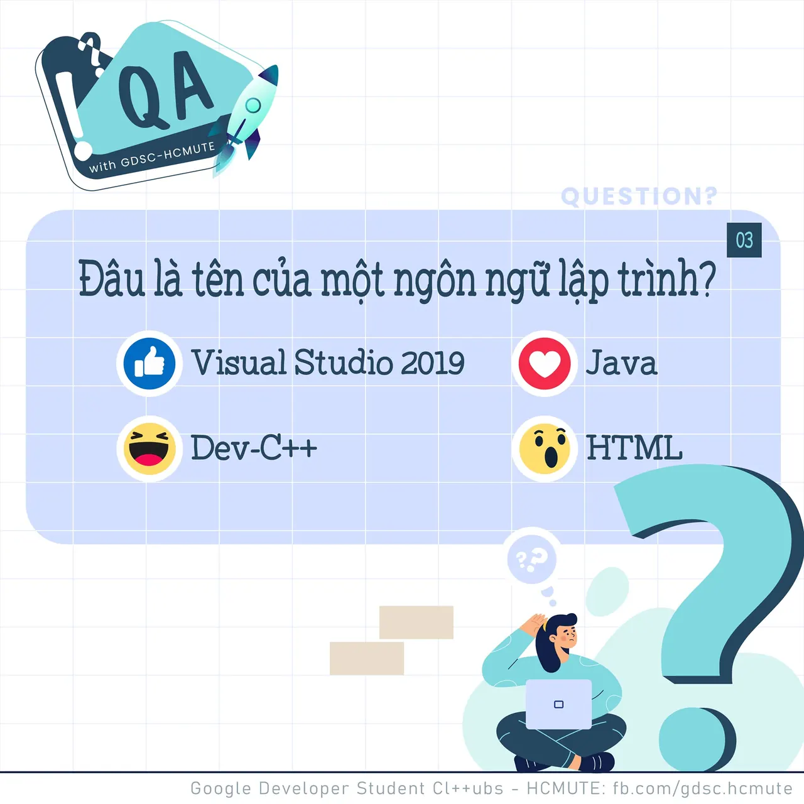

\[QA GDSC - Question\]
  
Loa loa loa, QA lại đến với các bạn rồi đâyyyy

<!--truncate-->

  
 Ở QA lần trước, chúng ta đã tìm hiểu quy luật của dãy 𝐝ã𝐲 𝐬ố 𝐟𝐢𝐛𝐨𝐧𝐚𝐜𝐜𝐢. Dãy số tuân theo quy luật bắt đầu từ số thứ ba sẽ có kết quả đúng bằng tổng hai số trước đó.

  
 Các bạn có thể xem lại chi tiết tại đây: [https://www.facebook.com/.../a.106463728.../124587429894409/](https://www.facebook.com/.../a.106463728.../124587429894409/)

  
 Và hôm nay, hãy cùng chúng mình đến với câu hỏi tiếp theo trong bài Test của Ban Học thuật nhé!!  
 Đâu là tên của một ngôn ngữ lập trình

  
 React và để lại Comment để GDSC - HCMUTE chúng mình xem có bao nhiêu bạn vượt qua thử thách lần này nào

  
Đừng quên Like và Follow Page để đón chờ phần Answer được lên sóng vào ngày mai nha  
---------------------------  
QA with GDSC HCMUTE là chuyên mục do GDSC - HCMUTE thực hiện với mong muốn cung cấp các kiến thức và thông tin hữu ích, giúp các bạn có thêm các tips thú vị trong lĩnh vực Công nghệ Thông tin thông qua Question và Answer được lên sóng hàng ngày!
  
 Mọi ý kiến đóng góp, các bạn có thể liên hệ trực tiếp thông qua fanpage Google Developer Student Clubs - HCM UTE: [https://www.facebook.com/gdsc.hcmute](https://www.facebook.com/gdsc.hcmute)
  
\#GDSC #GoogleDeveloperStudentClubs #GDSC\_HCMUTE #GDSC\_QA

---

_Bài viết được lưu trữ từ [fanpage HCMUTE Developer Student Club](https://www.facebook.com/hcmute.dsc)._
