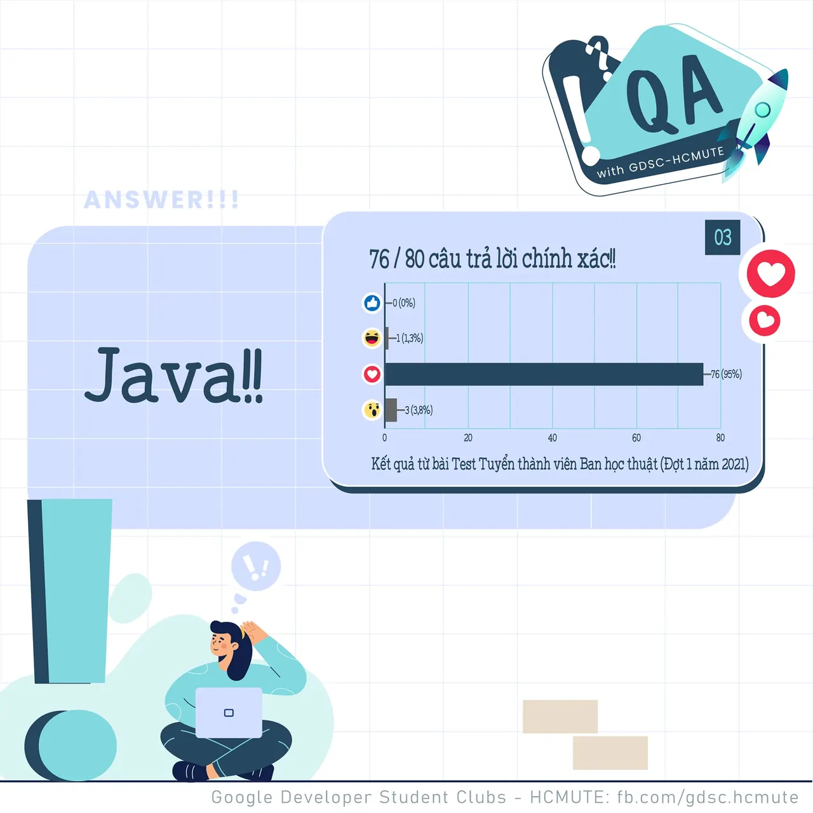
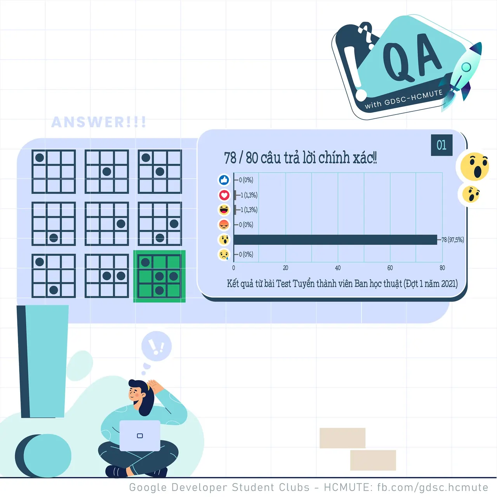

\[QA GDSC - Answer\]
  
Chào mọi người chào mọi người  
,

<!--truncate-->

  
 Với câu hỏi ngày hôm qua, thì Ad nhận được 53/61 react 𝐓𝐲𝐦, :&gt; cũng chính là 𝒄𝒂̂𝒖 𝒕𝒓𝒂̉ 𝒍𝒐̛̀𝒊 𝒄𝒉𝒊́𝒏𝒉 𝒙𝒂́𝒄 cho câu đố kiến thức này nhaaaa  
.

  
 Visual Studio 2019 là một môi trường phát triển tích hợp (IDE) của Microsoft. Hỗ trợ người dùng trong việc lập trình.

  
 Dev-C++ là một trường phát triển tích hợp tự do (IDE) được hỗ trợ bằng C/C++. Nó cũng nằm trong bộ trình dịch mã nguồn mở MinGW.

  
 Java là một ngôn ngữ lập trình hướng đối tượng, dựa trên các lớp. Cú pháp của Java tương tự như C và C++, nhưng có ít cơ sở cấp thấp hơn ngôn ngữ trên.

  
 HTML (viết tắt là Hypertext Markup Language) là một ngôn ngữ đánh dấu siêu văn bản được thiết kế để tạo nên các trang Web trên World Wide Web.

  
 Các bạn có cùng suy nghĩ với ad hông nào Để lại bình luận bên dưới để ad có thể hóng ké nha ^^  
---------------------------  
QA with GDSC - HCMUTE là chuyên mục do GDSC - HCMUTE thực hiện với mong muốn cung cấp các kiến thức và thông tin hữu ích, giúp các bạn có thêm các tips thú vị trong lĩnh vực Công nghệ Thông tin thông qua Question và Answer được lên sóng hàng ngày!
  
 Mọi ý kiến đóng góp, các bạn có thể liên hệ trực tiếp thông qua fanpage Google Developer Student Clubs - HCM UTE: [https://www.facebook.com/gdsc.hcmute](https://www.facebook.com/gdsc.hcmute)
  
\#GDSC #GoogleDeveloperStudentClubs #GDSC\_HCMUTE #GDSC\_QA

---

_Bài viết được lưu trữ từ [fanpage HCMUTE Developer Student Club](https://www.facebook.com/hcmute.dsc)._
