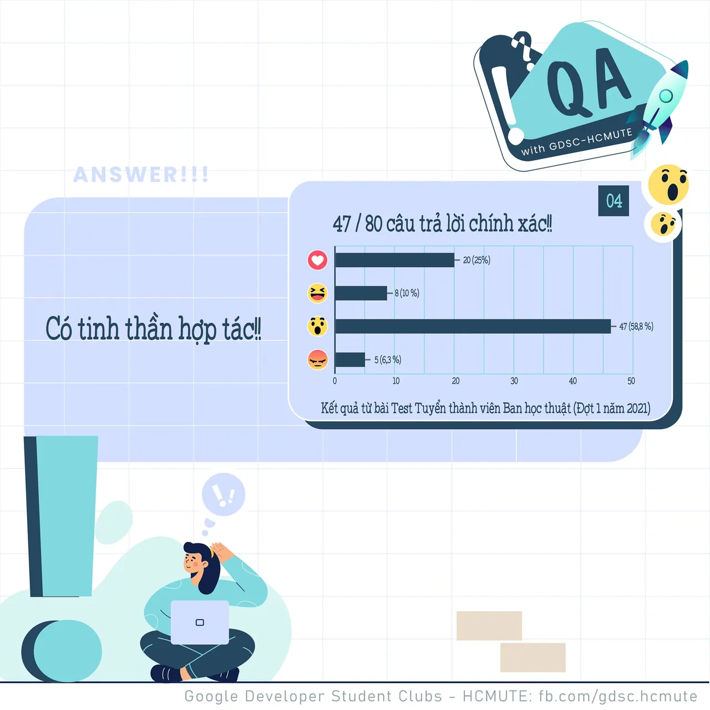

\[QA GDSC - Answer\]
  
Chào mọi người chào mọi người

<!--truncate-->

,
  
 Chốt hạ câu hỏi ngày hôm qua, thì Ad nhận được chỉ 5/28 lượt thả 𝐖𝐨𝐰 - 𝐂𝐨́ 𝐭𝐢𝐧𝐡 𝐭𝐡𝐚̂̀𝐧 𝐡𝐨̛̣𝐩 𝐭𝐚́𝐜, cũng chính là 𝒄𝒂̂𝒖 𝒕𝒓𝒂̉ 𝒍𝒐̛̀𝒊 𝒄𝒉𝒊́𝒏𝒉 𝒙𝒂́𝒄 cho câu hỏi nhận thức này nhaaaa  
.
  
 𝘚𝘢́𝘯𝘨 𝘵𝘢̣𝘰, 𝘯𝘩𝘢̣̂𝘯 𝘵𝘩𝘶̛́𝘤 và 𝘵𝘢̀𝘪 𝘨𝘪𝘰̉𝘪 𝘵𝘩𝘰̂𝘯𝘨 𝘮𝘪𝘯𝘩 là những kỹ năng cần thiết của mỗi người lãnh đạo. Nhưng yếu tố liên quan đến phẩm chất và cũng là một trong những phẩm chất cần thiết nhất chính là có 𝙩𝙞𝙣𝙝 𝙩𝙝𝙖̂̀𝙣 𝙝𝙤̛̣𝙥 𝙩𝙖́𝙘.
  
 Một người lãnh đạo không thể phát huy được hết kỹ năng và truyền đạt được năng lượng của mình cho mọi người thì rất khó khăn để dẫn dắt một tập thể đi lên. Do đó việc có tinh thần hợp tác là một trong những phẩm chất vô cùng quan trọng đối với một người lãnh đạo.
  
 Các bạn có suy nghĩ như thế nào với đáp án lần này? Để lại bình luận bên dưới để ad có thể hóng ké nha ^^
  
---------------------------
  
 QA with GDSC - HCMUTE là chuyên mục do GDSC - HCMUTE thực hiện với mong muốn cung cấp các kiến thức và thông tin hữu ích, giúp các bạn có thêm các tips thú vị trong lĩnh vực Công nghệ Thông tin thông qua Question và Answer được lên sóng hàng ngày!
  
 Mọi ý kiến đóng góp, các bạn có thể liên hệ trực tiếp thông qua fanpage Google Developer Student Clubs - HCM UTE: [https://www.facebook.com/gdsc.hcmute](https://www.facebook.com/gdsc.hcmute)  
\#GDSC #GoogleDeveloperStudentClubs #GDSC\_HCMUTE #GDSC\_QA

---

_Bài viết được lưu trữ từ [fanpage HCMUTE Developer Student Club](https://www.facebook.com/hcmute.dsc)._
