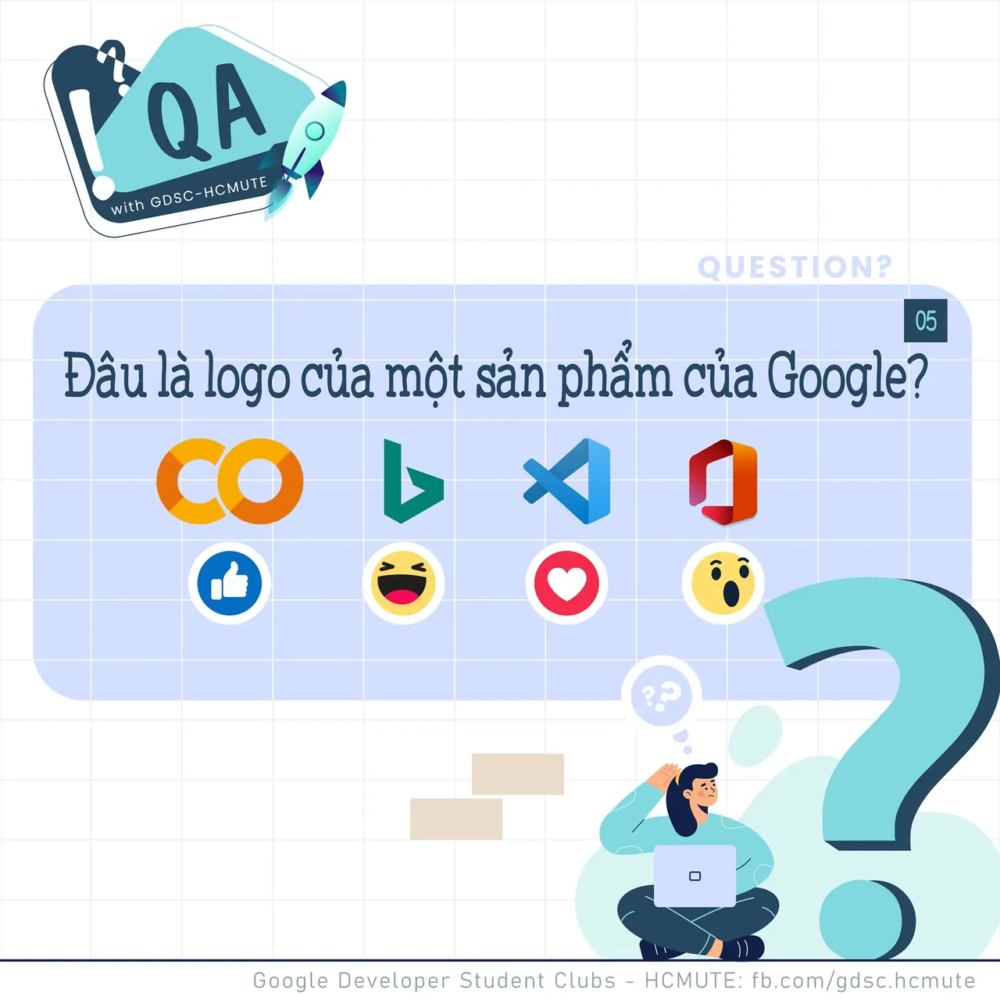

\[QA GDSC - Question\]
  
Loa loa loa, chào buổi tối mọi người

<!--truncate-->

  
 Series các câu hỏi trong bài Test học thuật lại tiếp tục rồi đâyyyy, hôm nay, tụi mình cùng bàn luận về 1 câu hỏi kiến thức nha ^^
  
 Đ𝘢̂𝘶 𝘭𝘢̀ 𝘭𝘰𝘨𝘰 𝘤𝘶̉𝘢 𝘮𝘰̣̂𝘵 𝘴𝘢̉𝘯 𝘱𝘩𝘢̂̉𝘮 𝘤𝘶̉𝘢 𝘎𝘰𝘰𝘨𝘭𝘦

  
 Cùng React đáp án và Comment tên của các sản phẩm quen thuộc với dân lập trình tụi mình ở bên dưới nhá! Cũng như để GDSC - HCMUTE xem có bao nhiêu bạn vượt qua thử thách lần này nào

  
Đừng quên Like và Follow Page để đón chờ phần Answer được lên sóng vào ngày mai nha  
---------------------------  
QA with GDSC HCMUTE là chuyên mục do GDSC - HCMUTE thực hiện với mong muốn cung cấp các kiến thức và thông tin hữu ích, giúp các bạn có thêm các tips thú vị trong lĩnh vực Công nghệ Thông tin thông qua Question và Answer được lên sóng hàng ngày!
  
 Mọi ý kiến đóng góp, các bạn có thể liên hệ trực tiếp thông qua fanpage Google Developer Student Clubs - HCM UTE: [https://www.facebook.com/gdsc.hcmute](https://www.facebook.com/gdsc.hcmute)
  
\#GDSC #GoogleDeveloperStudentClubs #GDSC\_HCMUTE #GDSC\_QA

---

_Bài viết được lưu trữ từ [fanpage HCMUTE Developer Student Club](https://www.facebook.com/hcmute.dsc)._
