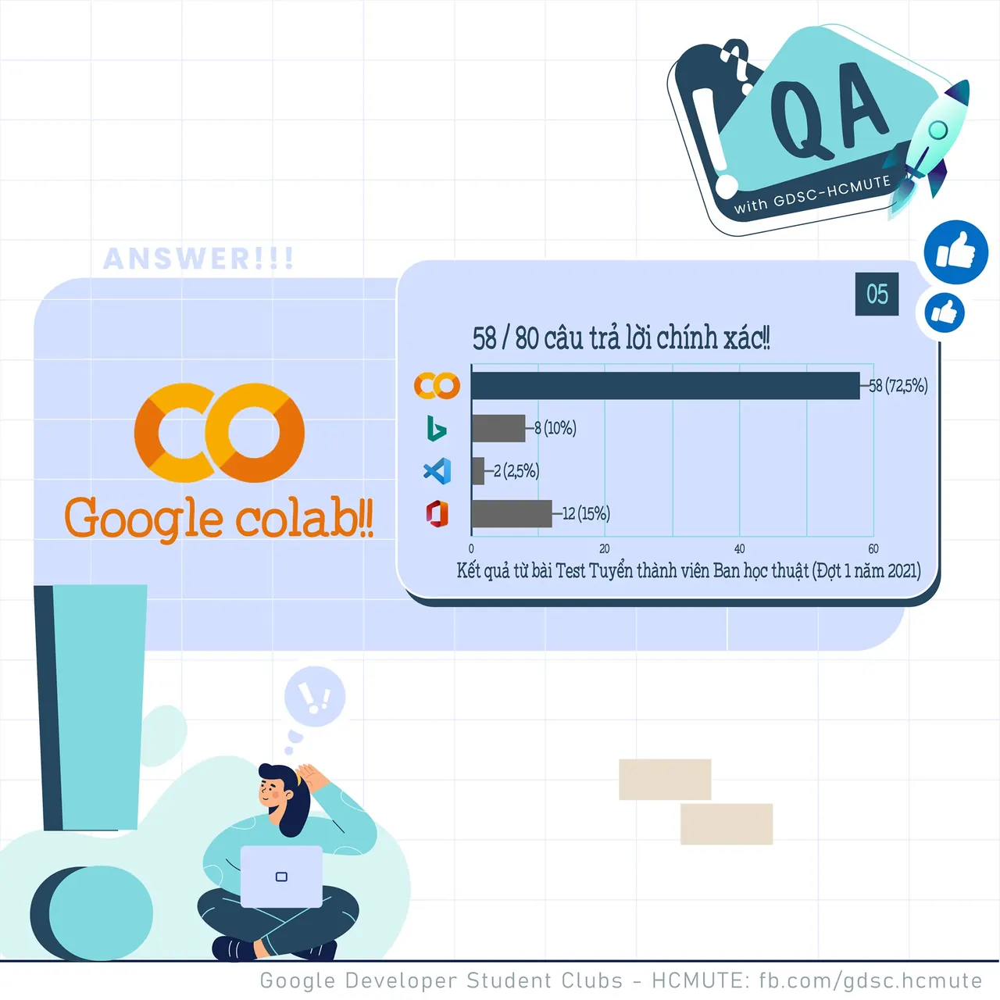

\[QA GDSC - Answer\]
  
Chào mọi người chào mọi người

<!--truncate-->

,
  
 Kết thúc câu hỏi nhìn hình đoán Logo, đa phần đáp án đều chính xác đó chính là "Like" - Google Colab Logo  
.
  
 Google colab - Colaboratory hay còn gọi là Google Colab, là một sản phẩm từ Google Research, nó cho phép chạy các dòng code python thông qua trình duyệt, đặc biệt phù hợp với Data analysis, machine learning và giáo dục. Colab không cần yêu cầu cài đặt hay cấu hình máy tính, mọi thứ có thể chạy thông qua trình duyệt, bạn có thể sử dụng tài nguyên máy tính từ CPU tốc độ cao và cả GPUs và cả TPUs đều được cung cấp cho bạn. Ngoài ra Colab thực sự tiện lợi với cơ chế chia sẻ. Cho dù bạn là sinh viên, nhà khoa học dữ liệu hay nhà nghiên cứu AI (trí tuệ nhân tạo), Colab đều giúp bạn hoàn thành công việc dễ dàng hơn.  
Nếu bạn hứng thú với Google Colab có thể tìm hiểu thêm tại: [https://colab.research.google.com](https://colab.research.google.com)
  
 Một điều thú vị ngoại trừ đáp án Google Colab thì các đáp án còn lại điều thuộc nhà Microsoft mà chúng ta hẳn đều khá quen thuộc, lần lượt là:  
\- Bing - Logo công cụ tìm kiếm.  
\- Visual Studio Code - một trình biên tập mã.  
\- Microsoft Office - một bộ ứng dụng văn phòng gồm các chương trình, máy chủ, và dịch vụ.
  
 Các bạn có suy nghĩ như thế nào với đáp án lần này? Để lại bình luận bên dưới để ad có thể hóng ké nha ^^  
---------------------------
  
 QA with GDSC - HCMUTE là chuyên mục do GDSC - HCMUTE thực hiện với mong muốn cung cấp các kiến thức và thông tin hữu ích, giúp các bạn có thêm các tips thú vị trong lĩnh vực Công nghệ Thông tin thông qua Question và Answer được lên sóng hàng ngày!
  
 Mọi ý kiến đóng góp, các bạn có thể liên hệ trực tiếp thông qua fanpage Google Developer Student Clubs - HCM UTE: [https://www.facebook.com/gdsc.hcmute](https://www.facebook.com/gdsc.hcmute)  
\#GDSC #GoogleDeveloperStudentClubs #GDSC\_HCMUTE #GDSC\_QA

---

_Bài viết được lưu trữ từ [fanpage HCMUTE Developer Student Club](https://www.facebook.com/hcmute.dsc)._
