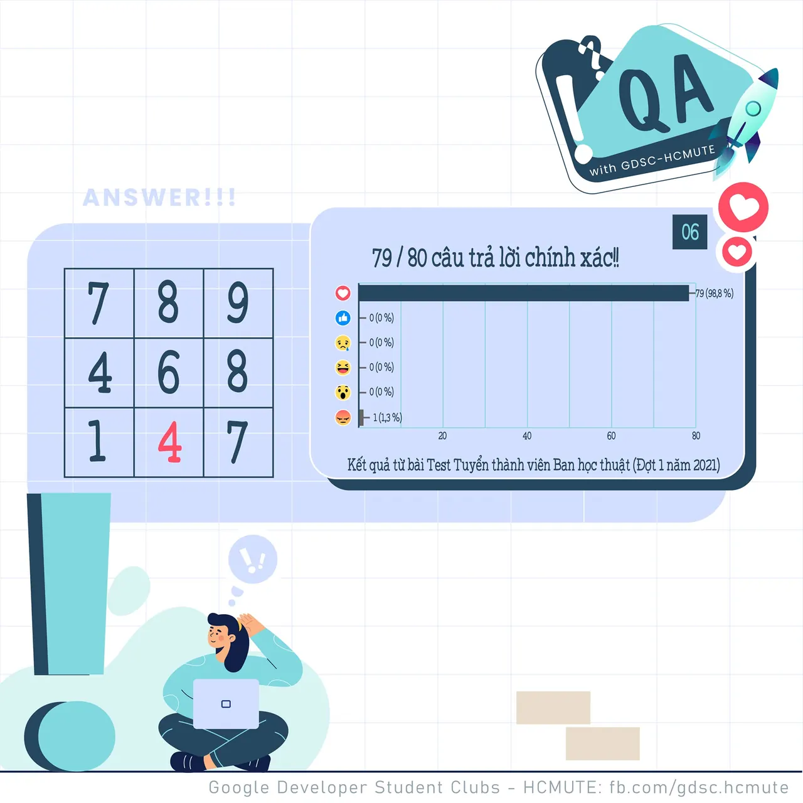

\[QA GDSC - Answer\]
  
Chào mọi người chào mọi người  
,

<!--truncate-->

  
 Câu hỏi IQ hôm qua có vẻ không làm khó được các nhà thông thái của chúng ta đúng hông nào  
 Với 52/63 lượt React Tym thì đáp án chính xác là 𝟒  
.

  
 Đây cũng chính là một câu hỏi thường gặp trong các bài Test IQ. Có thể thấy ở bài toán này, các con số tuân theo quy luật tăng dần K đơn vị ở mỗi dòng thứ K.

  
 Ví dụ ở dòng đầu tiên các con số có thứ tự tăng dần cách nhau 1 đơn vị, lần lượt ở dòng 2, 3 các con số tăng dần và cách nhau khoảng cách 2, 3 đơn vị. Do đó đáp án cần điền vào ô “  ” là 4.

  
 Các bạn có suy nghĩ như thế nào với đáp án lần này Để lại bình luận bên dưới để ad có thể hóng ké nha ^^  
---------------------------  
QA with GDSC - HCMUTE là chuyên mục do GDSC - HCMUTE thực hiện với mong muốn cung cấp các kiến thức và thông tin hữu ích, giúp các bạn có thêm các tips thú vị trong lĩnh vực Công nghệ Thông tin thông qua Question và Answer được lên sóng hàng ngày!
  
 Mọi ý kiến đóng góp, các bạn có thể liên hệ trực tiếp thông qua fanpage Google Developer Student Clubs - HCM UTE: [https://www.facebook.com/gdsc.hcmute](https://www.facebook.com/gdsc.hcmute)
  
\#GDSC #GoogleDeveloperStudentClubs #GDSC\_HCMUTE #GDSC\_QA

---

_Bài viết được lưu trữ từ [fanpage HCMUTE Developer Student Club](https://www.facebook.com/hcmute.dsc)._
