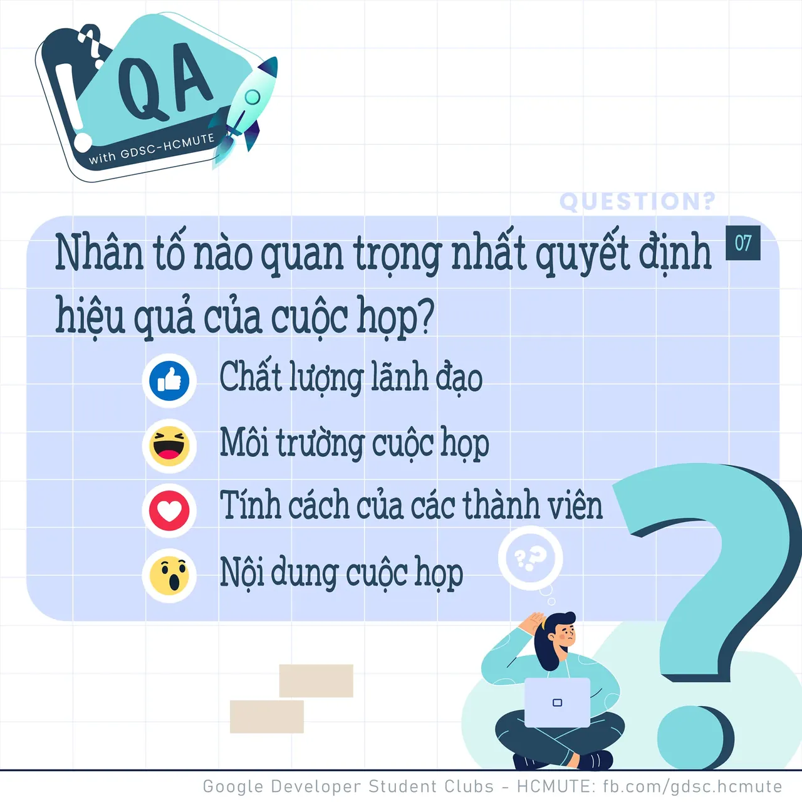

\[QA GDSC - Question\]
  
Loa loa loa, đến hẹn lại lên đâyyy

<!--truncate-->

 Trong suốt quá trình làm việc, học tập và rèn luyện, chắc hẳn ai trong tụi mình cũng từng 1 lần tham dự ít nhất một cuộc họp nào đó rồi nhỉ ^^
  
 Vậy theo mọi người, 𝑵𝒉𝒂̂𝒏 𝒕𝒐̂́ 𝒏𝒂̀𝒐 𝒒𝒖𝒂𝒏 𝒕𝒓𝒐̣𝒏𝒈 𝒏𝒉𝒂̂́𝒕 𝒒𝒖𝒚𝒆̂́𝒕 đ𝒊̣𝒏𝒉 𝒉𝒊𝒆̣̂𝒖 𝒒𝒖𝒂̉ 𝒄𝒖𝒐̣̂𝒄 𝒉𝒐̣𝒑?
  
 Bình tĩnh tự tin và để lại React cũng như Comment để GDSC - HCMUTE chúng mình xem có bao nhiêu bạn vượt qua thử thách lần này nào
  
Đừng quên Like và Follow Page để đón chờ phần Answer được lên sóng vào ngày mai nha
  
---------------------------
  
 QA with GDSC HCMUTE là chuyên mục do GDSC - HCMUTE thực hiện với mong muốn cung cấp các kiến thức và thông tin hữu ích, giúp các bạn có thêm các tips thú vị trong lĩnh vực Công nghệ Thông tin thông qua Question và Answer được lên sóng hàng ngày!
  
 Mọi ý kiến đóng góp, các bạn có thể liên hệ trực tiếp thông qua fanpage Google Developer Student Clubs - HCM UTE: [https://www.facebook.com/gdsc.hcmute](https://www.facebook.com/gdsc.hcmute)  
\#GDSC #GoogleDeveloperStudentClubs #GDSC\_HCMUTE #GDSC\_QA

---

_Bài viết được lưu trữ từ [fanpage HCMUTE Developer Student Club](https://www.facebook.com/hcmute.dsc)._
