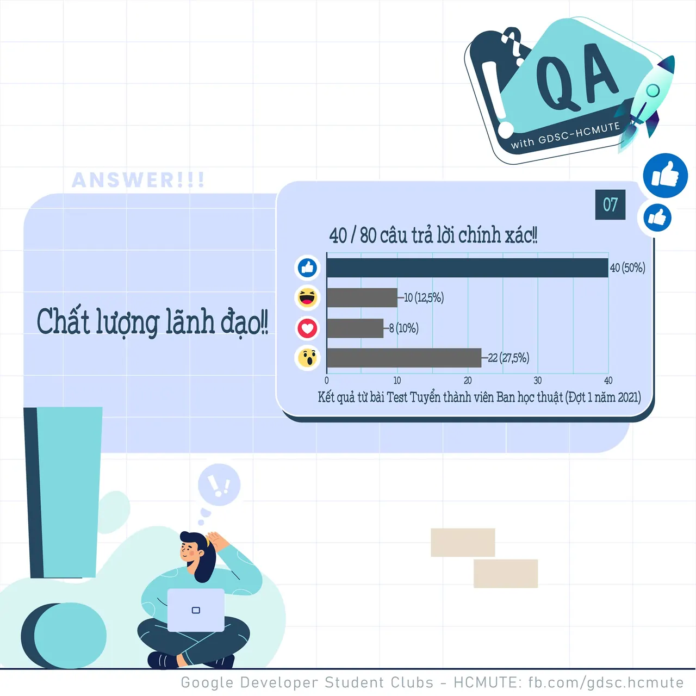

\[QA GDSC - Answer\]
  
Chào mọi người chào mọi người  
,

<!--truncate-->

  
 Sau 2 ngày trầy da tróc vảy với đăng ký môn học  
 thì tụi mình quay trở lại rồi đâyyyyyy  
.

  
 Với câu hỏi lần trước, tụi mình nhận được 11/19 react Like với 𝑪𝒉𝒂̂́𝒕 𝒍𝒖̛𝒐̛̣𝒏𝒈 𝒍𝒂̃𝒏𝒉 đ𝒂̣𝒐 - cũng chính là đáp án chính xác của câu hỏi này.

  
 Có thể thấy, trong mỗi cuộc họp để cùng nhau bàn bạc, thảo luận về một số vấn đề nhất định. Có rất nhiều nhân tố sẽ ảnh hưởng và quyết định đến hiệu quả của cuộc họp. Nhưng nhân tố đóng vai trò quan trọng nhất là “𝑪𝒉𝒂̂́𝒕 𝒍𝒖̛𝒐̛̣𝒏𝒈 𝒍𝒂̃𝒏𝒉 đ𝒂̣𝒐” để có thể chủ trì điều hành cuộc họp.

  
 Từ đó, có khả năng truyền đạt ý tưởng đồng thời giải quyết các vấn đề phát sinh trong suốt quá trình cuộc họp. Như vậy, chất lượng lãnh đạo là một trong những nhân tố quan trọng quyết định hiệu quả của cuộc họp.

  
 Các bạn có suy nghĩ như thế nào với đáp án lần này Để lại bình luận bên dưới để ad có thể hóng ké nha ^^  
---------------------------  
QA with GDSC - HCMUTE là chuyên mục do GDSC - HCMUTE thực hiện với mong muốn cung cấp các kiến thức và thông tin hữu ích, giúp các bạn có thêm các tips thú vị trong lĩnh vực Công nghệ Thông tin thông qua Question và Answer được lên sóng hàng ngày!
  
 Mọi ý kiến đóng góp, các bạn có thể liên hệ trực tiếp thông qua fanpage Google Developer Student Clubs - HCM UTE: [https://www.facebook.com/gdsc.hcmute](https://www.facebook.com/gdsc.hcmute)
  
\#GDSC #GoogleDeveloperStudentClubs #GDSC\_HCMUTE #GDSC\_QA

---

_Bài viết được lưu trữ từ [fanpage HCMUTE Developer Student Club](https://www.facebook.com/hcmute.dsc)._
