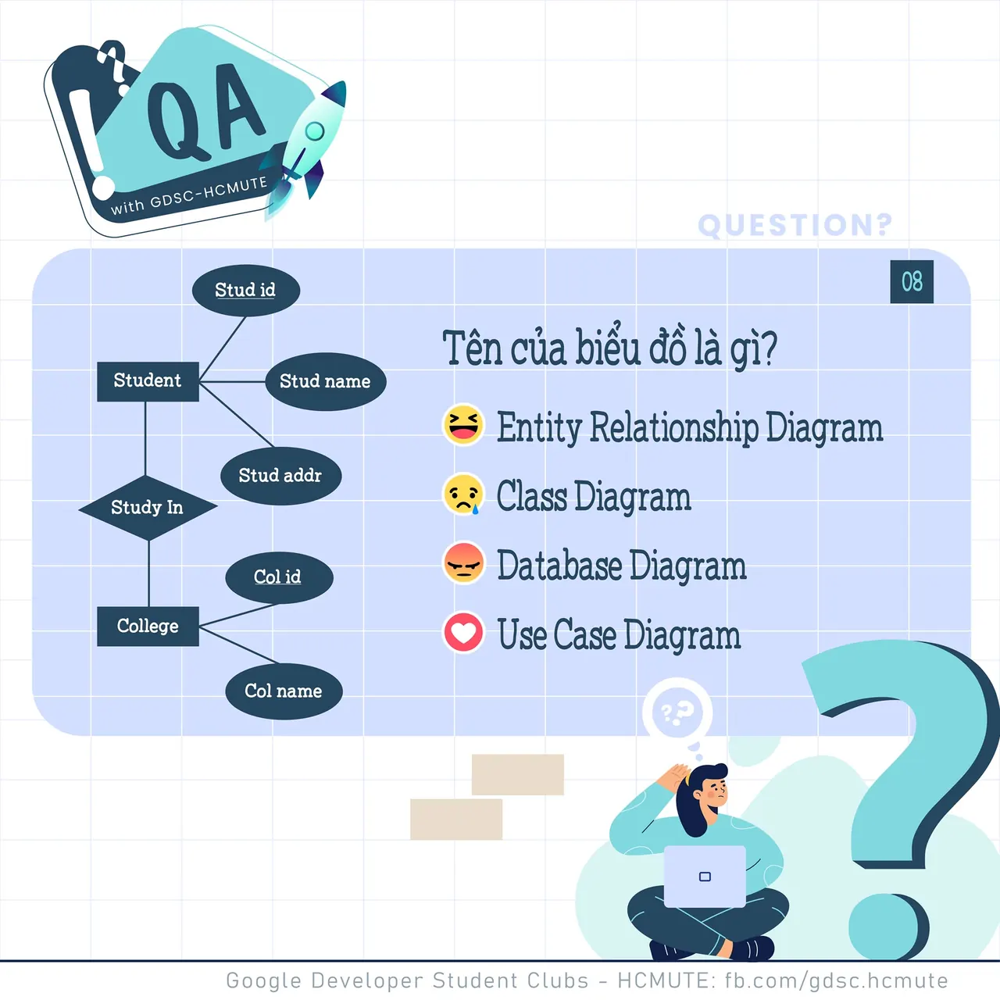

\[QA GDSC - Question\]
  
Loa loa loa, đến hẹn lại lên đâyyy

<!--truncate-->

  
 Hôm nay tụi mình cùng quay lại với 1 câu hỏi về Kiến thức chuyên môn nha ^^ Chắc hẳn, trong quá trình học, các bạn đã tiếp xúc và biết qua kha khá các dạng biểu đồ, lược đồ, sơ đồ,... Vậy mọi người có nhớ:

  
 𝑻𝒆̂𝒏 𝒄𝒖̉𝒂 𝒃𝒊𝒆̂̉𝒖 đ𝒐̂̀ 𝒅𝒖̛𝒐̛́𝒊 đ𝒂̂𝒚 𝒍𝒂̀ 𝒈𝒊̀

  
 Bình tĩnh tự tin v… See more

---

_Bài viết được lưu trữ từ [fanpage HCMUTE Developer Student Club](https://www.facebook.com/hcmute.dsc)._
