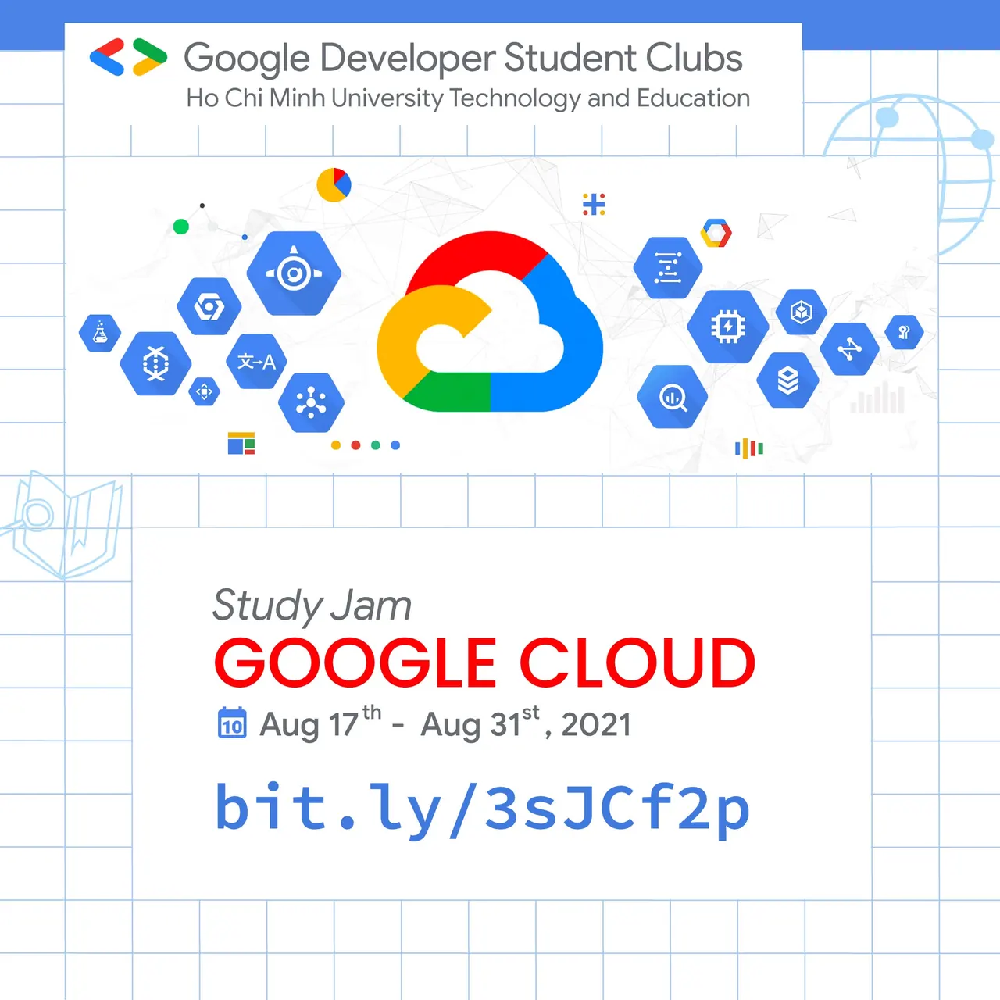

\[GOOGLE CLOUD STUDY JAM | GDSC-HCMUTE\]

<!--truncate-->

  
 Tin nóng tin nóng đâyyy  
,

  
 Hôm nay GDSC - HCMUTE đưa đến cho các bạn thông tin về một cơ hội tuyệt vời để học tập và tìm hiểu thêm về Điện toán đám mây - Google Cloud đây  
-------------------------------------  
Khi tham gia 𝐆𝐃𝐒𝐂 𝐂𝐥𝐨𝐮𝐝 𝐒𝐭𝐮𝐝𝐲 𝐉𝐚𝐦, các bạn không những có thể học "tất tần tật" về Google Cloud mà còn có cơ hội nhận được lộ trình học Phát triển điện toán đám mây - Cloud Developer learning path.

  
 Đặc biệt, khi tham gia, bạn sẽ nhận được:
  
 30 ngày truy cập vào Qwiklabs và học thêm nhiều khóa học khác về Cloud

  
 Huy hiệu từ Google Cloud để chia sẻ lên mạng xã hội và Linkedin cá nhân.

  
 Nhận quà bao gồm nón, balo và ô cực “xịn” từ Google Cloud (khi hoàn thành trước thời hạn kết thúc khóa học)

  
 Cách thức tham gia:
  
 Đăng ký tại: [http://bit.ly/3sJCf2p](http://bit.ly/3sJCf2p)

  
 Khóa học sẽ bắt đầu từ ngày 27/8

  
 Hoàn thành đăng ký trong khoảng thời gian từ 27/8 – 31/8 để có đủ điều kiện để nhận được những phần quà hấp dẫn.

  
 Chia sẻ trải nghiệm học tập của bạn và điền vào đơn xác nhận để nhận quà.

  
 Lưu ý: Các bạn vui lòng chọn đúng Chapter “𝐇𝐨 𝐂𝐡𝐢 𝐌𝐢𝐧𝐡 𝐂𝐢𝐭𝐲 𝐔𝐧𝐢𝐯𝐞𝐫𝐬𝐢𝐭𝐲 𝐨𝐟 𝐓𝐞𝐜𝐡𝐧𝐨𝐥𝐨𝐠𝐲 𝐚𝐧𝐝 𝐄𝐝𝐮𝐜𝐚𝐭𝐢𝐨𝐧” nhá!

  
 Bên cạnh đó, Thư xác nhận tham gia sẽ được gửi đến bạn trước ngày bắt đầu khóa học. Nên các bạn lưu ý kiểm tra thư mục rác (Spam) hoặc các thư mục phân loại như (Mạng xã hội, Nội dung cập nhật, Diễn đàn, Quảng cáo) để không bỏ lỡ các thông tin để tham gia 𝑸𝒘𝒊𝒌𝒍𝒂𝒃𝒔 nha.

  
 Vậy thì, Tại sao nên tham gia GDSC Cloud Study Jam

  
 Hiện nay, vị trí liên quan tới Cloud nằm trong top 10 vị trí nhân sự phổ biến của ngành IT trên toàn cầu và Việt Nam. Khóa học nhằm khuyến khích các nhà phát triển ứng dụng và các lập trình viên tìm hiểu về thiết kế, phát triển và triển khai các ứng dụng điện toán đám mây.

  
 Tài liệu học tập phù hợp cho tất cả mọi người muốn tìm hiểu về sự phát triển của Google Cloud, từ những người mới bắt đầu cho đến những lập trình viên chưa từng tìm hiểu về điện toán đám mây.

  
 Các bài học có trong GDSC Cloud Study Jam bao gồm:
  
Google Cloud Fundamentals: Core Infrastructure
  
Developing Applications with Google Cloud Platform
  
Getting started with Google Kubernetes Engine
  
Serverless Cloud Run Development
  
Serverless Firebase Development
  
Deploy to Kubernetes in Google Cloud
  
Còn chần chờ gì nữa mà không điền thông tin và cùng tham gia với chúng mình để có thêm bước đệm vững chắc về Cloud cho công việc trong tương lai chứ  
--------------------------------  
Mọi ý kiến đóng góp, các bạn có thể liên hệ trực tiếp thông qua fanpage Google Developer Student Clubs - HCM UTE: [https://www.facebook.com/gdsc.hcmute](https://www.facebook.com/gdsc.hcmute)
  
\#GDSC #GoogleDeveloperStudentClub #GDSC\_HCMUTE #GoogleCloud #StudyJam

---

_Bài viết được lưu trữ từ [fanpage HCMUTE Developer Student Club](https://www.facebook.com/hcmute.dsc)._
