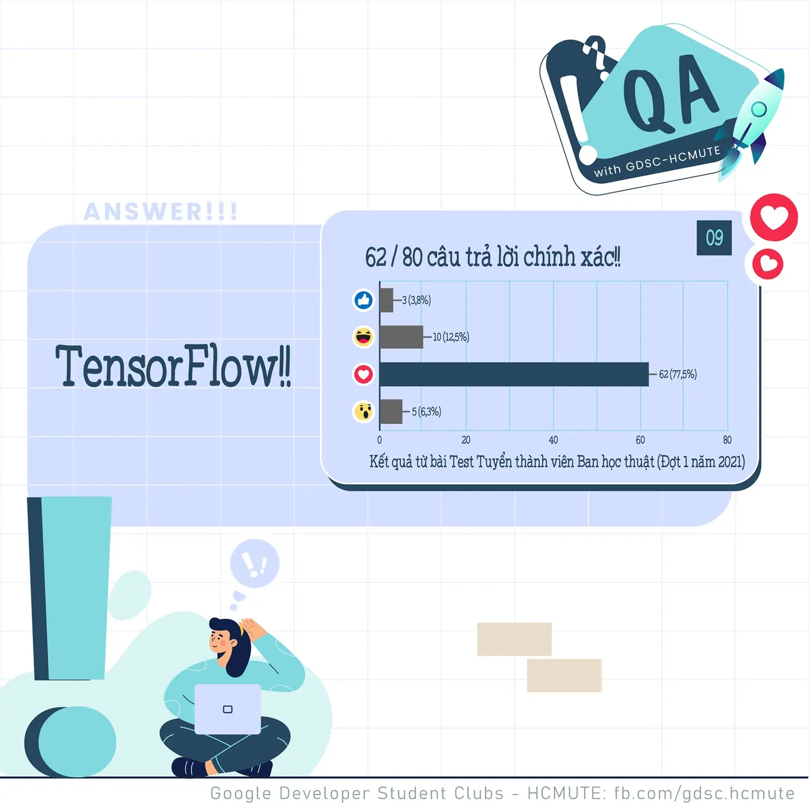
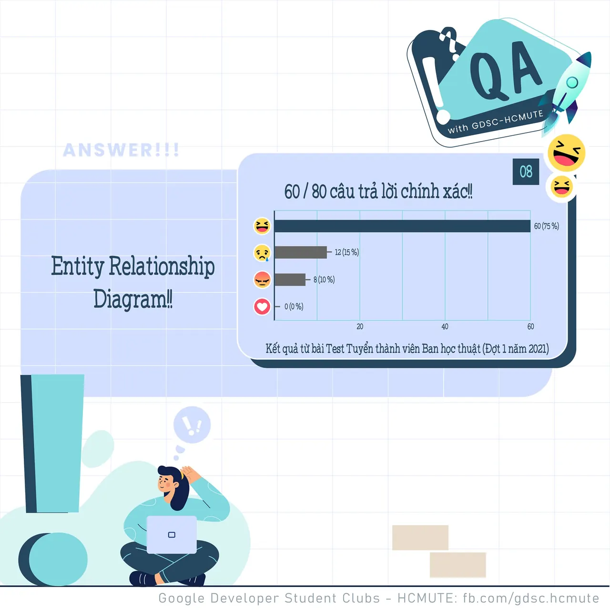

\[QA GDSC - Answer\]  
Chào mọi người chào mọi người  
,
  
 Alo alo các cao nhân gần xa đã tìm được đáp án hay chưa nhỉ

<!--truncate-->

  
 Với câu hỏi về Framework dùng cho 𝐌𝐚𝐜𝐡𝐢𝐧𝐞 𝐋𝐞𝐚𝐫𝐧𝐢𝐧𝐠, tụi mình nhận được 19/26 react Tym với 𝑻𝒆𝒏𝒔𝒐𝒓𝑭𝒍𝒐𝒘 - cũng chính là đáp án chính xác của câu hỏi này.

  
 𝑻𝒆𝒏𝒔𝒐𝒓𝑭𝒍𝒐𝒘 là một thư viện phần mềm mã nguồn mở dành cho máy học trong nhiều loại hình tác vụ nhận thức và hiểu ngôn ngữ. Và hiện đang được sử dụng cho cả nghiên cứu lẫn sản xuất bởi 50 đội khác nhau trong nhiều sản phẩm thương mại của Google, như nhận dạng giọng nói, Gmail, Google Photos, và tìm kiếm.

  
 Các bạn có suy nghĩ như thế nào với đáp án lần này Để lại bình luận bên dưới để ad có thể hóng ké nha ^^  
---------------------------  
QA with GDSC - HCMUTE là chuyên mục do GDSC - HCMUTE thực hiện với mong muốn cung cấp các kiến thức và thông tin hữu ích, giúp các bạn có thêm các tips thú vị trong lĩnh vực Công nghệ Thông tin thông qua Question và Answer được lên sóng hàng ngày!
  
 Mọi ý kiến đóng góp, các bạn có thể liên hệ trực tiếp thông qua fanpage Google Developer Student Clubs - HCM UTE: [https://www.facebook.com/gdsc.hcmute](https://www.facebook.com/gdsc.hcmute)
  
\#GDSC #GoogleDeveloperStudentClubs #GDSC\_HCMUTE #GDSC\_QA

---

_Bài viết được lưu trữ từ [fanpage HCMUTE Developer Student Club](https://www.facebook.com/hcmute.dsc)._
