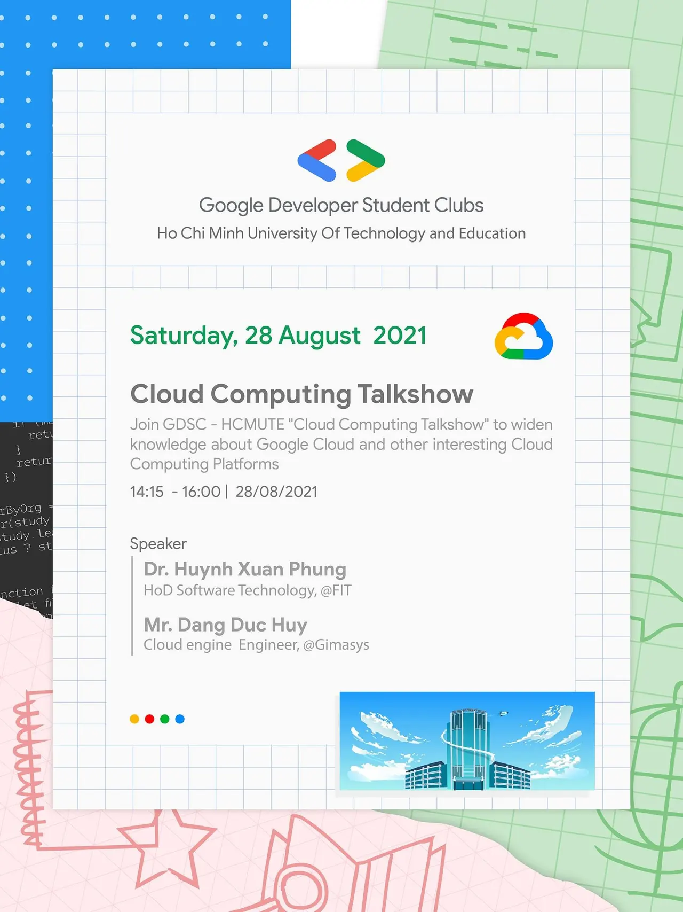

\[TALKSHOW CLOUD COMPUTING | GDSC - HCMUTE\]
  
 Chắc hẳn phần lớn các bạn có sử dụng thiết bị công nghệ, khái niệm Đ𝑖𝑒̣̂𝑛 𝑡𝑜𝑎́𝑛 đ𝑎́𝑚 𝑚𝑎̂𝑦 - 𝐶𝑙𝑜𝑢𝑑 𝐶𝑜𝑚𝑝𝑢𝑡𝑖𝑛𝑔

<!--truncate-->

 đã không còn quá xa lạ, với các ứng dụng vô cùng gần gũi và quen thuộc như Google Drive, One Drive, Dropbox hay iCloud,... Bên cạnh đó, hiện nay, với xu hướng phát triển ứng dụng tích hợp đám mây để tối ưu lưu trữ và tiết kiệm chi phí, thì các vị trí liên quan tới Cloud cũng đang nằm trong top 10 vị trí nhân sự phổ biến c… See more

---

_Bài viết được lưu trữ từ [fanpage HCMUTE Developer Student Club](https://www.facebook.com/hcmute.dsc)._
