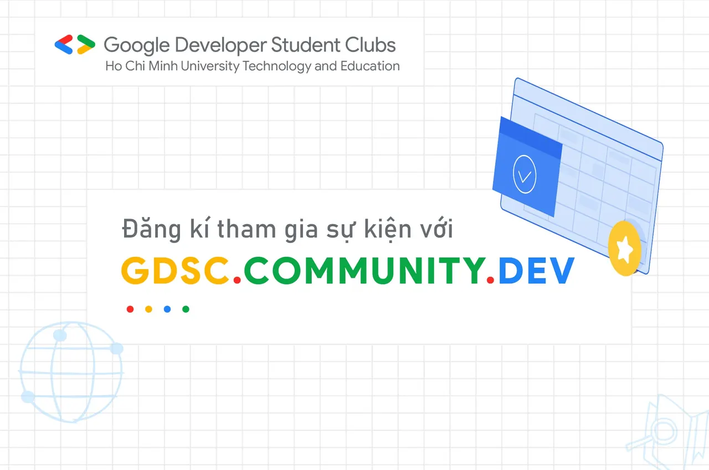
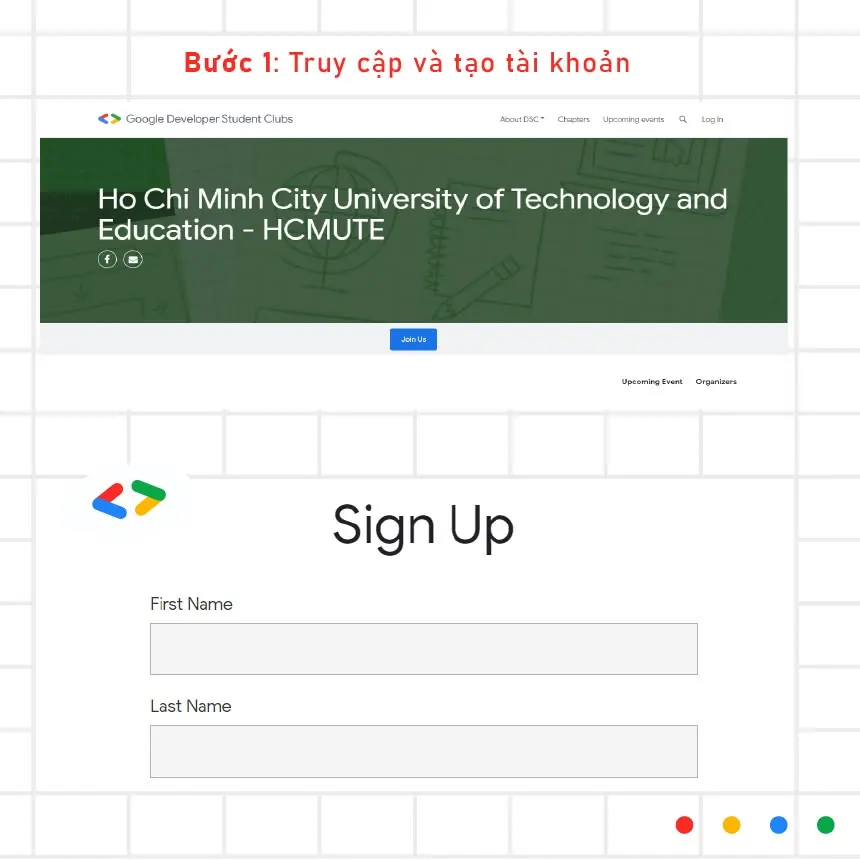
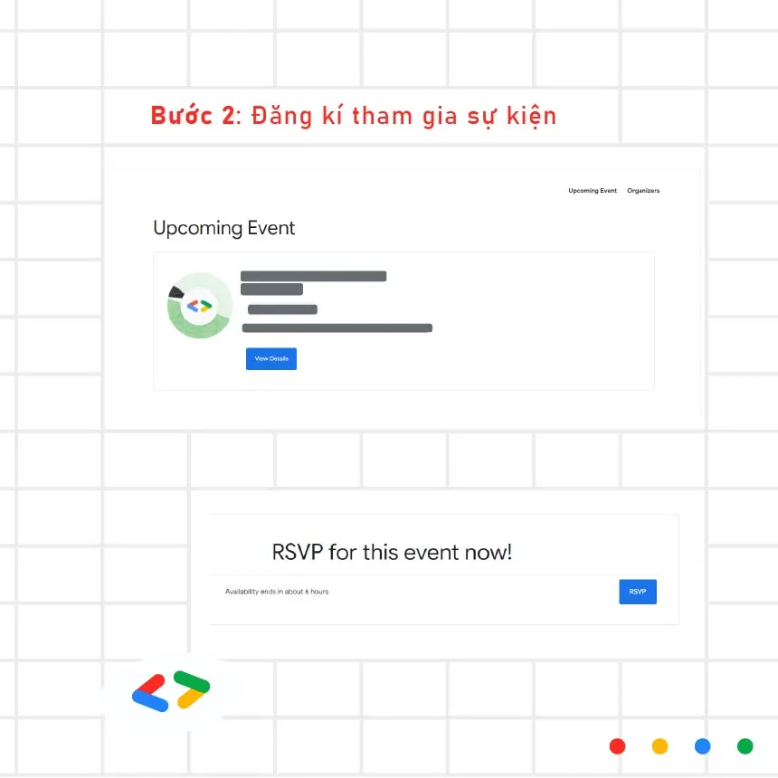
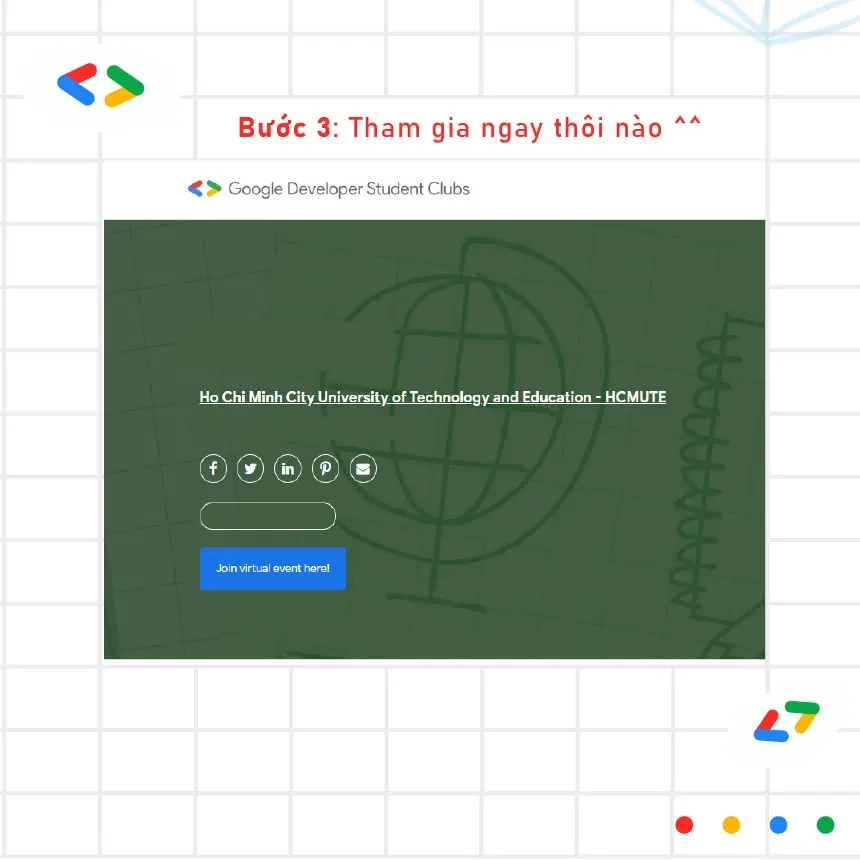

Bước 1: Truy cập vào đường dẫn được gửi và tạo tài khoản
  
\- Truy cập vào link sau: [https://gdsc.community.dev/ho-chi-minh-city-university.../](https://gdsc.community.dev/ho-chi-minh-city-university.../)

<!--truncate-->

\- Các bạn click vào Log In ở góc phải trên màn hình, sau đó đăng nhập vào tài khoản Google của các bạn.
  
\- Sau khi đăng nhập xong, các bạn điền thông tin để tạo tài khoản mới trên gdsc.community.dev. Sau khi điền xong hết các bạn click vào nút Sign Up ở cuối form đăng ký, vậy là các bạn đã có tài khoản trên gdsc.community.dev rồi!

---

_Bài viết được lưu trữ từ [fanpage HCMUTE Developer Student Club](https://www.facebook.com/hcmute.dsc)._
