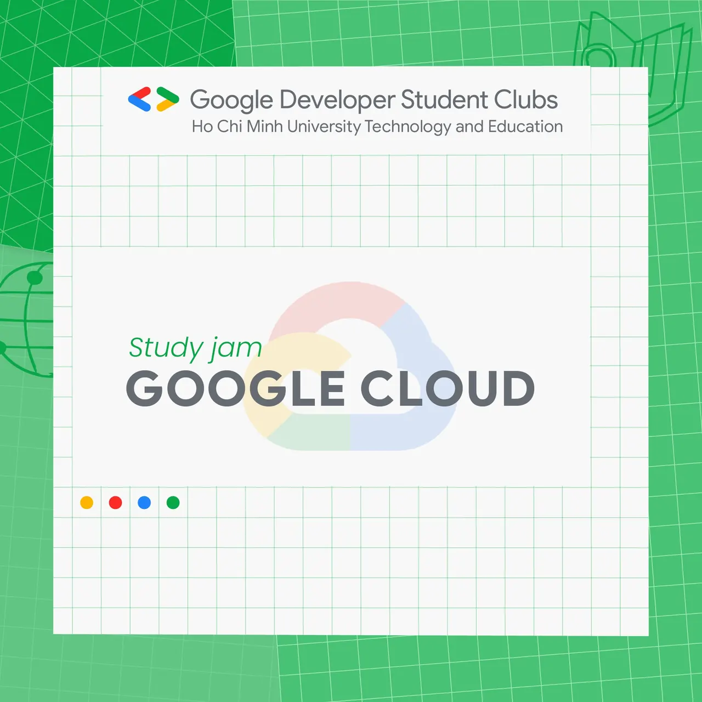

\[GOOGLE CLOUD STUDY JAM | GDSC-HCMUTE\]

<!--truncate-->

  
 Chào mọi người chào mọi người,

  
 Khoá học Google Cloud Study Jam đã chính thức được bắt đầu vào hôm qua 28/8/2021, không biết các bạn đã hoàn thành lộ trình của mình tới đâu rồi nhỉ

  
 Bên cạnh đó, các bạn đừng quên check Mail  
 để nhận đường link tham gia nhóm và cùng tụi mình chia sẻ, trao đổi, hoàn thành khoá học một cách tốt nhất nha ^^

  
 Các bạn lưu ý đăng ký và hoàn thành các khoá học sau trên nền tảng Qwiklabs từ ngày  
/  
 đến  
/  
 để nhận được phần quà \*swag* xịn xò đến từ Google nha, bao gồm:

  
 Perform Foundational Infrastructure Tasks in Google Cloud
  
 Implement DevOps in Google Cloud
  
 Monitor and Log with Google Cloud Operations Suite
  
 Serverless Cloud Run Development
  
 Serverless Firebase Development
  
 Deploy to Kubernetes in Google Cloud

  
 Chi tiết về chương trình: [https://www.facebook.com/gdsc.hcmute/posts/129849012701584](https://www.facebook.com/gdsc.hcmute/posts/129849012701584)

  
 Chúc các bạn hoàn thành khoá học và có thêm nhiều kiến thức để tự tin trở thành một Cloud Developer chuyên nghiệp nhá ^^  
--------------------------------  
Mọi ý kiến đóng góp, các bạn có thể liên hệ trực tiếp thông qua fanpage Google Developer Student Clubs - HCM UTE: [https://www.facebook.com/gdsc.hcmute](https://www.facebook.com/gdsc.hcmute)
  
\#GDSC #GoogleDeveloperStudentClub #GDSC\_HCMUTE #GoogleCloud #StudyJam

---

_Bài viết được lưu trữ từ [fanpage HCMUTE Developer Student Club](https://www.facebook.com/hcmute.dsc)._
