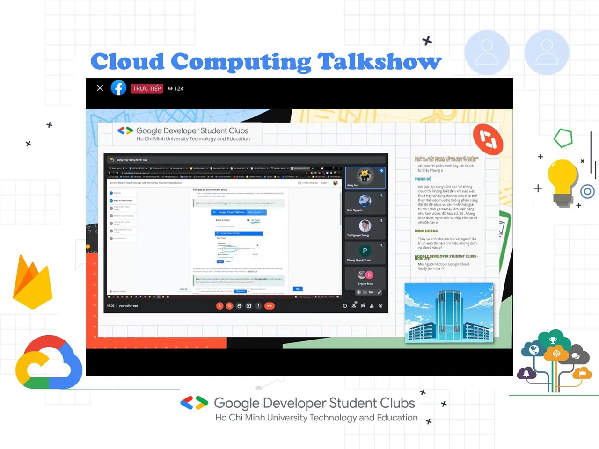

\[TALKSHOW CLOUD COMPUTING - LỜI CẢM ƠN | GDSC - HCMUTE\]
  
Chào buổi tối mọi người

<!--truncate-->

 Vậy là talkshow về Điện toán đám mây - Cloud Computing đã kết thúc rồi.  
 Không biết các bạn cảm thấy như thế nào nhỉ? Chứ Ad thì thấy những kiến thức mình thu thập được phải nói là quá đã luôn rồi đó.
  
Và để có một buổi chia sẻ tuyệt vời như vậy, BTC xin gửi lời cảm ơn chân thành đến với 2 vị diễn giả:
  
\- Tiến sĩ Huỳnh Xuân Phụng - Trưởng Bộ môn Công nghệ phần mềm, Khoa Công nghệ thông tin trường ĐH Sư phạm Kỹ thuật TP.HCM.
  
\- Anh Đặng Đức Huy - Kỹ sư Cloud engine tại Gymasis, cựu sinh viên trường đại học Bách khoa Hà Nội.
  
đã dành thời gian tham gia và chia sẻ những kiến thức quý báu của mình với các bạn sinh viên, giúp cho sinh viên ngành Công nghệ thông tin cũng như các ngành liên quan có thêm những cái nhìn mới về Cloud Computing  
.
  
 Ngoài ra, không quên cảm ơn sự đồng hành của hơn 120 bạn sinh viên đã cùng tham dự trong suốt 2 tiếng đồng hồ và góp phần tạo nên buổi Talkshow đầy thú vị và hấp dẫn này.
  
Đồng thời, BTC xin chúc mừng  
 bạn có câu trả lời đúng và nhanh nhất đã giành được phần quà từ Talkshow:
  
 Bạn Nguyễn Hữu Trọng
  
 Bạn Nguyễn Văn Thuận
  
 Bạn Nguyễn Thành Phát
  
 Các bạn vui lòng liên hệ FanPage để nhận quà từ chương trình nha!
  
Mong rằng qua buổi Talkshow, các bạn đã có thêm những kiến thức bổ ích và thú vị về Cloud Computing, thêm tự tin tham gia khóa học Google Cloud Study Jam trong thời gian này nha (^-^)!
  
 Hẹn gặp lại mọi người tại các chương trình kế tiếp của CLB!
  
-------------------------------
  
 Thông tin về chương trình Google Cloud Study Jam, các bạn có thể xem lại tại: [https://www.facebook.com/gdsc.hcmute/posts/131617709191381](https://www.facebook.com/gdsc.hcmute/posts/131617709191381)
  
--------------------------------
  
 Mọi ý kiến đóng góp, các bạn có thể liên hệ trực tiếp thông qua fanpage Google Developer Student Clubs - HCM UTE: [https://www.facebook.com/gdsc.hcmute](https://www.facebook.com/gdsc.hcmute)
  
\#GDSC #GoogleDeveloperStudentClub #GDSC\_HCMUTE #GoogleCloud #StudyJam #CloudComputing #GDSC\_TalkShow

---

_Bài viết được lưu trữ từ [fanpage HCMUTE Developer Student Club](https://www.facebook.com/hcmute.dsc)._
