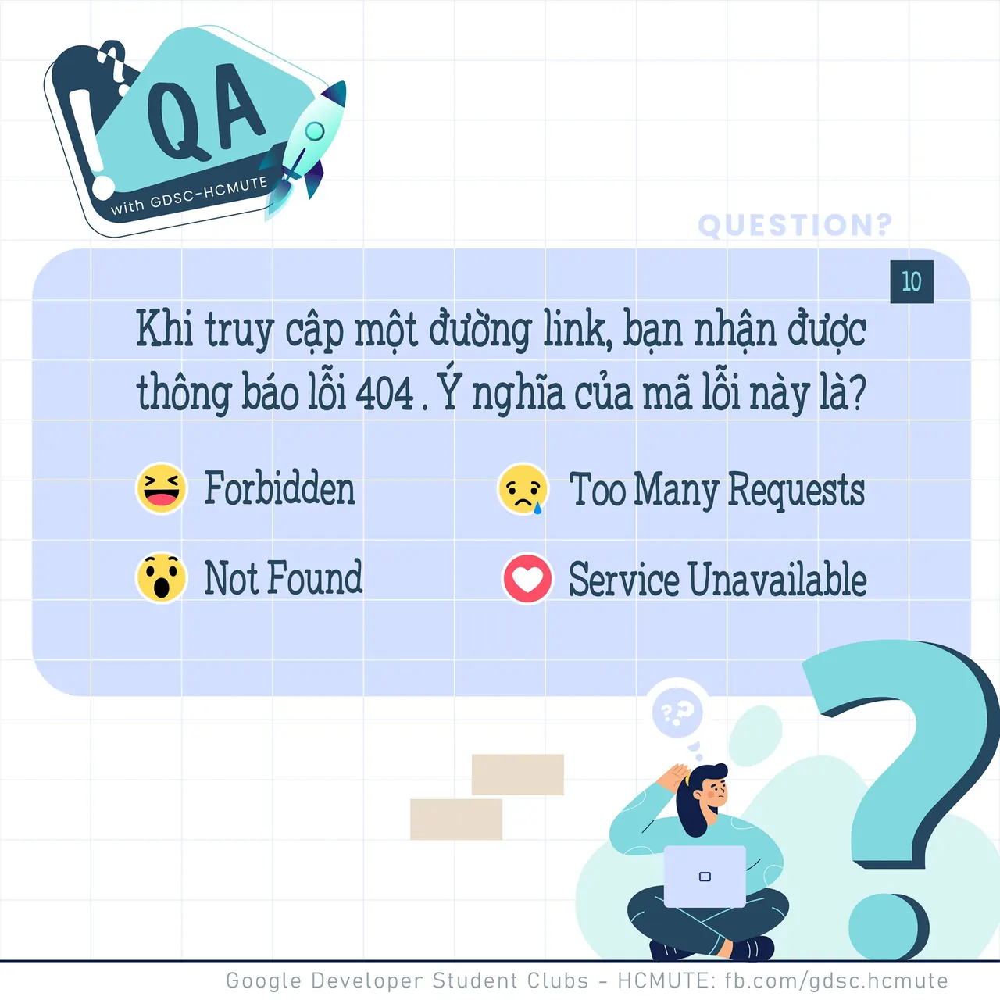

\[QA GDSC - Question\]
  
Chào mọi người chào mọi người, tụi mình quay trở lại rồi đâyyyyyy

<!--truncate-->

.
  
 Hôm nay tụi mình cùng tiếp tục với 1 câu hỏi về Kiến thức chuyên môn trong bài Test của Ban Học thuật (Thuộc Đợt Tuyển Thành viên - Đợt 1, năm 2021). Chắc hẳn câu hỏi này sẽ không làm khó mọi người đâu ^^
  
 𝐊𝐡𝐢 𝐭𝐫𝐮𝐲 𝐜ậ𝐩 𝐦ộ𝐭 đườ𝐧𝐠 𝐥𝐢𝐧𝐤, 𝐛ạ𝐧 𝐧𝐡ậ𝐧 đượ𝐜 𝐭𝐡ô𝐧𝐠 𝐛á𝐨 𝐥ỗ𝐢 𝟒𝟎𝟒. Ý 𝐧𝐠𝐡ĩ𝐚 𝐜ủ𝐚 𝐦ã 𝐥ỗ𝐢 𝐧à𝐲 𝐥à 𝐠ì?
  
 Bình tĩnh tự tin và để lại React cũng như Comment để GDSC - HCMUTE chúng mình xem có bao nhiêu bạn vượt qua thử thách lần này nào
  
Đừng quên Like và Follow Page để đón chờ phần Answer được lên sóng vào ngày mai nha
  
---------------------------
  
 QA with GDSC HCMUTE là chuyên mục do GDSC - HCMUTE thực hiện với mong muốn cung cấp các kiến thức và thông tin hữu ích, giúp các bạn có thêm các tips thú vị trong lĩnh vực Công nghệ Thông tin thông qua Question và Answer được lên sóng hàng ngày!
  
 Mọi ý kiến đóng góp, các bạn có thể liên hệ trực tiếp thông qua fanpage Google Developer Student Clubs - HCM UTE: [https://www.facebook.com/gdsc.hcmute](https://www.facebook.com/gdsc.hcmute)  
\#GDSC #GoogleDeveloperStudentClubs #GDSC\_HCMUTE #GDSC\_QA

---

_Bài viết được lưu trữ từ [fanpage HCMUTE Developer Student Club](https://www.facebook.com/hcmute.dsc)._
