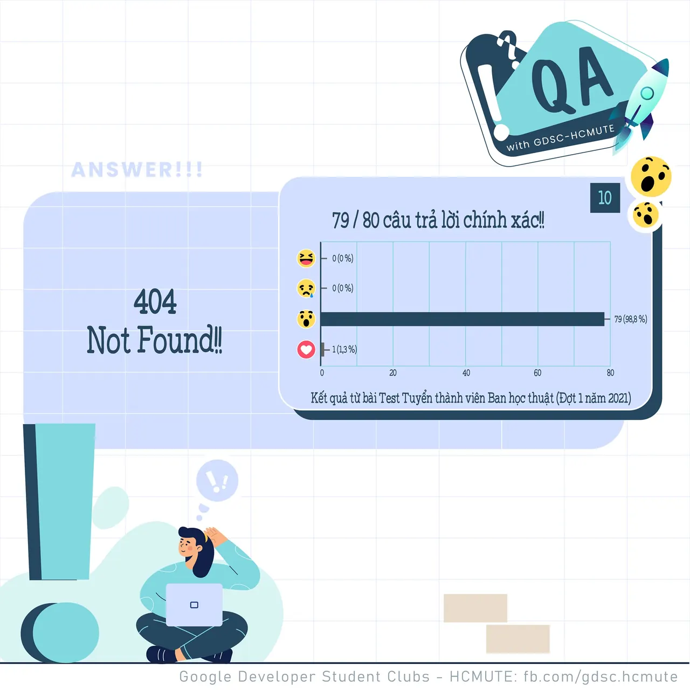

\[QA GDSC - Answer\]  
Chào mọi người chào mọi người

<!--truncate-->

,
  
 Với câu hỏi về lỗi 404 khi truy cập đường link 47/56 react Wow với 𝑵𝒐𝒕 𝑭𝒐𝒖𝒏𝒅 - cũng chính là đáp án chính xác của câu hỏi này.
  
 Lỗi 𝐍𝐨𝐭 𝐅𝐨𝐮𝐧𝐝 hay 𝟒𝟎𝟒 là thông báo về một đường liên kết không tồn tại. Khi người dùng click vào đường link đó, theo mặc định trình duyệt sẽ xuất hiện một thông báo như “This page could not be found on the server. 404 Error”.
  
 Có nhiều nguyên nhân dẫn đến Error 404: Người dùng đánh sai địa chỉ trang web, URL thay đổi mà bạn không khai báo hay chuyển hướng, người dùng đi theo một liên kết sai từ một website khác khi bạn thay đổi, xóa landing page cũ.
  
 Các bạn có suy nghĩ như thế nào với đáp án lần này? Để lại bình luận bên dưới để ad có thể hóng ké nha ^^  
---------------------------
  
 QA with GDSC - HCMUTE là chuyên mục do GDSC - HCMUTE thực hiện với mong muốn cung cấp các kiến thức và thông tin hữu ích, giúp các bạn có thêm các tips thú vị trong lĩnh vực Công nghệ Thông tin thông qua Question và Answer được lên sóng hàng ngày!
  
 Mọi ý kiến đóng góp, các bạn có thể liên hệ trực tiếp thông qua fanpage Google Developer Student Clubs - HCM UTE: [https://www.facebook.com/gdsc.hcmute](https://www.facebook.com/gdsc.hcmute)  
\#GDSC #GoogleDeveloperStudentClubs #GDSC\_HCMUTE #GDSC\_QA

---

_Bài viết được lưu trữ từ [fanpage HCMUTE Developer Student Club](https://www.facebook.com/hcmute.dsc)._
