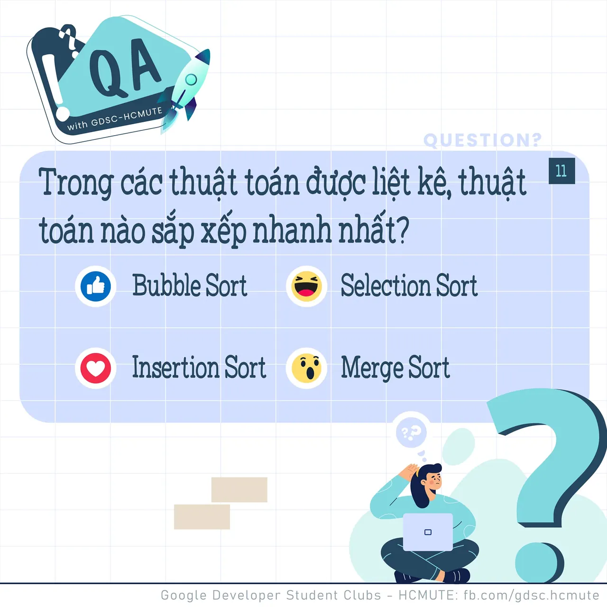

\[QA GDSC - Question\]
  
Chào buổi tối mọi người  
.

<!--truncate-->

  
 Hôm nay các cao nhân gần xa hãy cùng tụi mình tìm câu trả lời cho câu hỏi chuyên môn thú vị này nhá ^^

  
 𝑻𝒓𝒐𝒏𝒈 𝒄𝒂́𝒄 𝒕𝒉𝒖𝒂̣̂𝒕 𝒕𝒐𝒂́𝒏 𝒅𝒖̛𝒐̛́𝒊 đ𝒂̂𝒚, 𝒕𝒉𝒖𝒂̣̂𝒕 𝒕𝒐𝒂́𝒏 𝒔𝒂̆́𝒑 𝒙𝒆̂́𝒑 𝒏𝒂̀𝒐 𝒍𝒂̀ 𝒏𝒉𝒂𝒏𝒉 𝒏𝒉𝒂̂́𝒕

  
 Bình tĩnh tự tin và để lại React cũng như Comment để GDSC - HCMUTE chúng mình xem có bao nhiêu bạn vượt qua thử thách lần này nào

  
Đừng quên Like và Follow Page để đón chờ phần Answer được lên sóng vào ngày mai nha  
---------------------------  
QA with GDSC HCMUTE là chuyên mục do GDSC - HCMUTE thực hiện với mong muốn cung cấp các kiến thức và thông tin hữu ích, giúp các bạn có thêm các tips thú vị trong lĩnh vực Công nghệ Thông tin thông qua Question và Answer được lên sóng hàng ngày!
  
 Mọi ý kiến đóng góp, các bạn có thể liên hệ trực tiếp thông qua fanpage Google Developer Student Clubs - HCM UTE: [https://www.facebook.com/gdsc.hcmute](https://www.facebook.com/gdsc.hcmute)
  
\#GDSC #GoogleDeveloperStudentClubs #GDSC\_HCMUTE #GDSC\_QA

---

_Bài viết được lưu trữ từ [fanpage HCMUTE Developer Student Club](https://www.facebook.com/hcmute.dsc)._
