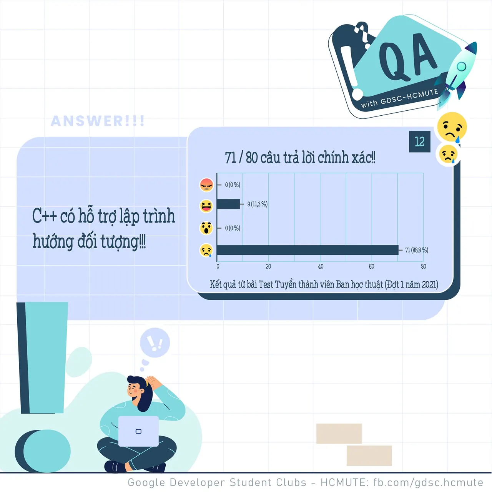
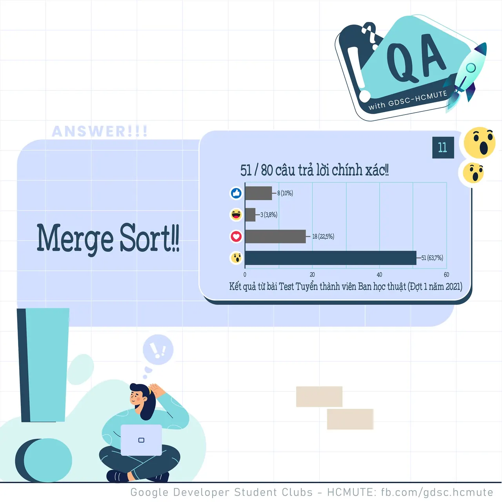

\[QA GDSC - Answer\]
  
Chào mọi người chào mọi người

<!--truncate-->

,
  
 Với câu hỏi về thuật toán sắp xếp nào nhanh nhất, tụi mình nhận được 40/44 react Sad với 𝑪++ 𝒉𝒐̂̃ 𝒕𝒓𝒐̛̣ 𝒍𝒂̣̂𝒑 𝒕𝒓𝒊̀𝒏𝒉 𝒉𝒖̛𝒐̛́𝒏𝒈 đ𝒐̂́𝒊 𝒕𝒖̛𝒐̛̣𝒏𝒈, 𝒄𝒐̀𝒏 𝑪 𝒕𝒉𝒊̀ 𝒌𝒉𝒐̂𝒏𝒈 - cũng chính là đáp án chính xác của câu hỏi này.
  
 Sự khác nhau giữa C và C++ là C là một ngôn ngữ thủ tục (procedural language) vì nó tuân theo những quy trình từng bước bao gồm các hàm,… Nói cách khác, C cung cấp hướng dẫn cho máy tính theo cách tiếp cận từ trên xuống.
  
 Ngược lại C++ là hướng đối tượng thay vì hướng thủ tục.
  
 Các bạn có suy nghĩ như thế nào với đáp án lần này? Để lại bình luận bên dưới để ad có thể hóng ké nha ^^  
---------------------------
  
 QA with GDSC - HCMUTE là chuyên mục do GDSC - HCMUTE thực hiện với mong muốn cung cấp các kiến thức và thông tin hữu ích, giúp các bạn có thêm các tips thú vị trong lĩnh vực Công nghệ Thông tin thông qua Question và Answer được lên sóng hàng ngày!
  
 Mọi ý kiến đóng góp, các bạn có thể liên hệ trực tiếp thông qua fanpage Google Developer Student Clubs - HCM UTE: [https://www.facebook.com/gdsc.hcmute](https://www.facebook.com/gdsc.hcmute)  
\#GDSC #GoogleDeveloperStudentClubs #GDSC\_HCMUTE #GDSC\_QA

---

_Bài viết được lưu trữ từ [fanpage HCMUTE Developer Student Club](https://www.facebook.com/hcmute.dsc)._
