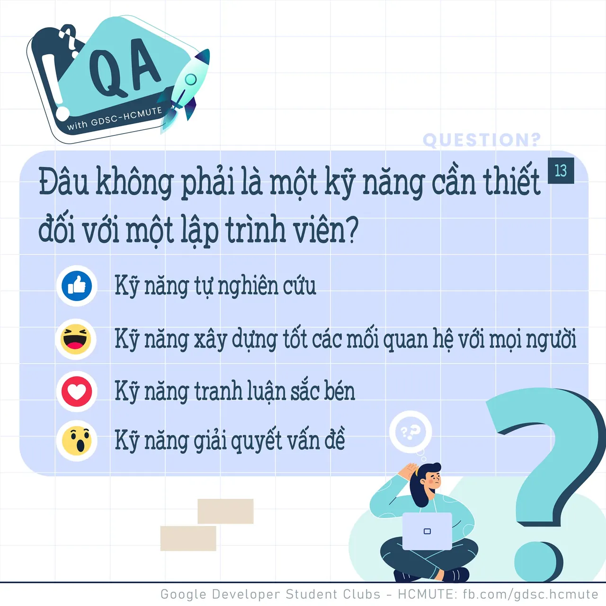

\[QA GDSC - Question\]
  
Alo alo

<!--truncate-->

  
 Tuần này tụi mình sẽ giải lao với một câu hỏi kỹ năng nhá! Ngoài các kiến thức và kỹ năng lập trình, thì các kỹ năng mềm cũng đóng vai trò vô cùng cần thiết.

  
 Vậy theo bạn, Đ𝒂̂𝒖 𝒌𝒉𝒐̂𝒏𝒈 𝒑𝒉𝒂̉𝒊 𝒍𝒂̀ 𝒎𝒐̣̂𝒕 𝒌𝒚̃ 𝒏𝒂̆𝒏𝒈 𝒄𝒂̂̀𝒏 𝒕𝒉𝒊𝒆̂́𝒕 đ𝒐̂́𝒊 𝒗𝒐̛́𝒊 𝒍𝒂̣̂𝒑 𝒕𝒓𝒊̀𝒏𝒉 𝒗𝒊𝒆̂𝒏

  
 Bình tĩnh tự tin và để lại React cũng như Comment để GDSC - HCMUTE chúng mình xem có bao nhiêu bạn vượt qua thử thách lần này nào

  
Đừng quên Like và Follow Page để đón chờ phần Answer được lên sóng vào ngày mai nha  
---------------------------  
QA with GDSC HCMUTE là chuyên mục do GDSC - HCMUTE thực hiện với mong muốn cung cấp các kiến thức và thông tin hữu ích, giúp các bạn có thêm các tips thú vị trong lĩnh vực Công nghệ Thông tin thông qua Question và Answer được lên sóng hàng ngày!

  
 Mọi ý kiến đóng góp, các bạn có thể liên hệ trực tiếp thông qua fanpage Google Developer Student Clubs - HCM UTE: [https://www.facebook.com/gdsc.hcmute](https://www.facebook.com/gdsc.hcmute)
  
\#GDSC #GoogleDeveloperStudentClubs #GDSC\_HCMUTE #GDSC\_QA

---

_Bài viết được lưu trữ từ [fanpage HCMUTE Developer Student Club](https://www.facebook.com/hcmute.dsc)._
