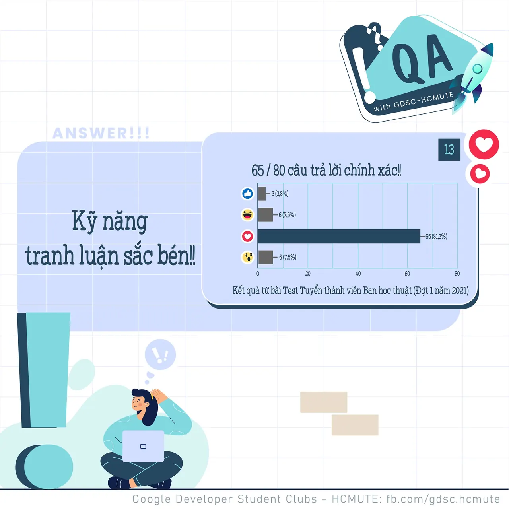

\[QA GDSC - Answer\]
  
Chào mọi người  
,

<!--truncate-->

  
 Với câu hỏi về kỹ năng mềm đối với một lập trình viên, tụi mình nhận được 20/26 react Tym  
 với 𝑲𝒚̃ 𝒏𝒂̆𝒏𝒈 𝒕𝒓𝒂𝒏𝒉 𝒍𝒖𝒂̣̂𝒏 𝒔𝒂̆́𝒄 𝒃𝒆́𝒏 - cũng chính là đáp án chính xác của câu hỏi này.

  
 Một trong những kỹ năng cần thiết đối với mỗi lập viên cần có đó là kỹ năng tự nghiên cứu, xây dựng tốt các mối mối quan hệ với mọi người và hơn cả đó là kỹ năng giải quyết vấn đề. Những kỹ năng này giúp cho các lập trình viên dễ dàng tiến xa trong công việc, hỗ trợ rất nhiều trong suốt quá trình làm việc và học tập của bản thân.

  
 Kỹ năng tranh luận sắc bén cũng có thể coi là điều cần có nhưng quan trọng hơn cả phải là kỹ năng lắng nghe, nhìn nhận để tự mình khắc phục và phát huy những điểm mạnh bản thân hơn là việc có khả năng tranh luận sắc bén về một vấn đề nào đó.

  
 Các bạn có suy nghĩ như thế nào với đáp án lần này Để lại bình luận bên dưới để ad có thể hóng ké nha ^^  
---------------------------  
QA with GDSC - HCMUTE là chuyên mục do GDSC - HCMUTE thực hiện với mong muốn cung cấp các kiến thức và thông tin hữu ích, giúp các bạn có thêm các tips thú vị trong lĩnh vực Công nghệ Thông tin thông qua Question và Answer được lên sóng hàng ngày!
  
 Mọi ý kiến đóng góp, các bạn có thể liên hệ trực tiếp thông qua fanpage Google Developer Student Clubs - HCM UTE: [https://www.facebook.com/gdsc.hcmute](https://www.facebook.com/gdsc.hcmute)
  
\#GDSC #GoogleDeveloperStudentClubs #GDSC\_HCMUTE #GDSC\_QA

---

_Bài viết được lưu trữ từ [fanpage HCMUTE Developer Student Club](https://www.facebook.com/hcmute.dsc)._
